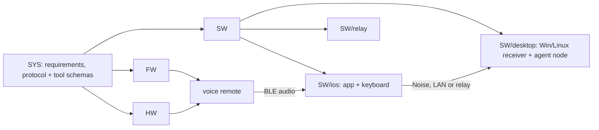

# AI working rules for this repo

*(The one shared instruction file. Codex reads this; `CLAUDE.md` imports it with
`@AGENTS.md`. Edit here, not in both.)*

This repo, `voiceremote`, is a monorepo for the voice remote system (called Voice
Control Fabric in the product definition): the iPhone app and keyboard,
the Windows/Linux receiver and agent node, the cloud relay, the voice remote
(board + firmware), and the system documents behind them. Humans must be able to
navigate it easily. Keep the main tree clean.

## Where things go

| Content | Location |
|---|---|
| Human-reviewed, authoritative work (requirements, design, schematics, firmware, apps) | `SYS/`, `HW/`, `FW/`, `SW/` |
| External reference material (Apple/vendor docs, datasheets, standards, licences of reused code) | `DOCS/` |
| AI-generated analyses, research notes, scripts, benchmark runs, drafts | `AI/<DISCIPLINE>/` (mirrors `SYS`, `HW`, `FW`, `SW`) |
| Throwaway temp files | `AI/scratch/` (gitignored) |

- **`AI/` is the AI's workspace.** Scratch, scripts, benchmark runs, research
  notes, working analyses: everything AI produces to get to an answer.
- **The other root folders are for people.** They hold results: the design, the
  decisions, and the code people use. Write the result there and keep the
  working behind it in `AI/`, linked.
- Write a result straight into the main tree when a human asks for it there.
  Otherwise draft in `AI/` and promote once it is reviewed.
- Name AI outputs `AI/<DISCIPLINE>/YYYY-MM-DD-short-slug.md`. For multi-file
  work (script + results), use a folder with that same name.
- Put a short header at the top of every AI output: purpose, inputs used, and
  whether results are verified.
- Scripts that produced a result live next to that result so it can be
  reproduced.
- Don't add files to the repo root. Don't create new root folders without
  asking. (`.github/` is the one exception.)

## What is where, and what it releases

| Folder | Holds | Releases |
|---|---|---|
| `SYS/` | Product definition, system design, requirements (`[REQ-n]`, `[D-n]`, `[Q-n]`), protocol and tool schemas (source of truth for codegen), security and safety model, system test plans | — |
| `SW/ios/` | iPhone app, keyboard extension, Live Activity, Swift packages `Core`, `Stt`, `Brain` | `ios-v*` → TestFlight build |
| `SW/desktop/` | Rust workspace: `core`, `inject-windows`, `inject-linux`, `agents`, `app` (Tauri tray; `--headless` for agent nodes) | `desktop-v*` → Windows + Linux installers |
| `SW/relay/` | Cloudflare Worker + Durable Objects | `relay-v*` → Worker deploy |
| `SW/bench/` | STT + brain benchmark tools and curated phrase/command sets (audio in Git LFS) | — |
| `FW/` | Voice remote firmware (nRF5340, Zephyr), host tools, `docs/characterisation/` | `fw-v*` → firmware images |
| `HW/` | Remote PCB + mic array (KiCad), enclosure and stand CAD, `fixtures/` | `hw-v*` → fab and assembly package |
| `DOCS/` | External references only | — |
| `AI/` | Working material. Not authoritative until promoted. | — |

A release tag must equal the component's declared version (Xcode marketing
version, `Cargo.toml`, `package.json`, firmware `VERSION`) or the release job
refuses it. iOS, desktop and relay guards live in
`.github/workflows/{ios,desktop,relay}.yml`, `SW/ios/ci/checks.py` and
`SW/relay/ci/check-version.mjs`; release commits must be accepted on `origin/main`.
Desktop also checks the Tauri bundle version. Signing/deployment still require
owner credentials; successful releases remain **unverified**. FW/HW guards are
**TBD** until their first actual versioned artifacts.

## READMEs

Every folder that holds real content gets a `README.md`. A README is a map of
the folder, not an essay:

- **Lead with a diagram** (Mermaid) showing how this folder's pieces relate to
  each other and to the rest of the system.
- **Then a table** of what's in the folder: file or subfolder, what it is, status.
- **Show the thing.** Screenshots, renders, plots, board views.
- **Say where to start**, link the key files, name the `[REQ-n]` it satisfies.
- Status at a glance (✅ done · 🟡 in progress · ⬜ not started).
- No walls of prose. Past about one screen, move detail to a linked doc.
- Update the README in the same change that alters the folder's contents.

## Engineering rules

- **Prove it.** Every design decision and every claim that a requirement is met
  needs evidence: a measurement, a benchmark run, or an analysis. "Should work"
  is not evidence; unproven claims are marked **unverified**.
  - Speech and brain claims (WER, term accuracy, latency, battery) cite a
    `SW/bench/` run on a named device, with the run output in `AI/SW/`.
  - Commit the script that produced a result next to the result.
  - On-device measurements beat simulator or desktop numbers.
- **Requirements live in `SYS/`.** Design work traces back to `[REQ-n]`. Don't
  invent requirements; propose them in `AI/SYS/` or ask.
- **Contracts are mechanical, not prose.** The protocol and tool schemas in
  `SYS/` generate the Swift, Rust and TypeScript types. If you change a schema,
  regenerate and update its round-trip tests in the same commit.
- **Authority invariants (security).** Model output never sets
  `authenticated_actor`, `activation_kind`, `approval_credential_class` or
  `granted_scope_id`. Inferred (tier 1) actions never reach the execution queue
  without an approval event. Dictation never presses Send/Enter. Each of these
  is enforced by a test; changing the behaviour means changing the test in the
  same commit.
- **Privacy.** Never commit or log real transcripts, audio, contacts or keys.
  Benchmark audio is the owner's curated set only, in LFS, never in CI logs.
- Cite sources for every external number. Use `DOCS/` copies where they exist.
- Mark unverified numbers **TBC** and unknown numbers **TBD**. Never present a
  guess as fact.
- Code reused from Hex (anomalyco/hex) or Handy (MIT) keeps its licence header,
  and the licence goes in `DOCS/licences/`. No GPL code (e.g. VoiceInk).

## Hardware and firmware together

- **The board is the truth about the board.** `HW/` holds the real KiCad design;
  firmware pin claims are checked against it by a script, not by reading a PDF.
  **TBD** until P3 starts.
- The remote's physical OFF switch cuts microphone power in hardware. Firmware
  must not be able to override it.

## Style

- Keep documents short and scannable: tables, not prose. No filler.
- **"Shall" statements belong in the requirements document only.**
- **Lead with the visual.** Put the plot or diagram where the reader hits the
  conclusion.

## Build and test

Commands below run from the repository root. They prove local contracts and
synthetic behavior; device, GUI, provider and deployed acceptance stay **unverified**.

| Component | Where it runs | Test command |
|---|---|---|
| `SYS/` schemas + codegen | hwgeekom | `make -C SYS check` |
| Local E2E: Worker + desktop CLI + Swift harness, synthetic injector | hwgeekom (Linux) | `bash SYS/tests/e2e/run.sh` |
| `SW/desktop` | hwgeekom; Windows via CI | `HEAVY_CPUS=4 heavy cargo test --workspace -j4 --locked --manifest-path SW/desktop/Cargo.toml` |
| `SW/relay` | hwgeekom | `HEAVY_CPUS=4 heavy npm --prefix SW/relay test` (max 4 workers) |
| iOS portable packages | hwgeekom (Linux) | `HEAVY_CPUS=4 heavy swift test -j 4 --package-path SW/ios/Packages/Core` (repeat for Protocol, Stt, Brain, Policy, Router, KeyboardBridge, AppModel, Pairing) |
| CI release/simulator guards | hwgeekom | `python3 -m unittest discover -s SW/ios/ci -p 'test_*.py'` |
| `SW/bench` synthetic scorer | hwgeekom | `HEAVY_CPUS=4 heavy uv run --project SW/bench pytest SW/bench/tests` |
| iOS app + Apple adapters | **GitHub Actions macOS runner only** | After XcodeGen + simulator selection: `xcodebuild test -project SW/ios/VoiceRemote.xcodeproj -scheme VoiceRemote -destination "platform=iOS Simulator,id=$SIMULATOR_ID" -parallel-testing-enabled NO -jobs 4 CODE_SIGNING_ALLOWED=NO` |
| `FW/` and `HW/` | hwgeekom build; hworker lab only | **TBD**: no board/versioned artifact yet; no valid build/test command |

- **Compute tiers (owner's machines).** On hwgeekom, builds and tests up to
  10 cores / 20 GB go through `heavy <command>` (lowest priority, capped), one
  heavy job per project, parallelism 4 or less. Anything bigger goes to the cloud
  (`cloud-run`). hworker is for hardware only (lab and HIL), not compute.
- iOS cannot build on hwgeekom. Write Swift there, push, and read the CI result.
- **macOS CI minutes are scarce** (they count 10x on a private repo). The iOS
  workflow runs only on `ios-ci-*` tags, `ios-v*` tags and manual dispatch. Keep
  all logic that can be in plain Swift packages, testable with `swift test` on
  Linux, and put Apple-only code behind thin adapters.
- **Codex workers** run sandboxed in a worktree: they don't commit or push (the
  coordinator does), and `~/.cargo/bin` is on PATH via `export PATH=$HOME/.cargo/bin:$PATH`.

## Branches and PRs

Integration branch: `dev/integration`. `main` only moves when the owner accepts a
merge from it. One short-lived branch per task,
`<engine>/<type>-<slug>` (`claude/feat-pairing-qr`, `codex/fix-wayland-paste`),
types `feat fix clean hw sim research review docs`. Draft PR against `dev/integration`;
squash-merged after review. Never commit straight to `main`. Bug fixes start
with a failing test. Commit subjects are prefixed by area: `SYS:`, `SW:`, `FW:`,
`HW:`, `CI:`, `DOCS:`, `chore:`.

## Code Review Rules
<!-- read by review bots (Codex code review) -->
- Flag any change without a test for the behaviour it changes.
- Flag secrets, tokens, credentials, real transcripts or audio in code, config or logs.
- Flag a schema change in `SYS/` without regenerated types and updated round-trip tests.
- Flag any path where model output can set an authorization field, dispatch a
  tier 1 action without approval, or press Send/Enter during dictation.
- Flag a claim that a requirement or benchmark target is met without a bench run beside it.
- Flag new files at the repo root, new root folders nobody approved, and AI
  working material outside `AI/<DISCIPLINE>/`.
- Flag a folder whose contents changed without its `README.md` changing in the same PR.
- Flag GPL code, or reused MIT code without its licence header.
- Leave formatting and lint to CI.

## Lessons

- CI cost: `desktop-ci-*` skips the 20-minute tray and installer build; use `tray-ci-*` only when `crates/tray` or packaging changes. Use `ios-ci-*` only when Swift changed.
<!-- one line per lesson learned after a merge; repo-specific only -->

- To run CI on a branch, the coordinator tags its commit `ios-ci-*` or
  `desktop-ci-*` (or dispatches the workflow); ordinary branch pushes do not run
  those workflows. These CI tags do not authorize a release.
- Swift control-character checks must iterate `unicodeScalars`; `Character`
  iteration can combine CR/LF and miss forbidden scalar values.
