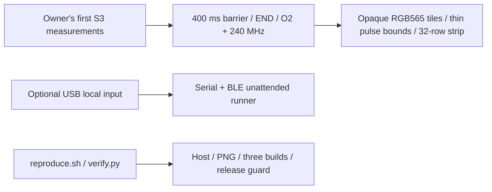

# StopWatch hardware fixes — 2026-11-02

Purpose: coordinator evidence for fixes to the first real StopWatch test.
Inputs: HEAD b0daefb, owner's measurements in this task, pinned IDF 5.5.6/LVGL,
synthetic UI/audio/flash/serial/BLE fixtures. Verified: final host/build/artifact
results below. Unverified: all new device performance, radio and USB behavior.
No board, adapter, real serial port, flash, commit, push, PR or extra review used.

| Entry | Evidence / purpose | Status |
|---|---|---|
| [reproduce.sh](reproduce.sh), [verify.py](verify.py) | Full commands and artifact assertions; caller supplies offline mirror/cache environment | ✅ Reproducible |
| [host.log](host.log) | 16 suites: realistic render wait, queued-tail END, hook and fake unattended run | ✅ Host only |
| [preview.log](preview.log), [baseline.sha256](baseline.sha256) | 17 original PNGs, cache/fallback equality, pulse bounds and native timing | ✅ No pixel differences |
| [s3.log](s3.log), [c6.log](c6.log), [hook.log](hook.log) | Normal S3/C6 and separate hook builds, generated-config/size evidence | ✅ Compile only |
| [release-reject.log](release-reject.log), [verification.log](verification.log) | Release rejects hook; defaults omit hook symbols and app USB dependency | ✅ Checked |
| [HIL runner](../../../FW/tools/hil/README.md) | Usage, prerequisites, PASS/FAIL steps and retained outputs | 🟡 Hardware unverified |
| [historical handoff](../2026-11-02-offline-handoff.md) | Preserved previous working notes; its fixture limitation is superseded by the hook | ✅ Moved |

The original hardware figures are owner-reported task inputs, not rerun here:
-Og/160 MHz redraw ≈181 ms; -O2/240 MHz ≈118 ms and streaming/pulse mean ≈175 ms;
DMA ≈1 ms/strip; 400 ms phone barrier measured 41–91 ms without rejection;
Opus 8.9 ms mean / 15.7 ms max per 20 ms frame. Host mocks had missed this.

| Size (bytes) | Baseline S3 | Normal S3 | Delta | Baseline C6 | Normal C6 | Delta |
|---|---:|---:|---:|---:|---:|---:|
| Image | 1,166,201 | 1,199,167 | +32,966 | 1,240,894 | 1,294,382 | +53,488 |
| DIRAM | 174,639 | 170,111 | −4,528 | 157,604 | 156,636 | −968 |

Hook S3: image **1,207,259**, DIRAM **173,755**; +8,092/+3,644 versus normal.
Linker DIRAM is not free runtime heap. S3 cache requests **1,109,850 PSRAM bytes**
(9 opaque sector tiles including neighbouring caps + 6 static Orb styles), with
allocator overhead TBC. Failed allocation falls back per tile. Internal DMA strip
is **29,824 B**, +14,912 versus 16 rows; allocation failure retries 16 rows.
C6 requests no PSRAM; native cache-disabled fixtures prove primitive fallback.

Native timing (production aggregates, `-O2`, host wall clock, no physical DMA):
400 control redraws and 100 pulse redraws per variant; see `preview.log` for
mean/max and exact run values. Host noise prevents a device latency projection.
Cached control/pulse rendering improves; **S3 speedup and <50 ms press-to-pixel
remain unmeasured**, not an acceptance claim. Pulse traffic is **144,690 pixels/s**
versus **359,120** before (**59.7% less**); bounds follow both ring edges. The
32-row strip reduces full-screen transfers 30→15 (partial regions differ).
All 17 PNGs are byte-identical, including the bounded long-name fixture after its
old 33-byte overflow was corrected to the protocol's 32-byte maximum.

Barrier regression failed on the original 175 ms modeled draw. New tests accept
175 ms and completed 450 ms rendering even when the wait reports expiry, while
missing/failed/modal rendering fails. END regression failed before the fix;
entirely unsent tail no longer creates a gap, partial transmission still interrupts.
Native UI checks deliberately inject one flush failure and three barrier rejects;
these expected counters in `preview.log` are test fixtures, not measured defects.

Assumptions: existing owner bond, stable enrolled identity, empty journal,
exclusive serial/BLE access, silence/curated stimulus, Linux POSIX serial. No new
Python dependency or lock change. Firmware remains 0.3.0 / contract 1.1.
Release invocations use REMOTE_RELEASE=ON or firmware-tag CI signals.

Moved licences byte-for-byte (README links updated). `git mv` was attempted but
index.lock creation failed because the worktree index is read-only; filesystem
moves are ready for coordinator rename staging. No CMake licence reference existed.
No SYS links point to either moved path. Prior untracked notes were left untouched:
AI/FW/README.md:6,18 and AI/FW/2026-11-02-offline-sync/README.md:30 still refer to
FW/handoff.md and are stale.

Hardware still needs to verify press-to-pixel (<50 ms target), actual PSRAM/internal
heap and stack headroom, sustained Opus/radio/flash timing, USB re-enumeration,
physical scanout, acoustic quality, flash fault/full behavior and battery impact.
The runner tests software reboot during capture, not a precisely timed power cut.

Open questions: achieved S3 latency/heap under sustained capture; USB-hook HIL
results on the bonded device; production release automation's retained signal.
