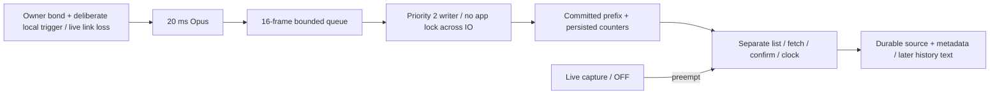

# Offline recording handoff — 2026-11-02

Purpose: preserved pre-hardware handoff. Inputs: stage-2 firmware at b0daefb.
Verification: historical host/build evidence below; hardware conclusions superseded
by [hardware fixes](2026-11-02-hardware-fixes/README.md).

The USB test hook now provides local input; the historical fixture limitation below
applies to ordinary firmware only. See [unattended runner](../../FW/tools/hil/README.md).



Purpose: coordinator handoff for draft 1.1 offline recording, touch-glitch fix and
phone simulator. Inputs: HEAD `064b528`, complete `SYS/protocol/remote-ble.md`,
ESP-IDF **5.5.6**, current S3/C6 baseline builds, synthetic host/audio/UI fixtures.
**Verified:** host logic/crash/runtime/client tests, native rendering, both builds,
binary version/capabilities and generated partition comparison. **Unverified:**
all new hardware/audio/flash/radio/power behavior. No hardware, adapter, serial,
flash, eFuse, encryption, commit, push, PR or extra review was used. SYS is unchanged.
Traces to [REQ-8], [REQ-18], [REQ-49–53], [REQ-56], [REQ-58], [REQ-62]; no claim
of measured hardware compliance. Owner's `hw_mic_cut=0` prototype exception remains.

| Entry point | Result |
|---|---|
| [Storage design](../../FW/app/offline-storage.md) | Raw sector journal: independently CRC/commit-protected frames, verified-prefix recovery, immutable finalized export, persistent ID/boot and durable deletion intent |
| `FW/app/offline_capture.c`, `offline_runtime.c` | Fresh owner-trigger policy, live-loss boundary, locally owned reconnect, stored mode/clock, full/failure stop, OFF volatile-tail discard, bounded writer queue and separate sync |
| `FW/app/audio_runtime.c` | One encoder history across offline reconnect; generation cancellation prevents stale PCM/Opus output after OFF |
| `FW/app/ble.c`, `protocol.c` | Contract 1.1, firmware 0.3.0; StopWatch caps `0xbf`, C6 `0x00`; authenticated sync characteristics omitted on C6 |
| `FW/app/ui_input.h`, board touch API | A failed I2C read holds prior state for <100 ms; timeout cancels and requires a real up. Failed-first regression observed before fix |
| `FW/app/ui.c`, [preview](../../FW/tools/ui_preview/README.md) | Truthful offline listening + Bluetooth-off target; small full/waiting/sync icons; 17 states, original 12 PNGs unchanged |
| [Client procedure](../../FW/tools/ble_client/deferred.md) | `--sync DIR --remote-id ID`, resumable fsynced copies, structure/count/CRC, WAV/time/mode, short disposition, idempotent confirm, `--set-clock`, timed disconnect |

The raw journal avoids filesystem dependency and exposes every write boundary to
fake flash. Frame body/commit are separate writes; two journal sectors protect
counter/deletion updates. Deleted IDs cost no historical tombstones. IDs/boot never
wrap; dirty lost counters fail closed. Ordinary firmware flashing preserves the
partition and counters. A RAM-only 16 KiB next-sector/export-byte index avoids
rereading old sectors on resume; its test counts 96 reads for the last frame of a
300-frame/two-sector record, before and after mount. The flash format is unchanged.

| Partition | StopWatch offset | Size | C6 |
|---|---:|---:|---|
| Partition table | `0x8000` | `0x1000` | Same |
| NVS | `0x9000` | `0x6000` | Same |
| PHY | `0xf000` | `0x1000` | Same |
| Factory | `0x10000` | `0x177000` | Same |
| Offline | `0x187000` | `0xe79000` (15,175,680 B) | Absent |

The new table ends at 16 MiB; C6 keeps the old table within its 4 MiB flash.
`tests/check_partitions.py` compares **generated binaries**, including the saved
pre-edit tables, and IDF's old single-app-large layout. NVS remains **0x9000 /
0x6000**. Bond preservation is proven as a layout property; actual bonded reconnect
after flashing is hardware-only. No NVS erase is part of this update.

**Capacity is calculated, unmeasured.** 3705 sectors minus two journal sectors =
3703 data sectors. Header-excluded area: 3703 × 4032 = **14,930,496 B** (G total).
Assumed 24 kbit/s / 50 frames/s gives 60-byte packets and 3100 exported B/s.
Private 12-byte frame overhead makes 72 stored B/frame; 56 frames/sector yields
**4147.36 s = 69.12 min**, equivalent to 12,856,816 exported bytes. Partially filled
record tails, 128-record limit, quarantines and actual packets reduce capacity.
G free/total is allocatable frame area, including future frame bookkeeping, rather
than chip size or a guarantee of exported bytes. See the complete calculation.

| Bytes | S3 baseline | S3 final | Delta | C6 baseline | C6 final | Delta |
|---|---:|---:|---:|---:|---:|---:|
| Total image | 1,151,369 | 1,166,201 | +14,832 | 1,224,080 | 1,240,894 | +16,814 |
| Padded `.bin` | 1,151,488 | 1,166,320 | +14,832 | 1,224,416 | 1,241,232 | +16,816 |
| DIRAM used | 173,251 | 174,639 | +1,388 | 156,236 | 157,604 | +1,368 |
| `.bss` + `.data` | 78,996 | 80,356 | +1,360 | 69,308 | 70,676 | +1,368 |
| DIRAM remainder | 168,509 | 167,121 | −1,388 | 295,876 | 294,508 | −1,368 |
| Runtime free internal/PSRAM delta | TBC | TBC | TBC | No offline allocation | No PSRAM | N/A |

Baseline builds were rebuilt/sized **before edits**. These link-time numbers are
not runtime free heap. S3 adds a 6144-byte internal writer stack, an 18-job queue
(two slots reserved around the 16-frame/320 ms nominal bound), and the **49,232-byte** bounded store/index allocation. Compiled jobs are
544 bytes: queue payload is **9792 bytes**, plus queue/RTOS overhead. Together
with the writer stack this adds **15,936 internal bytes before overhead**; an
internal store fallback adds a further 49,232 bytes. Board allocation prefers PSRAM, with internal fallback;
all flash IO buffers, queue, task stacks and DMA remain internal. C6 allocates no
store, writer or queue; shared core assumes no PSRAM. Exact compiled type sizes
are in `final-build-metadata.log`; allocator/RTOS overhead and free heap need hardware.

**Flash-stall risk remains unverified.** A writer task avoids blocking the app
mutex on IO but cannot keep flash-resident code executing while SPI1 disables
cache. IDF `components/spi_flash/cache_utils.c` coordinates both CPUs; priority
alone cannot protect Opus, NimBLE, touch or LVGL. StopWatch enables
`CONFIG_I2S_ISR_IRAM_SAFE`; its overflow callback is IRAM-safe and four DMA
frames provide an 80 ms nominal horizon. This is buffering, not a timing proof.
No erase is intentionally scheduled during capture; counter writes occur before
starting acquisition, frame programming during offline capture, and data erases
only after confirmation while idle. A fresh trigger can race an in-flight flash
operation, which cannot be retracted. Flash auto-suspend stays disabled because
chip support is unverified (IDF `components/spi_flash/Kconfig`). Display DMA/IRQs
and BLE may be delayed too. Hardware must measure maximum stall, DMA loss, queue
headroom, BLE/input/display latency, heap/stack, wear, power and battery life.
Writer logs `queue_high` and `flash_write_max_us` on finalization; existing five-second
`timing` and per-live-segment encoder/heap logs remain. No audio contents are logged.

Assumptions: one existing owner bond; no tap-lock; 24 kbit/s is a configuration,
not an acoustic/throughput measurement; UTC is always approximate (zero if unknown)
and snapshots at capture start. Unix epoch through year 9999 is accepted; future,
stale (>10000 ms) or wrong-boot samples are rejected. Queue depth, task stacks,
flash cadence and the 128-record bound are engineering bounds, not measurements.
A frame commits after its commit word; power loss discards queued/in-flight tail.
A strict real-time tail-loss bound is TBC. Storage is unencrypted, confirmed delete
is logical, and the contract's privacy/product questions remain open.

Two contract gaps remain unchanged:

| Gap | Handling / consequence |
|---|---|
| “Explicit incompatible-version result” has no wire representation | Info is read-only; Phone state and C1–C4 carry no peer version/incompatibility result. Client rejects a different major and never arms. Firmware cannot distinguish that peer from an incomplete handshake (which explicitly permits offline). No invented opcode or silent SYS change |
| Unattended end-to-end recording test cannot finish through BLE alone | The contract deliberately keeps offline capture locally owned through reconnect; Phone state cannot operate local OFF/PTT. An existing physical actuator fixture is required to create the deliberate trigger and finish the record. No test backdoor added |

Re-enrollment is blocked while any previous records or storage errors remain,
including after revoke. Normal deletion needs durable C4. To change owners with
retained records, an **explicitly authorized local maintenance erase** can remove
only data sectors, preserving the first two offline counter journals and NVS:
`esptool.py --chip esp32s3 --port /dev/ttyACM0 erase_region 0x189000 0xe77000`.
This command was **not run** and is not a normal flash step. Lost/corrupt journals
need explicit identity reset/new enrollment namespace; never erase counters and
reuse the same enrolled identity. The CLI requires `--remote-id` because this draft
has no readable enrollment identity. Keep it stable across normal updates.

Run from repository root, one heavy job at a time (no more than four compiler jobs).
Regenerated S3/C6 sdkconfigs were checked for their respective tables, flash sizes,
160 MHz CPU, and S3's IRAM-safe I2S setting. Set the supplied offline mirror/cache
variables in the shell only; none are embedded in source:

```sh
export PATH=$HOME/.local/share/uv/python/cpython-3.12.14-linux-x86_64-gnu/bin:$PATH
export IDF_TOOLS_PATH=$HOME/hw-tools/espressif
. ~/hw-tools/esp-idf/export.sh
export IDF_TOOLS_PATH=/tmp/voiceremote-espressif
export TMPDIR=$PWD/AI/scratch/offline-build-tmp
mkdir -p "$TMPDIR"
heavy bash FW/tests/run.sh
heavy bash FW/tools/ui_preview/run.sh
heavy idf.py -C FW -B FW/build-m5 -DIDF_TARGET=esp32s3 -DREMOTE_TIMING=ON reconfigure
heavy cmake --build FW/build-m5 -j 4
heavy idf.py -C FW -B FW/build-m5 build
heavy idf.py -C FW -B FW/build-m5 size
heavy idf.py -C FW -B FW/build-c6 -DREMOTE_BOARD=waveshare_c6_169 -DIDF_TARGET=esp32c6 -DREMOTE_TIMING=ON reconfigure
heavy cmake --build FW/build-c6 -j 4
heavy idf.py -C FW -B FW/build-c6 -DREMOTE_BOARD=waveshare_c6_169 build
heavy idf.py -C FW -B FW/build-c6 size
```

[Reproduction script and evidence](2026-11-02-offline-sync/README.md)
include final host/preview/build/size/table logs and the failed-touch observation.
All **10 host suites** pass, including 26 Python cases, production runtime/audio
harnesses, contract hex round trips, 15 capture mutation boundaries and 10 deletion
boundaries (whole/torn writes/erases), full storage, resume, ID persistence,
idempotent confirm, live preemption, and OFF. All **17 previews** pass; the original
**12 PNG hashes** are unchanged. Host scheduling models do not prove radio timing.

Coordinator-only hardware procedure — **not executed**. Run only after the
coordinator has exclusive device/adapter access. Prerequisites: existing authenticated
bond; known address; an authorized physical-control fixture. Without that fixture,
only the BLE reconnect/open-record checks below are unattended; complete pass/fail
is blocked, not claimed. Use silence/curated synthetic test input; outputs stay ignored.

```sh
export UV_CACHE_DIR=/tmp/voiceremote-uvc-s2 UV_OFFLINE=1 UV_LINK_MODE=copy
remote_addr=AA:BB:CC:DD:EE:FF
mkdir -p AI/scratch/offline-hil
uv run --project FW/tools/ble_client python FW/tools/ble_client/client.py --address "$remote_addr" --capture 2 --recording 1 --arm --save AI/scratch/offline-hil/live.wav --disconnect-after 8
sleep 3
uv run --project FW/tools/ble_client python FW/tools/ble_client/client.py --address "$remote_addr" --remote-id stopwatch-enrollment-1 --sync AI/scratch/offline-hil/copies --seconds 15
```

| Step | Fixture action / expected serial and client output | Pass / fail |
|---|---|---|
| Start live | After initial snapshot, fixture selects OFF then REC. Client emits streaming Input. At 8 s client prints `Disconnecting BLE without phone stop` | A recovered/preselected snapshot alone never starts capture |
| Lose link | No fixture action. Serial shows `offline: capture started mode=0`; recording Orb remains lit with Bluetooth-off target | No replay of earlier live frames into offline record; no false listening if storage/mic start fails |
| Reconnect while REC | Second command sees Input `offline=True`, `offline sync paused...`; serial must not report local finalization merely on reconnect | Open record is absent from list/count and no fetch bytes are transmitted |
| Finalize locally | Fixture selects OFF, then PTT with button up. Serial shows `offline: finalized waiting=1... queue_high=... flash_write_max_us=...`; OFF must stop acquisition/data, preserve durable prefix | Local boundary required. Phone stop alone must not finalize |
| Sync/verify | Rerun the second command with `--set-clock` while idle. Expect `resume=...`, `verified disposition=audio-saved` (or `discarded-short`), `confirmed deletion`, `offline list exhausted`; waiting icon clears | One ID/source/sidecar/WAV, stored mode/time intact, only verified durable source confirmed |
| Retry/resume | Disconnect sync mid-fetch with `--disconnect-after 2`, then repeat the second command with the same directory/identity | First missing byte resumes; partial metadata/bytes match; lost R4 retries C4 without refetch |
| Priority/OFF | Fixture triggers live capture while fetching, then OFF; reconnect/list again | Sync stops before new capture; no further sync audio after OFF; unfinished copy retained for retry |
| Reboot/full/fault | Fixture power-cycles during a frame write and later fills storage; repeat sync. Correlate serial/timing counters | Verified prefix has interrupted flag; IDs/boot advance, full stops visibly without overwrite; no counter reuse |

To verify idempotence, rerun the sync command after success: only `list exhausted`,
no new ID/WAV. Fail on deletion before verification, changed immutable metadata,
Audio/sync splicing, capture restarted by reconnect, old-owner access, overflow
without visible stop, or unsafe OFF behavior. Collect existing serial output via
the coordinator's collector; this worker never opened a serial device. Exact fixture
actuator commands are **TBD**, because no fixture interface was supplied. Therefore
an exact BLE-only, no-person end-to-end completion procedure is unworkable under
this unchanged contract; the executable BLE half and expected outputs are above.

Open questions: which actuator fixture can supply deliberate local controls; how
to encode an explicit incompatibility result; hardware flash/audio/BLE/display
stall limits and actual heap/capacity; enrollment identity reset and production
at-rest privacy/retention policy.
