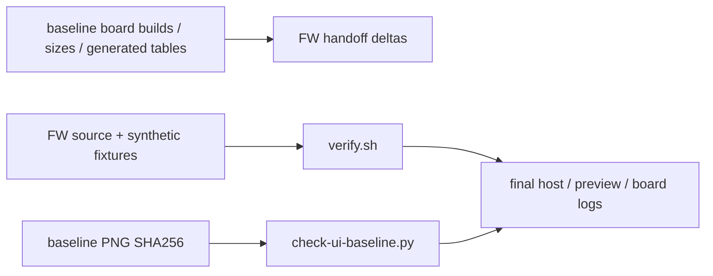

# Offline sync verification — 2026-11-02

Purpose: preserve reproducible offline-recording implementation evidence. Inputs:
HEAD 064b528 baseline, draft BLE 1.1, ESP-IDF5.5.6, synthetic bytes/silence only.
Host/build results verified in the logs; no hardware, Bluetooth or serial access.

| File | Contents | Status |
|---|---|---|
| `verify.sh` | Serial host/preview/S3/C6 verification and size commands, ≤4 compiler jobs | ✅ Reproducible with local toolchain |
| `baseline-*-{build,size}.log` | Both current builds rebuilt and sized before changes | ✅ Baseline |
| `baseline-*-partition-table.bin` | Original generated tables; NVS offset/size comparison inputs | ✅ Baseline |
| `final-*.log` | Final host, preview, both builds/sizes and generated table evidence | ✅ See logs |
| `index-host.log`, `runtime-{red,green}.log` | Focused crash/write/delete/queue regression evidence | ✅ Synthetic |
| `client-tests.log` | Initial 23-case Python client run; final host log includes later regressions | ✅ Synthetic |
| `touch-ui-evidence.md` | Failed-touch red/green observation and native render results | ✅ Host/native |
| `ui-baseline-sha256.json`, `check-ui-baseline.py` | Repeat unchanged-baseline check for twelve original states | ✅ Native |
| `check-builds.py`, `final-build-metadata.log` | ELF firmware/capability metadata, generated config and compiled allocation sizes | ✅ Built binaries |
| `index-*.log` | Indexed-fetch host/build verification before final full run | ✅ Synthetic/build |
| `work-s3-*.log` | First integration build/configuration, retained as working evidence | 🟡 Superseded by final logs |

Start with [FW/handoff.md](../../../FW/handoff.md) for conclusions, assumptions and
hardware-only limits. All logs exclude audio bytes, transcripts, keys and contacts.
