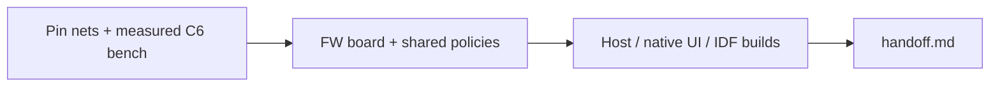

> **Purpose:** C6 port build/host evidence. **Inputs:** shared StopWatch app, vendor references and owner-supplied C6 bench facts. **Verified:** see handoff; device bring-up remains unverified.

| File | Purpose | Status |
|---|---|---|
| [handoff.md](handoff.md) | Results, flash recipe, memory and hardware checklist | ✅ Host/build verified; hardware unverified |
| `verify_reference.py` | Rebuild base UI and compare all 17 original PNGs | ✅ Passed |
| `measure.py`, `measurements.md`, `ram-evidence.txt` | Reproducible linked sizes/types and bounded RAM arithmetic | ✅ Linked/arithmetic; runtime TBC |
| `rebuild-c6.sh` | C6-only rotation-0 gap correction rebuild; prior host/UI results retained (shared/tested files unchanged) | ✅ Three-step build passed |
| `validate.sh` | Serial IDF builds, sizes and final host/UI checks; supply mirror in shell | ✅ Passed |

Start with the [board map](../../../FW/boards/waveshare_c6_169/README.md).
Transient build logs and PNGs live in ignored `AI/scratch/c6-port/`.
