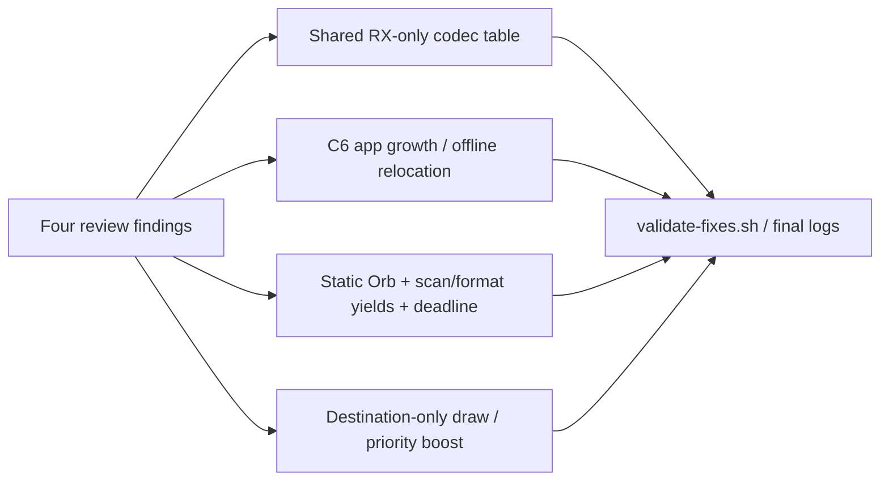

> **Purpose:** handoff for four cross-review fixes after ef82fee. **Inputs:** firmware, supplied read-only C6 vendor driver/schematic, ES8311 datasheet rev 10.0, installed IDF 5.5.6. **Verified:** all four three-step builds, all 31 host tests and full native UI runner pass. Hardware unverified.

| Change | Evidence |
|---|---|
| DAC powered down on both boards | `FW/tests/test_es8311.c`: actual shared writes, DAC/HP never enabled; ADC/PGA/mic settings retained |
| C6 app `0x1c0000`, offline moved/shrunk | `check_partitions.py`: historical NVS, exact map, alignment/non-overlap/flash end; normal/hook binary ≥20% unused |
| Static listening / runtime yields / deadline | C6 native touch + physical checks; `offline_runtime_yields`; native 344/400 ms accepted, 401 ms rejected, on-time completion with delayed reacquisition |
| Shorter host barrier on both boards | Destination strip only with valid baseline; normal Orb/sector/pulse work deferred; renderer S3 1→3→1, C6 1→20→1; native exit-path restoration and both compiled policy guards |

Start with [firmware build instructions](../../../FW/README.md). Traces to existing
[REQ-18] completed-destination barrier; SYS contract unchanged. Reproduce with
`bash AI/FW/2026-11-11-c6-port/validate-fixes.sh` after supplying mirror/cache vars.
Every build/test in that script runs through `heavy`, ≤4 workers, one job at a time,
with `TMPDIR=$PWD/AI/scratch/tmp`. No device, serial, Bluetooth, flash, commit or push.

## Codec evidence

[ES8311 datasheet rev 10.0](https://files.waveshare.com/wiki/common/ES8311.DS.pdf),
pp. 18–20: `0x12` bit 1 PDN_DAC=1 powers down DAC, bit 0 ENREFR=0 disables
its output reference; `0x13` bit 4 HPSW=0 clears HP drive selection. Shared
`FW/boards/es8311_mic.h` changes only these two values. ADC/PGA power stays
`0x0d=0x01`, `0x0e=0x02`; mic route/gain/clock/sample format unchanged.
Supplied `demo/Arduino/examples/04_es8311_example/es8311.cpp:385–388` confirms
power-up meanings and independent ADC setup. StopWatch had the identical sequence,
so receives the same low-risk RX-only fix, retaining both external amp disables.
C6 amp CTRL is hardwired VSYS; DAC shutdown does not turn the amplifier off.

## C6 map / data handling

| Name | Offset | Size |
|---|---|---|
| nvs | `0x9000` | `0x6000` |
| phy_init | `0xf000` | `0x1000` |
| factory | `0x10000` | `0x1c0000` (1,835,008 B) |
| offline | `0x1d0000` | `0xe30000` (14,876,672 B) |

Headroom uses `(app size - image size) / app size`, the stricter unused fraction,
consistent with the reported old 9.5%. NVS stays put. Old C6 offline recordings
need export before update and relocated partition reformat during update; there
is no data migration. Mount deliberately refuses to erase surviving record magic,
so an app-only flash can fail closed rather than automatically reformat. Physical
flash-size capability guard is unchanged. No flash performed in this worktree.

## Blocked-host estimate and limits

Production CBR is 24,000 bit/s at 20 ms: 60-byte Opus payload plus 12-byte Audio
header. With ATT MTU ≥75 this is 50 notifications/s and normally one 128-byte MSYS
block per notification (32-bit mbuf/header + reserved ATT/L2CAP/HCI space fit).
The unchecked demand model is **50 × 1 s × 1 = 50 mbuf blocks**; at the new
400 ms fallback limit it is **20 blocks**, before other traffic. At minimum
MTU 23, each frame splits into ceil(60/8)=8 notifications: unchecked demand is
400 notifications/s (but the 5 ms main loop can submit at most 200/s). Larger
synthetic packets can chain mbufs. These arithmetic demands are not measured
pool occupancy, and are not the actual producer behavior:

- `FW/app/ble.c` `ble_audio_ready()` requires `audio_pending==0`; `audio_send()`
  caps ordinary pending notifications at one, with a second reserved for END.
  Hence a blocked host retains at most **one ordinary Audio notification plus
  END** (normally two small blocks), rather than 50 unchecked notifications.
- The generated configs have **24×128-byte MSYS1**, **24×320-byte MSYS2**, and
  **24 ACL buffers**; treating these as one common 24-block budget is inaccurate.
- Stalled callbacks still block progress: eight queued Opus frames provide
  160 ms nominal storage; the ninth frame faults, depending on queue occupancy.
  The pending-notification watchdog faults after >200 ms. A 400 ms deadline
  alone cannot guarantee uninterrupted audio.
- Destination-first drawing and temporary priority boost reduce normal blocking;
  they do not prove a wall-time bound for a pre-existing full frame, flash stalls
  or failed DMA. C6 keeps its one-tick/strip yield; audio still outranks render.
  With a clean valid baseline a barrier invalidates only 240×68 pixels on C6
  (≤9 8-row strips) or 466×96 on S3 (≤3 32-row strips), not the Orb/full screen.
  Full recovery after a failed frame/overlay remains necessary. No async ATT path.

Source inputs for arithmetic: `FW/app/{audio.h,audio.c,audio_runtime.c,ble.c}`,
`FW/sdkconfig.defaults`, generated configs; IDF 5.5.6
`components/bt/host/nimble/nimble/nimble/host/src/ble_hs_mbuf.c` and
`.../porting/nimble/{include/os/os_mbuf.h,src/os_mbuf.c}`. Static analysis, not a
radio measurement. Only DMA success within 400 ms for the matching request,
with no modal, can satisfy the write; late completion is rejected even if drawn.

## Validation

Codec and 401 ms regressions failed before fixes. The map checker rejected the
old generated C6 factory table. Focused host/native tests passed after fixes.
Final validation (after last source/test edit):

| Command / artifact | Result |
|---|---|
| StopWatch `FW/build-m5` | Three-step reconfigure / `cmake --build -j 4` / IDF build passed; 1,198,672 B |
| StopWatch hook `FW/build-m5-hook` | Same sequence passed; hook ON, release OFF; 1,207,392 B |
| C6 `FW/build-c6` | Same sequence passed; **1,390,160 B**, app **24.2423% unused** (444,848 B) |
| C6 hook `FW/build-c6-hook` | Same sequence passed; hook ON, release OFF; **1,399,760 B**, app **23.7191% unused** (435,248 B) |
| `heavy bash FW/tests/run.sh` | **31/31 CTest tests passed**, including all native/C6/priority/yield/partition checks |
| `heavy bash FW/tools/ui_preview/run.sh` | Passed: ordinary/hook/cache-disabled, both C6 layouts, timings, all 23 PNG cache comparisons |
| `git diff --check` | Passed |

All four use timing ON. StopWatch uses esp32s3/m5stopwatch; C6 uses
esp32c6/waveshare_c6_169. Release ON/hook OFF only for normal variants.
Reproduction script is [validate-fixes.sh](validate-fixes.sh); ignored logs are
`AI/scratch/c6-fix/{validation,*-config,*-build,*-finalize,host-final,preview-final}.log`.
Image sizes are file lengths (the same padded binary sizes checked by IDF).
Headroom is unused partition fraction; relative to image size normal C6 has
31.9998% extra space, hook C6 31.0945%. No hardware acceptance claimed.

## Assumptions / hardware-only work

- Exact C6 unit remains 16 MiB; headroom is unused fraction of the app partition.
- Existing prototype OFF exception and REQ-18 contract remain authoritative.
- Export/reformat is an owner update step; automatic destructive migration was
  not introduced, and NVS must be preserved.
- Native priority fakes prove API ordering/restoration, not FreeRTOS preemption;
  synthetic flash tests prove yield cadence, not watchdog timing.
- Hardware must verify codec PCM/gain, speaker noise/current, physical flash and
  offline update handling, task priorities under streaming, renderer/ATT latency,
  TX completions/queue occupancy/overflow, watchdog behavior and physical pixels.
