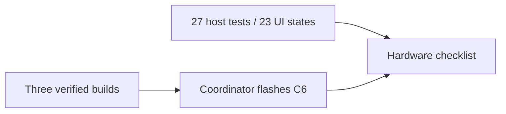

> **Purpose:** coordinator C6 bring-up handoff. **Inputs:** shared app, vendor schematic/demo, owner’s exact-unit bench facts, local builds/tests. **Verified:** host/build only; this firmware has not run on hardware.



| Result | Evidence |
|---|---|
| C6 drivers | ST7789V2 rotation 0 / gap (0,20), swap/mirror off; CST816T, ES8311/I2S; [every pin and source](../../../FW/boards/waveshare_c6_169/README.md#pins-and-source-evidence) |
| Inputs | Probe TCA9554 0x20: physical selectors/buttons; absent: rectangle Orb ring, BOOT PTT, PWR target. Boot REC, invalid/stale/I2C, debounce and stuck INT tested |
| Shared app | Same BLE 1.1, Opus, owner policy, offline journal and sync; no SYS edits or new dependencies |
| Checks | Earlier **27/27** host tests, **23** UI states, **17/17** original PNGs unchanged; StopWatch normal/hook and release-hook checks pass. Offset follow-up rebuilds C6 only; shared/tested files unchanged |
| Reproduce | `validate.sh`, `verify_reference.py`, `measure.py`; offset follow-up: `rebuild-c6.sh`. Raw logs: ignored `AI/scratch/c6-port/` |

| Build | Image bytes | DIRAM used / remaining |
|---|---:|---:|
| C6 stub baseline | 1,291,508 | 158,708 / 293,404 |
| C6 port | 1,389,264 | 174,382 / 277,730 |
| StopWatch | 1,198,087 | 172,223 / 169,537 |
| StopWatch hook | 1,206,791 | 175,911 / 165,849 |

C6 delta: **+97,756 image / +15,674 static RAM bytes**. [RAM arithmetic](measurements.md):
139,804 known dynamic bytes plus 23,040 BLE stack/msys budget leaves **114,886 bytes
before uncounted overhead**; runtime free heap is **TBC**, logged at boot. LVGL’s
48 KiB pool is already static; only a 2500/7056-byte A8 glyph lives within it.
Bit 7 is enabled on the measured 16 MiB unit, cleared for missing/out-of-range storage.
NVS stays `0x9000/0x6000`; offline is `0x187000/0xe79000`. No PSRAM or full artwork cache.

Single-core priorities: Opus **22** / 32 KiB stack, BLE host **21**, input **5**,
render/writer **1**; IDF radio controller remains **23**. Eight-row DMA strips yield
one tick; touch/expander I2C timeout 2 ms outside the audio mutex. Timing logs report
encode wall-time load estimate, loop, touch, DMA and queue maxima. Flash-cache stalls
remain **unverified**. StopWatch priorities/cache/strip/input behavior remain unchanged.

Opus: fixed-point, disabled float API, alloca, `-O2`, VOIP, 16 kHz mono/20 ms,
24 kbit/s CBR, complexity 0, wideband, DTX/FEC off. Supplied standalone bench:
11.48 ms mean / 17.06 ms worst, ~22 KiB stack; **not this port’s runtime**.
`REMOTE_ENCODE_BENCH` omitted to avoid another encoder/boot lifecycle.

Copy the three C6 artifacts preserving this layout. From `FW/build-c6/`, using
esptool 4.x on the flashing machine (`$PORT` chosen there):

```sh
python -m esptool --chip esp32c6 --port "$PORT" --baud 460800 \
  --before default_reset --after hard_reset write_flash \
  --flash_mode dio --flash_freq 80m --flash_size 16MB \
  0x0 bootloader/bootloader.bin \
  0x8000 partition_table/partition-table.bin \
  0x10000 voice_remote.bin
```

Offsets/options come from generated `flash_args`; do not erase NVS/offline data,
program eFuses or enable encryption. Recordings remain unencrypted prototype data.

1. Read boot logs: physical flash 16 MiB, input mode, heap/minimum; verify image and pairing number.
2. Check all borders/colors/touch, vendor +20-row display gap (rotation 0; swap/mirror off), held touch/up, BOOT/PWR, battery latch.
3. Fit Rev G: labels/all detents/buttons, boot REC/held buttons, 00/I2C faults/stuck INT; verify OFF stops.
4. Pair/reconnect; compare live audio, rapid UI changes, timing/queue maxima, stack watermark.
5. Offline record while redrawing; reboot/recover, sync/resume/delete, reconnect capture preemption; measure flash stalls and heap minimum.

Open questions: panel borders/colors with the vendor +20-row gap; sustained audio/flash timing and acoustic gain; actual heap/stack margin; switch direction/bounce; GPIO9/IMU sharing. Schematic amp CTRL is hardwired to VSYS: DAC is muted, but amplifier power OFF needs hardware changes. Hardware microphone cut remains absent (`hw_mic_cut=0`, existing exception).
