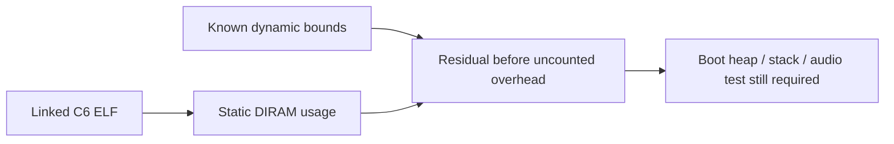

> **Purpose:** final linked size/RAM arithmetic. **Inputs:** IDF size logs, ELF/GDB, configured allocation bounds. **Verified:** build sizes and arithmetic; runtime free heap **TBC**.

| Build | IDF image bytes | Padded binary bytes | DIRAM used | DIRAM remaining |
|---|---:|---:|---:|---:|
| stub | 1,291,508 | baseline only | 158,708 | 293,404 |
| c6 | 1,389,264 | 1389616 | 174,382 | 277,730 |
| m5 | 1,198,087 | 1198208 | 172,223 | 169,537 |
| m5-hook | 1,206,791 | 1206912 | 175,911 | 165,849 |

C6 delta versus build-only stub: **+97,756 image bytes**, **+15,674 static DIRAM bytes**.
The reference 452,112-byte linker region excludes reserved memory; 512 KiB chip SRAM
is not a free-heap figure. Linker remaining is not runtime free heap.

| Known dynamic allocation | Bytes |
|---|---:|
| Store | 49,232 |
| 18 queue jobs | 9,792 |
| Opus state | 24,716 |
| Opus stack | 32,768 |
| Writer stack | 6,144 |
| Renderer stack | 8,192 |
| I2S DMA payload | 5,120 |
| LCD strip | 3,840 |
| Known subtotal | 139,804 |
| BLE host/controller stacks + configured msys payload budget | 23,040 |
| Residual before other IDF/controller/driver/heap/task overhead | 114,886 |

This residual is an **estimate / upper budget, TBC**, not measured free heap.
LVGL's 48 KiB built-in pool is already included in static BSS; the 2500/7056-byte
A8 glyph lives inside it, not in an extra full artwork cache. Driver descriptors,
queue/allocator overhead, controller allocations, other system task stacks and
fragmentation reduce the residual. Boot logs actual free/minimum internal heap;
production audio logs allocation size, free heap and stack watermark when the
audio tag is enabled. The 32 KiB stack follows the owner's ~22 KiB synthetic
measurement, leaving ~10 KiB nominal margin (production maximum **TBC**).

Opus mono allocation is 24,716 bytes from the linked size functions:
2208-byte outer state + 17352-byte SILK + 5156-byte CELT, aligned to four bytes.
See `ram-evidence.txt` and `measure.py`; the CELT static 48k mode used by get_size
has overlap 120 and 21 bands (`celt/static_modes_fixed.h:1519–1523`). This is
allocation sizing, not an encode throughput measurement.

Bit 7 remains enabled on the measured 16 MiB C6: RAM arithmetic leaves room for
the shared store, bounded queue and production encoder with BLE. It clears before
offline allocation/registration for missing or physically out-of-range storage.
Physical heap/stack sufficiency and flash-cache stalls remain **unverified**.

Raw logs are ignored under `AI/scratch/c6-port/`; `validate.sh` and
`verify_reference.py` reproduce the checks. No new dependency graph was needed.
