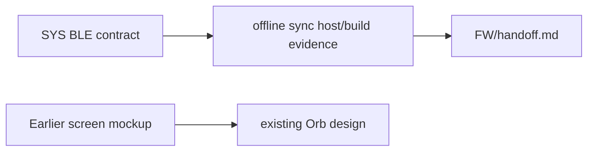

# Firmware working evidence

Purpose: map firmware working material. Inputs: firmware/contracts and synthetic tests.
Verification status is recorded with each result; hardware remains unverified.

| Path | Purpose | Status |
|---|---|---|
| [2026-11-02-offline-sync/](2026-11-02-offline-sync/) | Repeatable host/build evidence, size baselines and unchanged UI checks | ✅ Host/build; hardware TBC |
| [2026-11-11-c6-port/](2026-11-11-c6-port/) | C6 pin evidence, build/host results, RAM and coordinator flash checklist | 🟡 Hardware unverified |
| `stopwatch-screen-mockup.html` | Earlier UI working mockup | 🟡 Historical |

Start with [the firmware handoff](../../FW/handoff.md).
