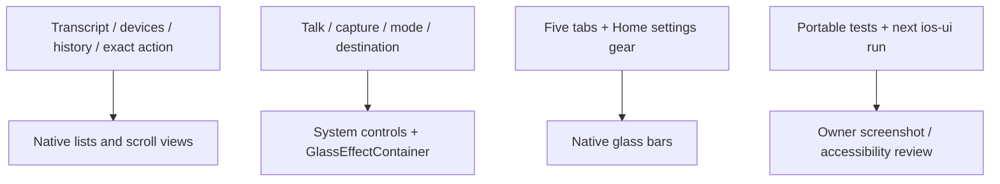

<!-- Purpose: native iOS 26 UI design rules and first-run accessibility triage.
Inputs: Apple primary sources read online 2026-11-04; coordinator's 73 synthetic audit JSONs.
Verification: documented API signatures/availability and local audit counts checked;
new Apple SDK compilation, simulator rendering, haptics and accessibility fixes unverified. -->

| Source read | Design rule / implementation decision |
|---|---|
| [Materials, including Liquid Glass](https://developer.apple.com/design/human-interface-guidelines/materials#Liquid-Glass) | Glass separates controls/navigation from content. Keep transcript and list rows on system backgrounds; never glass cards or a blur imitation. Use regular glass, without layered glass backgrounds. The standalone `/liquid-glass` HIG URL returned 404; its actual guidance is here. |
| [Adopting Liquid Glass](https://developer.apple.com/documentation/technologyoverviews/adopting-liquid-glass) | Let system bars, menus, sheets and controls adopt the material. Remove competing custom styling; keep content scrolling beneath bars. |
| [Applying Liquid Glass to custom views](https://developer.apple.com/documentation/swiftui/applying-liquid-glass-to-custom-views) | Group related effects, assign stable IDs, animate sparingly. Apply effects after layout; keep the transcript outside the effect container. |
| [Tab bars](https://developer.apple.com/design/human-interface-guidelines/tab-bars) | Stable destinations, labels, no navigation actions masquerading as tabs. Avoid overflow: Home, Devices, History, Suggestions, Agents; Settings via Home gear. |
| [Toolbars](https://developer.apple.com/design/human-interface-guidelines/toolbars) | Use recognizable symbols and system group separation. Home’s info and gear get a native spacer; emergency Stop is reachable while content scrolls. |
| [Sheets](https://developer.apple.com/design/human-interface-guidelines/sheets) | Focused, temporary tasks: pairing, exact approval and explanatory help. Pairing reveals invitation then four-word confirmation, with one main action per step. |
| [Buttons](https://developer.apple.com/design/human-interface-guidelines/buttons) | A clear verb and one prominent action. Native glass styles for talk/stop and approval; list actions stay ordinary, with secondary choices in menus. |
| [Controls](https://developer.apple.com/design/human-interface-guidelines/controls) | Use standard controls and clear state. Capture and Mode are separate labelled, full-width segmented pickers. Off has an explicit explanation and enable action. |
| [Color](https://developer.apple.com/design/human-interface-guidelines/color) | Prefer adaptive system foregrounds and native tint; reserve prominent color for the primary action. Stop’s symbol and text inherit one style. Never use color alone to convey recording. |
| [Typography](https://developer.apple.com/design/human-interface-guidelines/typography) | Semantic text styles; no fixed font-size cap. Transcript and four-word phrase have prominence; detail text wraps and scrolls. |
| [Layout](https://developer.apple.com/design/human-interface-guidelines/layout) | Clear hierarchy, system safe areas and scrollable content. Move explanatory walls into help sheets; don’t embed Home in a settings Form. |
| [Accessibility](https://developer.apple.com/design/human-interface-guidelines/accessibility) | Labels, generous controls, text plus symbols, system preferences. Keep the ordinary demo from forcing a Dynamic Type size. Retain every audit finding for review. |

## API review

All links below were read as Apple's Markdown documentation. These APIs were checked
for signatures/availability; local syntax parsing cannot substitute for Apple SDK typechecking.

| API | Use / decision |
|---|---|
| [glassEffect(_:in:)](https://developer.apple.com/documentation/swiftui/view/glasseffect(_:in:)) | iOS 26. Apply regular interactive glass only to the custom Hold control, after its frame/padding. |
| [GlassEffectContainer](https://developer.apple.com/documentation/swiftui/glasseffectcontainer) | iOS 26. Groups the capture/mode/destination controls and coordinates primary-action transitions. |
| [glassEffectID(_:in:)](https://developer.apple.com/documentation/swiftui/view/glasseffectid(_:in:)) | iOS 26. A stable `talk` ID and namespace connect idle/hold/continuous/finishing transitions; motion stays restrained. |
| [glass](https://developer.apple.com/documentation/swiftui/primitivebuttonstyle/glass), [glassProminent](https://developer.apple.com/documentation/swiftui/primitivebuttonstyle/glassprominent) | iOS 26. Use system styles instead of recreating glass. No extra glass background on these buttons. |
| [tabBarMinimizeBehavior](https://developer.apple.com/documentation/swiftui/view/tabbarminimizebehavior(_:)), [never](https://developer.apple.com/documentation/swiftui/tabbarminimizebehavior/never) | iOS 26. Keep five tabs stable and discoverable during recording; no minimization. |
| [tabViewBottomAccessory](https://developer.apple.com/documentation/swiftui/view/tabviewbottomaccessory(content:)) | iOS 26 accessory placement follows the tab bar. Studied, not added: Home already owns recording; another permanent bar would crowd it. |
| [Switchable accessory](https://developer.apple.com/documentation/swiftui/view/tabviewbottomaccessory(isenabled:content:)) | Requires **26.1**; do not use unguarded on the 26.0 baseline. |
| [ToolbarSpacer](https://developer.apple.com/documentation/swiftui/toolbarspacer) | iOS 26 native group spacing, with explicit toolbar placement. |
| [scrollEdgeEffectStyle](https://developer.apple.com/documentation/swiftui/view/scrolledgeeffectstyle(_:for:)) | iOS 26. Soft scroll edges on Home; system bars keep their native edge treatment. |
| [safeAreaBar](https://developer.apple.com/documentation/swiftui/view/safeareabar(edge:alignment:spacing:content:)), [Apple accessibility example](https://developer.apple.com/videos/play/tech-talks/111433/) | iOS 26 native bottom control bar integrates the scroll edge treatment; no hand-built blur or opaque toolbar overlay. |
| [backgroundExtensionEffect](https://developer.apple.com/documentation/swiftui/view/backgroundextensioneffect()) | Mirrors/blurs background beyond bounds, commonly beneath split-view sidebars. Studied, not applied to a transcript-only phone screen; no decorative fake backdrop. |
| [Reduce Transparency](https://developer.apple.com/documentation/swiftui/environmentvalues/accessibilityreducetransparency), [Reduce Motion](https://developer.apple.com/documentation/swiftui/environmentvalues/accessibilityreducemotion) | Read-only environment preferences. Native glass adapts; custom Hold uses an opaque system fill / identity effect. Disable custom layout animations under Reduce Motion. |

## Apple's own primary actions

These are **design inferences from Apple's guides**, not measurements or simulator
inspection of Apple's apps. Versioned guide fetches for Music/Voice Memos hit HTTP
429; the linked current guide content was available in Apple's search results.

| App / primary source | Inference for Voice Remote |
|---|---|
| [Voice Memos](https://support.apple.com/en-au/guide/iphone/iph4d2a39a3b/ios), [live transcription](https://support.apple.com/en-mo/guide/iphone/iph00953a982/ios) | A singular recording action changes to Stop; live content earns the main area. Our transcript is the hero, not a decorative waveform or a grid of buttons. |
| [Music player](https://support.apple.com/en-gb/guide/iphone/iph676daac9b/ios) | Compact controls name their current content/destination, while the expanded screen prioritizes that content. Keep destination and mode obvious without explanatory walls. |
| [Phone Unified layout](https://support.apple.com/en-au/126076) | Strong list hierarchy; the call action remains distinguishable from row navigation and secondary options. History gets one primary row action and a More menu. |
| [Shortcuts](https://support.apple.com/guide/shortcuts/run-a-shortcut-from-the-app-apd5ba077760/9.0/ios/26) | A clear primary action and an available running-state cancel control. Our suggestions remain previews; real Policy/Face ID still decides execution. |

## Icon choice

[Apple's asset-catalog guide](https://developer.apple.com/documentation/xcode/configuring-your-app-icon)
supports a single 1024-pixel source per appearance, including dark and grayscale
tinted variants. Chosen: original analytic microphone artwork, rendered reproducibly
by `SW/ios/Configuration/generate_icon.py`; default opaque PNG, transparent dark PNG,
and grayscale tinted PNG. No copied SF Symbol artwork or pre-rendered glass. Icon
Composer authoring/compilation is unavailable here; a handwritten package cannot
be validated, so no claim of a working layered `.icon` file. Home Screen rendering
and owner acceptance of this deliberately simple microphone mark are **unverified**.

## First-run audit triage

Reproduce with the adjacent [audit summarizer](2026-11-04-liquid-glass-audit.py):
`python3 AI/SW/2026-11-04-liquid-glass-audit.py PATH_TO_SHOTS1`.
Inputs: coordinator scratchpad `shots1/audit__*.json`, synthetic data only.
**73 audits, 895 findings**; repeated appearances/screens are counted, not unique defects.

| Finding | Count | Action / remaining uncertainty |
|---|---:|---|
| Dynamic Type partially unsupported | 212 | Removed default demo size override; wrapping semantic text, native lists and simplified controls. Next native audit must establish which findings persist. |
| Dynamic Type unsupported | 171 | Removed fixed-size demo card; debug disclosure uses scalable text. Largest-size fixtures intentionally pin AX5 and may still be reported as fixed; real OS category changes remain a separate check. |
| Text clipped | 172 | Removed inactive Finish/Stop, compact menu pickers and raw Swift dumps; wrapping transcript/action/permission rows; scrollable recovery and pairing. Segmented-control behavior at AX5 remains **unverified**. |
| Contrast failed | 140 | Removed competing colored/secondary footnote walls, fixed debug panel and custom color system. Use native semantic colors/regular glass. Actual contrast **unverified** until rerun. |
| Contrast nearly passed | 142 | Same treatment; no thresholds waived. Some sampled section headers were partially under system bars; those need a stationary visible-element rerun, not assumed dismissal. |
| Hit area too small | 42 | Native system controls, at least 44-point custom/button labels, vertically separated actions, menus instead of narrow inline links. Original findings have no element reference, so exact attribution is **unknown**, not fixed by claim. |
| Potentially inaccessible text | 16 | Explicit labels on icons/state/destination; decorative symbols hidden. Original findings have no element reference; leave open for visual/VoiceOver review. |

No findings are suppressed. Accessibility audit remains an inventory, not a pass.
The debug Reduce Transparency screenshot flag previews our **custom Hold fallback only**;
Apple exposes the preference as read-only, so this is not evidence of changing the
simulator's system setting or its native bars. Actual OS Reduce Transparency/Reduce
Motion, VoiceOver, haptics, glass rendering and final contrast all need CI/device review.
Holding screenshots use a DEBUG launch preview through the same phone press handler;
the suite separately exercises the actual hold gesture. Policy is never faked.
