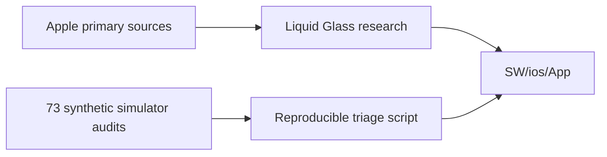

<!-- Purpose: map iOS UI research. Inputs: Apple docs and synthetic audits. Verification: local counts/source review; new Apple UI unverified. -->

| File | Purpose | Status |
|---|---|---|
| [2026-11-04-liquid-glass-research.md](2026-11-04-liquid-glass-research.md) | Sources, native design rules, API availability, icon decision and audit triage | 🟡 Sources/counts checked; new Apple UI **unverified** |
| [2026-11-04-liquid-glass-audit.py](2026-11-04-liquid-glass-audit.py) | Reproduce counts from exported audit JSONs without copying accessibility trees | ✅ Local synthetic inventory |

Start with the research note and the [iOS app map](../../SW/ios/App/README.md).
Inputs: Apple docs and synthetic first-run artifacts. Purpose: working design evidence;
not authoritative requirements. Trace: existing REQ-3–5/8/16–18/22–25/28–35/56/60.
