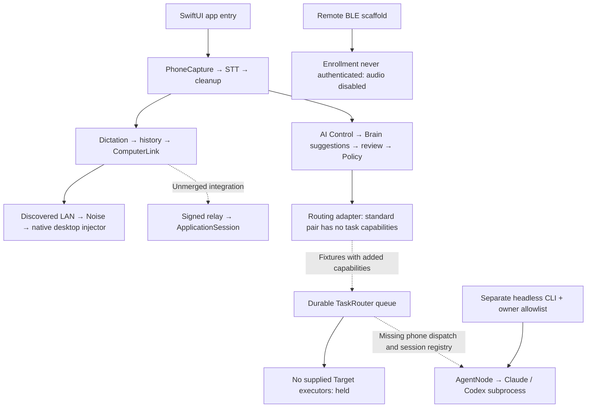

# Requirements audit — merged code and iPhone integration

**Purpose:** Separate implementation, app reachability, synthetic proof and owner acceptance for every requirement, Plan task and P0–P4 acceptance test.

**Inputs:** `AGENTS.md`; `SYS/requirements.md`; `SYS/system-design-v1.md` Plan; `SYS/product-definition-v0.2.md` §9; executable sources, schemas, tests and workflows throughout `SW/` and `SYS/`; contents of `HW/` and `FW/`; the separate iPhone integration worktree.

**Verification:** Source audit plus local checks recorded below. Physical iPhone, Windows application, GNOME, live provider, deployed relay, accessory and lab acceptance are **unverified**. No owner data or credentials were used.

**Conclusion:** There is substantial working protocol, relay, receiver, injection, phone-model and policy code. No product milestone is fully accepted. AI Control calls Brain and Policy, but standard pairing lacks task capabilities, so remote tool approval cannot even reach normal queue admission. A constructed durable router has no executors; a visible held task is proven only with an artificially capable registered device. Small LAN dictation has a real app-to-native-receiver code path; insertion in the owner's actual applications is unverified. The tray really calls pairing and receiver code. Its mode/capture display and toggle cannot work with the current phone implementation.

## Baseline and interpretation

| Item | Audit basis |
|---|---|
| Merged baseline, `M` | This worktree's `HEAD` and local `dev/integration` both equal `f6702e3dd6a167fad76ab1574c552f2a9b1d60f8` (`SW: desktop tray app and installers (#21)`). Initial tracked status was clean. No remote fetch or assumption about newer remote commits. |
| Unmerged input, `I:` | `/home/harrison/Documents/Projects/voiceremote/.claude/worktrees/codex-feat-ios-integration`, `HEAD` `6d8efa5` plus its existing modified/untracked source files, read on 2026-11-02 local time. `I:SW/...:line` means that absolute worktree plus the relative filename, **not merged code**. These are volatile working files, not an accepted commit. |
| Document authority | Requirements are themselves draft/unverified (`SYS/requirements.md:3`). Assess against their current text; newer Design wins the source differences already documented at `SYS/requirements.md:153`. Do not invent approval of targets or new requirements. |
| Status unit | A whole requirement or acceptance item. A working subcomponent does not close a compound requirement. The evidence column states which part exists and which part blocks completion. |
| Real test | Executes the implementation under assessment: e.g. generated codec round trips, production Worker in a local runtime, real TCP/Noise, actual filesystem persistence. Synthetic inputs alone do not make a deterministic codec test a fake. A fake microphone/model/injector/provider does **not** prove the corresponding physical/service boundary. |
| Reachability priority | An absent production caller/executor gets **U**, even when its package has many passing tests. Owner testing cannot repair missing wiring. A running library harness is not the SwiftUI app. |
| Scope exception | This note is the only deliverable. Folder README updates are intentionally excluded by the explicit user scope. No commit, push, PR or merge. |

| Mark | Exact classification |
|---|---|
| **D** | Done and proven by a real test, named in the row; limited to that requirement's scope. |
| **F** | Built, proven only with fakes at the required external boundary; app/native behavior remains **unverified**. Known implementation gaps are stated explicitly. |
| **U** | Built, not reachable from the real app or desktop path for the behavior in question; **unverified/incomplete**. |
| **M** | Missing, including a required portion of an otherwise partial implementation; **unverified/incomplete**. |
| **O** | Needs the owner: device, account, key, approved decision or measurement; **unverified**. Any prerequisite software gap is also identified. |

## Production entry-point traces

| Path | Source trace and actual stopping point |
|---|---|
| Phone startup and capture | `SW/ios/App/VoiceRemoteApp.swift:9` → runtime preparation at `:19` → `SW/ios/App/AppRuntime.swift:73` constructs `VoiceAppModel` with real `PhoneCapture`/remote source and engine factories. UI capture/mode/target controls are at `SW/ios/App/VoiceRemoteApp.swift:62`. `SW/ios/App/PhoneCapture.swift:41` starts AVAudioEngine and prefers HFP input when available. This is implementation, not evidence of a successful device build or recording. |
| Dictation | `SW/ios/Packages/AppModel/Sources/AppModel.swift:191` → `EngineRouter.transcribe` at `:241` → dictation commit at `:255` → `SW/ios/Packages/Core/Sources/DictationPipeline.swift:64` sanitizes, journals and calls the target → `SW/ios/App/ComputerLink.swift:222` sends Noise ciphertext on LAN. Desktop entry `SW/desktop/crates/app/src/main.rs:517` or tray `SW/desktop/crates/tray/src/backend.rs:359` enters the shared receiver → `SW/desktop/crates/app/src/desktop_receiver.rs:183` → `SW/desktop/crates/core/src/session.rs:211` → platform injector. The iPhone target instead calls `SW/ios/App/AppRuntime.swift:155` → keyboard queue → `SW/ios/KeyboardExt/KeyboardViewController.swift:112` → `UITextDocumentProxy.insertText`. |
| AI Control | Same transcription, then `SW/ios/Packages/AppModel/Sources/AppModel.swift:286` creates `SuggestionEngine`; `:318` reviews, `:350` approves through Policy, `:370` calls delivery. Runtime delivery at `SW/ios/App/AppRuntime.swift:91` calls `RegisteredRouting.enqueue`. **First stop:** standard desktop enrollments have receive_text only; `SW/ios/Packages/AppModel/Sources/RegisteredRouting.swift:22` rejects open/delegate capabilities before queue admission. **Second stop, if a capable device is injected:** `:35` creates an unavailable machine destination and `:41` calls `router.reconnect(targets: [])`. No real `Router.Target` is supplied. `prepare_send` and `cancel_task` are rejected at `:20`; target selection is the one locally executed tool (`AppModel.swift:355`). |
| Agent node | `SW/desktop/crates/app/src/main.rs:578` loads `--headless --agents-config` and calls the agent receiver at `:589`/`:614`. `SW/desktop/crates/agents/src/receiver.rs:68` admits commands and spawns work. `SW/desktop/crates/agents/src/process.rs:318` constructs the real Claude/Codex CLI call. This receiver exists; the phone does not supply a route/session/capability path to it. Native desktop sessions use `Session.deliver`, which deliberately only reserves commands (`SW/desktop/crates/core/src/session.rs:253`), not the agent executor. |
| Pairing from tray | `SW/desktop/crates/tray/src/main.rs:25` → `Backend.pair` → `SW/desktop/crates/tray/src/backend.rs:261`: room/invitation or LAN listener, rotating QR, Noise handshake, entered phrase, both confirmations, persisted settings, then receiver. Thus pairing is not a dead button. GUI/phone interoperability and timing are unverified. Relay selection disables the LAN listener (`:277`), rather than preferring LAN with relay fallback. |
| Tray display/toggle | `SW/desktop/crates/app/src/desktop_receiver.rs:169` waits for phone capture/mode reports. `:131` sends a desired-state `CaptureStateReport` for a toggle; no request ID distinguishes command from observation. Phone reader `SW/ios/App/ComputerLink.swift:155` handles only focus reports, and runtime state callbacks `SW/ios/App/AppRuntime.swift:102` update only BLE/keyboard/Live Activity. Consequently capture is unknown, toggle is refused or ignored, and mode is unknown. Tray flash is driven by receipt of dictation at `desktop_receiver.rs:174`, not an acknowledged announcement before insertion. |
| Cloud and accessory | Merged cloud clients are constructed (`SW/ios/App/AppRuntime.swift:83`, `:138`) but do not sign relay challenges (`SW/ios/Packages/Brain/Sources/ClaudeBrain.swift:69`, `SW/ios/Packages/Stt/Sources/CloudEngine.swift:34`). A stock secured relay refuses them. `RemoteBLELink.makeCapture` requires `authenticatedEnrollment` (`SW/ios/App/RemoteBLELink.swift:73`), initialized/reset false at `:47`/`:69` and never set true. Input edges only change a status label (`:242`), not mode/target/PTT. |

## Every requirement

The table contains exactly one row for each ID in `SYS/requirements.md`. Marks refer to **M**, with unmerged deltas explicitly labeled. Counts: **2 D · 16 F · 23 U · 9 M · 11 O**. These are evidence categories, not a percentage-complete score. All F/U/M/O outcomes remain **unverified** as requirement compliance.

| Requirement | Mark | Code/test evidence and remaining work |
|---|---|---|
| [REQ-1] Remote-independent fundamentals | **U** | Phone capture and approvals are constructed without a remote (`SW/ios/App/AppRuntime.swift:73`); execution stops at `SW/ios/Packages/AppModel/Sources/RegisteredRouting.swift:41`. `dictationNeverCallsBrainAndDestinationPrecedesAudio` uses spies (`SW/ios/Packages/AppModel/Tests/AppModelTests.swift:107`). Finish routing/execution before owner acceptance. |
| [REQ-2] iPhone/AirPods capture and visible stop | **O** | Real HFP/AVAudioEngine path at `SW/ios/App/PhoneCapture.swift:41`; visible state/stop at `SW/ios/App/VoiceRemoteApp.swift:72`/`:95`. Actual microphone routing, AirPods remaining on phone and stop latency need an iPhone/AirPods; no device run supplied. |
| [REQ-3] OFF/HOLD/CONTINUOUS | **F** | Trigger implementation `SW/ios/Packages/Core/Sources/AppState.swift:22`, host controls `SW/ios/Packages/AppModel/Sources/AppModel.swift:142`; tests `testHoldThresholdReleaseAndNoiseTaps` (`SW/ios/Packages/Core/Tests/LogicTests.swift:41`) and `pressReleaseCancellationAndForegroundAreFailClosed` use synthetic capture. Actual HOLD recording is unverified. |
| [REQ-4] Independent mode/target; mode everywhere | **U** | Phone mode preserves target (`SW/ios/Packages/AppModel/Sources/AppModel.swift:137`, `modeKeepsTargetAndStopClearsEveryCaptureState` at `Tests/AppModelTests.swift:116` in that package). Desktop expects `ModeState` (`SW/desktop/crates/app/src/desktop_receiver.rs:173`), but phone never publishes it. Remote controls/display have no authenticated operational rig. |
| [REQ-5] Distinct dictation and Brain→Policy→tools | **U** | Branches are real at `SW/ios/Packages/AppModel/Sources/AppModel.swift:254`; dictation's no-Brain spy test is `SW/ios/Packages/AppModel/Tests/AppModelTests.swift:107`. AI suggestions/review reach Policy; execution plugins are empty (`SW/ios/Packages/AppModel/Sources/RegisteredRouting.swift:41`). I does not fix agent execution. |
| [REQ-6] Listening while tasks execute | **U** | Independent capture producer exists (`SW/ios/Packages/AppModel/Sources/CaptureSegmenter.swift:31`), and queue storage is independent (`SW/ios/Packages/Router/Sources/TaskQueue.swift:100`). No phone-launched task executes; no real simultaneous listening/execution test. `continuousCaptureSplitsUtterancesWithoutWritingAudio` (`SW/ios/Packages/AppModel/Tests/RemoteContractTests.swift:74`) proves slicing only. |
| [REQ-7] Action Button/lock/cold start evaluation | **O** | Intent is implemented (`SW/ios/App/ListeningActivity.swift:46`) and cold startup helper tested (`SW/ios/Packages/AppModel/Tests/ReviewRegressionTests.swift:41`, `coldIntentAndViewShareExactlyOneRuntime`). No locked/unlocked physical-phone evaluation or measured limitations. |
| [REQ-8] Consistent 300 ms/double tap triggers | **U** | Phone trigger and exact threshold tests exist (`SW/ios/Packages/Core/Sources/AppState.swift:19`, `SW/ios/Packages/Core/Tests/LogicTests.swift:456`). Desktop CLI can request a toggle, not shared hold/double-tap behavior; BLE edges never invoke phone controls (`SW/ios/App/RemoteBLELink.swift:238`). No FW implementation. |
| [REQ-9] Swappable streaming STT candidates | **U** | Real adapters exist (`SW/ios/Packages/SttApple/Sources/AppleSpeechEngine.swift:11`, `WhisperKitEngine.swift:8` in the same folder); Argmax is compile-gated at `SW/ios/Packages/SttApple/Sources/ArgmaxEngine.swift:1` and never added by `SW/ios/App/AppRuntime.swift:134`. Stock relay cloud calls are unsigned. Fake engine tests do not prove live streaming by every candidate. |
| [REQ-10] Local default/cloud conditions/offline | **F** | Selector and offline silence at `SW/ios/Packages/Stt/Sources/EngineRouter.swift:20`; `testRouterDefaultsAndAllCloudTriggers` at `SW/ios/Packages/Stt/Tests/RouterTests.swift:7`. Host supplies heat and **Low Power Mode**, not measured battery level (`SW/ios/App/AppRuntime.swift:88`). A preferred local engine wins before thermal/max-accuracy conditions (`EngineRouter.swift:28`); clarify/fix this precedence. Cloud authentication is U in M, added in I. |
| [REQ-11] Vocabulary/meaning-preserving cleanup | **F** | App passes vocabulary through `EngineRouter` (`SW/ios/Packages/AppModel/Sources/AppModel.swift:241`); `FailSafeCleanup` allows only conservative edits (`SW/ios/Packages/Stt/Sources/CleanupPass.swift:64`). `testRouterCleansWholeUtteranceSoSplitNegationNeverBecomesSendInstruction` (`SW/ios/Packages/Stt/Tests/RouterTests.swift:45`) is synthetic. Acoustic bias/meaning on owner's corpus is unverified. |
| [REQ-12] Engine picker/same-audio A/B | **F** | Active Settings view reaches recorder (`SW/ios/App/Settings/SettingsView.swift:14`, `:30`) and runtime passes two engines to the same capture (`SW/ios/App/AppRuntime.swift:159`). `recorderExportMatchesAuthoritativeSchemaAndDeletesAudioOnlyAfterSuccess` (`SW/ios/Packages/AppModel/Tests/AppModelTests.swift:190`) uses fake engines/audio. Older `EnginePickerView.swift:8` is unused; its AppStorage keys are not the active settings contract. |
| [REQ-13] Full 200-phrase microphone benchmark | **M** | 200 reading prompts and recorder exist (`SW/bench/sets/phrases.json:2`, `SW/ios/Packages/AppModel/Sources/BenchmarkRecorder.swift:48`). Export result type only includes text/first/final timings (`SW/ios/Packages/Stt/Sources/ABRunner.swift:33`), no clipped-word annotation or battery measurement. Complete instrumentation, then owner recording on both sources. |
| [REQ-14] Beat Apple/25% term target | **O** | Real scorer gate at `SW/bench/benchkit/scoring.py:81`; `test_gate_boundaries` (`SW/bench/tests/test_bench.py:71`) proves arithmetic only. No owner run in `AI/SW/`, no selected engine evidence. Target remains TBC; synthetic winner is not a shipping choice. |
| [REQ-15] Stage and end-to-field latencies | **M** | Export only first/final text timing (`SW/ios/Packages/Stt/Sources/ABRunner.swift:33`); desktop has no positive insertion acknowledgement (`SW/desktop/crates/core/src/session.rs:277`). Cleanup timeout is a bound, not a measured latency. Add measurement/correlation, then named-device LAN/relay/field runs; all targets TBC. |
| [REQ-16] Focused-field insertion, never Send/Enter | **F** | Reachable injection at `SW/desktop/crates/core/src/session.rs:211`; forbidden controls and key plans at `SW/desktop/crates/inject-windows/src/policy.rs:19` and `SW/desktop/crates/inject-linux/src/lib.rs:110`. Real protocol/control rejection passes; GUI-field no-Send acceptance is unverified. X11 readback test is ignored locally (`SW/desktop/crates/inject-linux/tests/x11_display.rs`, `xvfb_inject_readback_restore_and_never_enter`); phone discards desktop failure statuses (`SW/ios/App/ComputerLink.swift:155`). |
| [REQ-17] Named target/Auto/recent activity ≤60 s | **F** | Named/Auto selector is called by app (`SW/ios/Packages/Core/Sources/TargetPicker.swift:49`). **Known mismatch:** it ranks/expires receipt timestamps, ignoring activity; `testReceiptOrderWinsOverPeerClockAndExpiresOnPhoneClock` explicitly tests that behavior (`SW/ios/Packages/Core/Tests/LogicTests.swift:434`). Desktop sends stable heartbeats every 30 s (`SW/desktop/crates/app/src/desktop_receiver.rs:70`), keeping idle devices eligible. Fix before claiming compliance. |
| [REQ-18] Private focus + announce before insertion | **M** | Content-free focus reports exist (`SW/desktop/crates/app/src/desktop_receiver.rs:148`). Phone label preparation exists (`SW/ios/App/ComputerLink.swift:208`), but `:216` admits no tray-ready acknowledgement. Tray flash occurs after text receipt (`SW/desktop/crates/app/src/desktop_receiver.rs:174`); no ordering proof that it displays before insertion. I leaves this gap. |
| [REQ-19] Required Windows/GNOME/X11 applications | **O** | Native factory selects actual OS injectors (`SW/desktop/crates/app/src/main.rs:191`). Tests use owned synthetic controls/protocol doubles; Windows smoke can skip inaccessible desktops (`SW/desktop/crates/inject-windows/examples/desktop-smoke.rs:37`). No Notepad/Chrome/Teams/GNOME acceptance record. Need owner desktops; code presence is not those results. |
| [REQ-20] Clipboard restoration/typing/portal/uinput | **F** | Windows clipboard/Unicode fallback is reachable (`SW/desktop/crates/inject-windows/src/policy.rs:147`); Linux candidates at `SW/desktop/crates/inject-linux/src/lib.rs:71` and native clipboard restoration at `SW/desktop/crates/inject-linux/src/native.rs:186`. Unit/protocol-double coverage passes; actual GNOME portal, `/dev/uinput`, layouts and clipboard managers are unverified. Wayland prefers EIS typing before paste; Design's paste-first wording is inconsistent with its later risk table. |
| [REQ-21] Optional rewrite/raw fallback/nonfocus overlay | **F** | Fail-safe cleanup is called (`SW/ios/Packages/Stt/Sources/EngineRouter.swift:108`); conservative failure fallback at `SW/ios/Packages/Stt/Sources/CleanupPass.swift:70`. Overlay show avoids `set_focus` (`SW/desktop/crates/tray/src/main.rs:157`). Actual overlay focus preservation is unverified; arbitrary LLM rewrite is not supplied. |
| [REQ-22] QR/token/Noise/no IP/LAN or relay | **U** | Phone QR flow is LAN-only (`SW/ios/App/ComputerLink.swift:93`); desktop and Pairing library support relay. Token expiry/one-use guard exists in `SW/desktop/crates/core/src/pairing.rs`; `SYS/tests/e2e/run.py:72` exercises clients, not the iOS UI. I adds relay redemption (`I:SW/ios/App/ComputerLink.swift:163`); still an exclusive configured transport, not automatic LAN preference/fallback. |
| [REQ-23] Both confirmations/phrase/role/capabilities | **O** | Real phrase and dual-confirmation boundary at `SW/ios/Packages/Pairing/Sources/PairingConnection.swift:34`/`:62`; phone records narrowed role/capabilities (`SW/ios/App/ComputerLink.swift:110`). `testInMemoryPairingRequiresBothConfirmationsThenExchangesText` (`SW/ios/Packages/Pairing/Tests/PairingTests.swift:52`) uses in-memory peers. Physical scan, phrase comparison and UI confirmation remain owner acceptance. |
| [REQ-24] Per-device keys/same Noise/no inbound/ciphertext | **M** | Actual Noise/session implementations and key stores exist (`SW/ios/Packages/Pairing/Sources/ApplicationSession.swift:48`, `SW/desktop/crates/core/src/session.rs:57`). Literal **no inbound ports** is not implemented: private-interface TCP listener binds a port (`SW/desktop/crates/app/src/desktop_transport.rs:99`). Relay-only mode avoids it; LAN direct requires it. Resolve Design wording: no public inbound/port-forwarding vs no listening socket at all. M phone also lacks relay application framing. |
| [REQ-25] Immediate revoke/key deletion/room drop/replay | **U** | LAN local revoke and key cleanup are wired (`SW/ios/App/ComputerLink.swift:184`), but room drop is a no-op at `:207`. Relay revocation/token replay are implemented and tested in core/Worker (`SW/relay/test/relay.test.ts:364`, `:382`). I adds signed room cleanup and remote revoke handling (`I:SW/ios/App/ComputerLink.swift:275`/`:305`); not merged/on-device proven. |
| [REQ-26] Relay/presence/APNs/offline task queue | **U** | Production Worker stores ciphertext and triggers APNs (`SW/relay/src/room.ts:225`); queue is bounded/expiring (`SW/relay/src/queue.ts:15`). Worker tests use real local runtime but fake APNs (`SW/relay/test/relay.test.ts:538`). Phone supplies no push registration/background notification handler; project only declares audio/BLE background modes (`SW/ios/project.yml:65`). A ciphertext frame queue cannot resume expired Noise task work while the phone sleeps. |
| [REQ-27] LAN/external pair under one minute | **O** | Local harness uses loopback endpoints and programmatically supplies QR/phrases (`SYS/tests/e2e/run.py:72`/`:89`). No home/external-network timing record. M external-network app pairing additionally needs the I transport work. |
| [REQ-28] Inferred tier 1 requires approval | **F** | Real app always submits inferred evidence (`SW/ios/Packages/AppModel/Sources/AppModel.swift:328`); gate returns a suggestion (`SW/ios/Packages/Policy/Sources/Policy/PolicyGate.swift:223`). `suggestionCannotExecuteUntilPhoneTapAndSensitivePolicyAuthentication` (`SW/ios/Packages/AppModel/Tests/AppModelTests.swift:141`) uses fake model, biometric and executor. Structural rejection is real; no working app-to-agent execution boundary yet. |
| [REQ-29] Trusted wake/PTT scope; phone sensitive approval | **U** | Sensitive approval is wired to LocalAuthentication (`SW/ios/Packages/Policy/Sources/Policy/Biometric.swift:35`). Wake/PTT scoped gate branch exists (`SW/ios/Packages/Policy/Sources/Policy/PolicyGate.swift:235`), but app only supplies `.inferred` (`SW/ios/Packages/AppModel/Sources/AppModel.swift:328`) and never installs grants. No trusted tier 2 ingress; Face ID/passcode device proof needed separately. |
| [REQ-30] Scoped expiring grants/no expansion | **U** | Grant dimension/expiry validation exists (`SW/ios/Packages/Policy/Sources/Policy/PolicyGate.swift:419`); `grantsRequireEveryScopeDimensionAndExpiry` (`SW/ios/Packages/Policy/Tests/PolicyTests/GateTests.swift:304`) exercises fixtures. No app caller of `installGrant`, grant settings/revocation flow, or trusted scope-selection path. |
| [REQ-31] Models cannot set authority fields | **D** | Closed decoder at `SW/ios/Packages/Brain/Sources/ProposalDecoder.swift:15`; trusted command construction at `SW/ios/Packages/Policy/Sources/Policy/PolicyGate.swift:304`. Real schema mutation check `test_model_authority_fields_are_unreachable` (`SYS/codegen/test_contract.py:79`), decoder rejection `testEveryAuthorityAndExtraFieldIsDroppedAndCounted` (`SW/ios/Packages/Brain/Tests/AuthorityAndRouterTests.swift:7`), and compiler boundary test `externalModuleCannotConstructOrDecodeAuthority` (`SW/ios/Packages/Policy/Tests/PolicyTests/AuthorityBoundaryTests.swift:5`). This proves structural authority separation, not model quality or owner identity recognition. |
| [REQ-32] Exact immutable approval preview | **F** | UI renders exact action/destination/consequences (`SW/ios/App/VoiceRemoteApp.swift:187`); hash binds retained context/tool (`SW/ios/Packages/Policy/Sources/Policy/PolicyGate.swift:215`). `editingInvalidatesApprovalIncludingABAAndDuringAuthentication` (`SW/ios/Packages/Policy/Tests/PolicyTests/GateTests.swift:265`) uses fake biometric. Real display/readability and phone authentication unverified. |
| [REQ-33] Untrusted speakers/playback/content no authority | **F** | Conservative wake evidence (`SW/ios/Packages/Brain/Sources/WakePhraseDetector.swift:10`) and gate downgrade (`SW/ios/Packages/Policy/Sources/Policy/PolicyGate.swift:73`). `ambiguousMeetingWakeDowngradesEvenWithGrant` (`SW/ios/Packages/Policy/Tests/PolicyTests/GateTests.swift:327`) injects flags; no curated meeting/TV/playback capture corpus. App does not establish trusted speaker/wake evidence. |
| [REQ-34] Idempotency/status/cancel/reconnect | **U** | Durable reserve-before-dispatch and authenticated status code exist (`SW/ios/Packages/Router/Sources/TaskQueue.swift:195`, `:258`, `:286`). `testReconnectRestartDispatchOnceAndCancelHeld` (`SW/ios/Packages/Router/Tests/RouterTests.swift:223`) uses fake targets. Phone has no executor, task status reader or task cancel UI (`SW/ios/App/VoiceRemoteApp.swift:177` only renders strings). After relaunch model `tasks` is not populated from router snapshot until a new delivery. |
| [REQ-35] Append-only phone log/encrypted relay copy | **M** | Real file journal/checkpoint construction at `SW/ios/App/AppRuntime.swift:66`; append/write-ahead chain at `SW/ios/Packages/Policy/Sources/Policy/Audit.swift:174`. `fileJournalReopensAndExcludesSecondWriter` (`SW/ios/Packages/Policy/Tests/PolicyTests/AuditTests.swift:78`) tests real disk with fake checkpoint. **No encrypted relay archive/replication caller, store or recovery path.** `recordsDueForArchival` (`Audit.swift:194`) only returns records. |
| [REQ-36] Brain proposes, phone owns execution | **U** | Real proposal decoder and app Policy review are wired (`SW/ios/Packages/AppModel/Sources/AppModel.swift:286`/`:318`). Phone execution stops at unavailable routing (`SW/ios/Packages/AppModel/Sources/RegisteredRouting.swift:41`); synthetic permits reaching an `ExecutionSpy` are not actual tools. |
| [REQ-37] Brain choices/hybrid fast path | **U** | Settings/router exist (`SW/ios/App/Settings/SettingsView.swift:36`, `SW/ios/Packages/Brain/Sources/BrainRouter.swift:42`). **Hybrid fast path is unreachable through current app:** `SuggestionEngine` labels requests only `.ambient`/`.multiStep` (`SW/ios/Packages/Brain/Sources/SuggestionEngine.swift:160`); `BrainRouter.swift:73` rejects those from simple routing. M cloud calls are unsigned; local Apple inference is device-unverified. |
| [REQ-38] Review/dismiss/edit/dedupe/rate/mute | **F** | Active UI actions at `SW/ios/App/VoiceRemoteApp.swift:156`; `SuggestionEngine` enforces rate/dedupe/revision rules (`SW/ios/Packages/Brain/Sources/SuggestionEngine.swift:123`). `testInferenceIsRateLimitedEvenWhenNoCardsAreProduced` (`SW/ios/Packages/Brain/Tests/StreamingRegressionTests.swift:129`) and app tests use fake brains. No actual model/UI acceptance run. |
| [REQ-39] 50 spoken-command correctness/latency/battery | **U** | 50 expected-command prompts exist (`SW/bench/sets/commands.json:2`); `BrainBenchmark.writeRun` (`SW/ios/Packages/Brain/Sources/BrainBenchmark.swift:15`) has no app caller, audio capture pipeline or battery input. `testSyntheticBenchmarkWritesRunFormatAndFailedEngineHasEmptyCalls` (`SW/ios/Packages/Brain/Tests/BenchmarkTests.swift:6`) proves export with a fake only. Need recorder wiring, then owner measurements. |
| [REQ-40] Linked task dependencies/cancel/revisions | **U** | Review-plan dependencies exist (`SW/ios/Packages/Brain/Sources/SuggestionEngine.swift:184`), but `tap` treats **review tap** as dependency approval (`:210`). App discards `TappedSuggestion.dependsOn` at `SW/ios/Packages/AppModel/Sources/AppModel.swift:330`; queued tasks have no dependency list (`SW/ios/Packages/Router/Sources/TaskQueue.swift:25`). App sends fresh IDs with `isComplete: true` (`AppModel.swift:294`), not incremental revisions. Actual dependency/cancel execution is missing. |
| [REQ-41] Claude/Codex/cloud agents + registry | **U** | Headless CLI reaches agent code (`SW/desktop/crates/app/src/main.rs:578`); real subprocess implementation at `SW/desktop/crates/agents/src/process.rs:318`. `named_sessions_route_to_right_fake_and_transcript_never_changes_argv` (`SW/desktop/crates/agents/tests/adapters.rs:342`) substitutes both CLIs/systemd (`:67`). Phone has no provider registry and empty executor list; cloud is explicitly `NotConfigured` (`SW/desktop/crates/agents/src/process.rs:96`). |
| [REQ-42] Explicit provider/host/fallback/visible route | **U** | Resolver honors hard constraints (`SW/ios/Packages/Router/Sources/Routing.swift:78`); `testReviewExplicitProviderAndHostNeverSwitch` (`SW/ios/Packages/Router/Tests/RouterTests.swift:180`). App fills only selected machine/project (`SW/ios/Packages/AppModel/Sources/RegisteredRouting.swift:23`), not configured provider/host/fallback options. No real route dispatch to show. |
| [REQ-43] Honest offline hold/redirect | **U** | `registeredDestinationQueuesWithRealRouterAndVisibleHold` (`SW/ios/Packages/AppModel/Tests/ReviewRegressionTests.swift:97`) uses real queue storage plus fake capture/model/biometric **and injected open_resource capability** at `:107`. Standard desktop pairing offers receive_text only (`SW/desktop/crates/tray/src/lib.rs:23`), so `SW/ios/Packages/AppModel/Sources/RegisteredRouting.swift:22` rejects before this hold path. I separately adds reachable held dictation; agent-task hold/resumption/cloud redirect remains unwired. |
| [REQ-44] Full session identity/no false continuity | **U** | Identity types contain all required dimensions (`SW/ios/Packages/Router/Sources/Routing.swift:5`, `SW/desktop/crates/agents/src/registry.rs:70`). Phone caller supplies no `providerSessions` (`SW/ios/Packages/AppModel/Sources/RegisteredRouting.swift:11`); explicit sessions fail at `:28`. Tests exercise identity equality/allowlists with fixtures, not real continued projects. |
| [REQ-45] Five-step routing priority | **U** | Deterministic resolver implemented at `SW/ios/Packages/Router/Sources/Routing.swift:104`; `testFiveStepPreferenceTable` (`SW/ios/Packages/Router/Tests/RouterTests.swift:96`) tests synthetic destinations. Real phone adapter supplies a singleton unavailable machine, no selected session/recent-project/default settings. |
| [REQ-46] Keyboard caret insertion/Messages/Mail/no Send | **O** | Actual proxy call at `SW/ios/KeyboardExt/KeyboardViewController.swift:112`; bridge producer at `SW/ios/App/AppRuntime.swift:155`. `testNoSendRejectsAllControlsAndNewlinesBeforeQueueAndAtDrain` (`SW/ios/Packages/KeyboardBridge/Tests/KeyboardBridgeTests.swift:124`) substitutes a text inserter. Need physical Messages/Mail caret tests; no automatic Send API exists here. |
| [REQ-47] App-group/Darwin/no keyboard mic/network | **F** | Extension only depends on KeyboardBridge and requests no open access (`SW/ios/project.yml:95`/`:119`); Darwin observer/read-only drain at `SW/ios/KeyboardExt/KeyboardViewController.swift:52`. Portable bridge tests prove queue/receipt behavior using fake inserters and Linux polling, not Apple app-group entitlement/Darwin delivery. Need Apple host test. |
| [REQ-48] Copy/share for rejecting fields | **O** | Actual Copy/Share controls at `SW/ios/App/VoiceRemoteApp.swift:144`/`:149`; fallback adapter in `SW/ios/Packages/KeyboardBridge/Sources/CommittedTextFallback.swift`. Supported fallback is built; field rejection and copy/share usability need owner iPhone acceptance. |
| [REQ-49] Physical microphone power cut/independent sources | **M** | No board/firmware sources (`HW/README.md:3`, `FW/README.md:3`). Phone only parses a peer's claimed mic-cut flag (`SW/ios/Packages/AppModel/Sources/RemoteContract.swift:19`); that is no electrical evidence. Hardware design plus owner power measurement required. |
| [REQ-50] Array/display/PTT/BLE Opus rig | **M** | Phone BLE/Opus scaffold exists but is disabled (`SW/ios/App/RemoteBLELink.swift:73`). `draftInfoAndSmallMTUAudioVectors` (`SW/ios/Packages/AppModel/Tests/RemoteContractTests.swift:27`) tests bytes only. No nRF5340 firmware, array, display or rig in `HW/`/`FW/`. |
| [REQ-51] Per-utterance quality selection/comparison | **U** | `SourceQuality.best` is a heuristic with injected SNR/clipping/proximity (`SW/ios/Packages/AppModel/Sources/RemoteContract.swift:128`); only test caller is `sourceScoringRejectsLostAndInvalidStreams` (`Tests/RemoteContractTests.swift:67` in that package). Runtime uses a manual remote boolean (`SW/ios/App/AppRuntime.swift:77`), no multi-source scorer/measurement path. |
| [REQ-52] Remote target cycle/recording/destination | **U** | Presentation encoding exists (`SW/ios/Packages/AppModel/Sources/RemoteContract.swift:192`); incoming button edges only update text status (`SW/ios/App/RemoteBLELink.swift:242`), never target selection. No FW/display to receive it and no authenticated enrollment path. |
| [REQ-53] Remote earns inclusion by whisper/comfort | **O** | Comparison/inclusion criterion remains unmeasured; no rig exists (`HW/README.md:3`). `SourceQuality` coefficients are explicitly TBC (`SW/ios/Packages/AppModel/Sources/RemoteContract.swift:137`). Owner chooses hardware, compares best off-the-shelf mic and evaluates comfort. |
| [REQ-54] Approved HIL design before code | **O** | Written review exists but explicitly awaits owner approval (`SYS/hil-safety-review.md:3`/`:6`). No HIL adapter code found; current Policy denies hardware (`SW/ios/Packages/Policy/Sources/Policy/PolicyGate.swift:177`). Written draft is not approved completion. |
| [REQ-55] Allowlisted HIL + independent physical safety | **M** | Only proposed architecture (`SYS/hil-safety-review.md:48`/`:63`); runtime hardware remains denied (`SW/ios/Packages/Policy/Sources/Policy/PolicyGate.swift:177`). No deployed adapter/interlocks/E-stop evidence. Requires approved design and owner lab verification before implementation/use. |
| [REQ-56] No default audio/7-day text/cloud indicator | **F** | M normal capture has no audio writes (`SW/ios/App/PhoneCapture.swift:7`); history purges at seven days (`SW/ios/Packages/AppModel/Sources/AppHistoryStore.swift:21`); UI cloud label (`SW/ios/App/VoiceRemoteApp.swift:76`). Recorder is an explicit exception (`BenchmarkRecorder.swift:19` in AppModel Sources). Tests are synthetic; suspended-phone purge timing unverified. **I adds persistent offline audio and indefinite held/failed/unconfirmed text retention** (`I:SW/ios/Packages/AppModel/Sources/RemoteOfflineSync.swift:100`, `I:SW/ios/Packages/AppModel/Sources/AppHistoryStore.swift:64`); resolve policy before promotion. |
| [REQ-57] Minimal focus/presence/no field-content capture | **F** | AT-SPI queries states/roles without names/text (`SW/desktop/crates/inject-linux/src/focus.rs:1`/`:62`); Windows metadata fail-closed guard (`SW/desktop/crates/inject-windows/src/policy.rs:73`). Receiver test `encrypted_session_reports_focus_changes_without_contents_and_delivers_fragmented_literal_text` (`SW/desktop/crates/app/src/desktop_receiver.rs:348`) uses fake sampler/injector. Native password-field/app behavior remains unverified. |
| [REQ-58] Consent/privacy/retention/encryption policy | **O** | Microphone/cloud explanations and consent toggles exist (`SW/ios/App/VoiceRemoteApp.swift:56`, `SW/ios/App/Settings/SettingsView.swift:19`). These do not establish meeting participant consent or approved provider/retention policy. Owner review required; I privacy changes need explicit resolution. |
| [REQ-59] Generated Swift/Rust/TS + round trips | **D** | `make -C SYS check` passed: generator freshness, 11 invariant tests, Rust 4, Swift 6, TS/relay 362. Real generated types are round-tripped (`SW/desktop/crates/protocol/tests/round_trip.rs:15`, `SW/ios/Packages/Protocol/Tests/VoiceRemoteProtocolTests/RoundTripTests.swift:55`, `SW/relay/test/protocol.test.ts:24`). This does not imply every planned message/ack exists. |
| [REQ-60] Five extension interfaces | **F** | `CaptureSource`/`SttEngine` (`SW/ios/Packages/Stt/Sources/SttEngine.swift:59`), `LlmBrain` (`SW/ios/Packages/Brain/Sources/LlmBrain.swift`), `Target`/`AgentAdapter` (`SW/ios/Packages/Router/Sources/TaskQueue.swift:16`) exist. Fake implementations exercise seams; no real phone `Router.Target` adapter. Rust core also exposes marker traits, which alone are not plugin integration. |
| [REQ-61] Account-bearing records/tenant rooms | **M** | Generated wire messages require account IDs and room namespace is `[account,room]` (`SW/relay/src/worker.ts:37`); real tenant/replay rejection tests pass. Local history entries/delivery records are not account-scoped; app uses shared `history.json`, `tasks.json`, `audit.jsonl` (`SW/ios/App/AppRuntime.swift:65`). Only peer filename is account-scoped (`:61`). Changing account/restarting can retain another account's history/tasks; global static key also persists (`SW/ios/App/ComputerLink.swift:102`). Wire tenancy is built; end-to-end account isolation is incomplete. |

## Plan tasks 1–15

Source of the task-specific completion checks: `SYS/system-design-v1.md:217`. A merged PR with a task number is not a passed Done-when gate.

| Task | Mark | Actual state against its Done-when check |
|---|---|---|
| 1 Protocol/codegen | **D** | All three generated runtimes round-trip; `make -C SYS check` passed. Test entry points: `SW/desktop/crates/protocol/tests/round_trip.rs:15`, `SW/ios/Packages/Protocol/Tests/VoiceRemoteProtocolTests/RoundTripTests.swift:55`, `SW/relay/test/protocol.test.ts:24`. |
| 2 Relay/presence/APNs | **F** | Actual local Worker exchanges encrypted frames (`SW/relay/test/relay.test.ts:332`). APNs test is synthetic (`:538`); no deployed two-network run. Cloud proxies are separately fake-upstream tested (`SW/relay/test/services.test.ts:139`). |
| 3 Desktop pairing/LAN/relay | **U** | CLI/tray/Pairing implementations exist (`SW/desktop/crates/tray/src/backend.rs:261`); merged phone only discovers LAN (`SW/ios/App/ComputerLink.swift:99`). Revocation has genuine protocol tests, but <1-minute actual QR pair and external-network app path not proven. I supplies some missing phone transport. |
| 4 Windows insertion/focus | **O** | Native implementation is selected by production entry (`SW/desktop/crates/app/src/main.rs:201`). Smoke only uses its own edit control and can skip (`SW/desktop/crates/inject-windows/examples/desktop-smoke.rs:37`). Notepad/Chrome/Teams and never-Enter acceptance need owner Windows. |
| 5 Linux insertion | **O** | Native portal/EIS/uinput/XTest paths exist (`SW/desktop/crates/inject-linux/src/lib.rs:71`). GNOME Wayland/X11 manual matrix unverified; X11 display test ignored locally. Protocol doubles are not the compositor. |
| 6 iPhone capture/pair/devices/modes/history | **U** | Real screens/capture/keyboard and LAN dictation wiring exist (`SW/ios/App/VoiceRemoteApp.swift:29`, `SW/ios/App/ComputerLink.swift:222`). Cloud/relay/status integration incomplete in M; target/tray state gap survives I. AirPods-on-phone while typing-to-PC needs owner run. |
| 7 STT engines/cleanup | **U** | Apple/WhisperKit adapters and cleanup are wired; Argmax never registered (`SW/ios/App/AppRuntime.swift:134`, `SW/ios/Packages/SttApple/Sources/ArgmaxEngine.swift:1`). Live engine streaming into app unverified; cloud signing missing in M. |
| 8 Benchmark kit/engine choice | **M** | Scorer/200 prompts/recorder exist (`SW/bench/benchkit/cli.py:17`, `SW/ios/Packages/AppModel/Sources/BenchmarkRecorder.swift:48`), but battery/clipping/stage timings missing from recorder. No owner report selecting a winner against Apple. |
| 9 iOS keyboard | **O** | Production bridge→proxy insertion exists (`SW/ios/KeyboardExt/KeyboardViewController.swift:112`); portable queue tests pass with fake inserter. Messages/Mail and no-send device acceptance remain unverified. |
| 10 Brain/fast path/cards/wake | **U** | Suggestions and review UI are wired (`SW/ios/App/VoiceRemoteApp.swift:156`); hybrid simple route and trusted wake ingress are not (`SW/ios/Packages/Brain/Sources/SuggestionEngine.swift:160`, `SW/ios/Packages/AppModel/Sources/AppModel.swift:328`). No live model evidence. |
| 11 Policy/grants/Face ID/audit | **U** | Policy and real LA adapter are called (`SW/ios/App/AppRuntime.swift:68`), but grants have no host caller, audit relay copy/recovery UI absent. Tier 3 gate fake tests pass (`SW/ios/Packages/Policy/Tests/PolicyTests/GateTests.swift:228`); actual Face ID/passcode needs owner device. |
| 12 Agent adapters/session | **U** | Headless node implemented (`SW/desktop/crates/app/src/main.rs:578`), tested with fake CLIs (`SW/desktop/crates/agents/tests/adapters.rs:67`). Phone cannot supply registered provider sessions/capabilities; cloud remains `NotConfigured` (`SW/desktop/crates/agents/src/process.rs:96`). “Arm-design session” app journey is not built end to end. |
| 13 Routing/offline/fallback | **U** | Resolver/durable holds implemented (`SW/ios/Packages/Router/Sources/TaskQueue.swift:195`), app only calls with zero targets (`SW/ios/Packages/AppModel/Sources/RegisteredRouting.swift:41`). No actual recovery, cloud executor or configured fallback path. Holds are honest, not successful completion. |
| 14 Remote rig/BLE/scoring | **M** | Phone-side draft decoder/scoring only (`SW/ios/Packages/AppModel/Sources/RemoteContract.swift:128`); capture disabled (`SW/ios/App/RemoteBLELink.swift:73`); `HW/README.md:3` and `FW/README.md:3` are the entire authoritative hardware/firmware content. No comparative run. |
| 15 HIL review | **O** | Written review present (`SYS/hil-safety-review.md:3`) and hardware denied (`SW/ios/Packages/Policy/Sources/Policy/PolicyGate.swift:177`). Approval/revision/date TBD; task is not complete until owner approves. |

## Product §9 acceptance tests, individually

Sources: P0 `SYS/product-definition-v0.2.md:253`; P1 `:259`; P2 `:265`; P3 `:271`; P4 `:275`. Splitting compound sentences below prevents partial coverage from hiding failed clauses.

| Acceptance item | Mark | Evidence / missing proof |
|---|---|---|
| P0.1 Scanned pairing on home LAN | **O** | QR scanner/confirmation is wired (`SW/ios/App/QRScanner.swift`, `SW/ios/App/ComputerLink.swift:93`); no physical scan/run. Harness injects QR on stdin (`SYS/tests/e2e/run.py:88`). |
| P0.2 Scanned pairing on external network | **U** | M phone always discovers Bonjour (`SW/ios/App/ComputerLink.swift:99`). I adds signed relay path (`I:SW/ios/App/ComputerLink.swift:163`); live network acceptance unverified. |
| P0.3 Revoked pair immediately fails | **F** | Real receiver checks enrollment during each session (`SW/desktop/crates/app/src/desktop_receiver.rs:119`); protocol replay/revoke tests exist (`SW/relay/test/relay.test.ts:382`). Actual phone/tray revoke across both paths not accepted; M phone room drop is empty (`SW/ios/App/ComputerLink.swift:207`). |
| P0.4 No manual IP entry | **F** | M phone discovers room via mDNS (`SW/ios/App/ComputerLink.swift:229`), tray binds private interface automatically (`SW/desktop/crates/app/src/desktop_transport.rs:92`). Need actual phone/desktop discovery test; loopback harness supplies a port explicitly. |
| P0.5 Headset stays on iPhone | **O** | Real HFP preference (`SW/ios/App/PhoneCapture.swift:45`); no AirPods-on-phone while PC receives text observation. |
| P0.6 Windows text reaches correct focused field | **O** | Production native injector is called (`SW/desktop/crates/app/src/main.rs:145`); no owner Windows application readback. |
| P0.7 Insertion never sends a message | **F** | Actual schema/keyplan/bridge reject line controls (`SYS/codegen/test_contract.py:82`, `SW/ios/Packages/KeyboardBridge/Tests/KeyboardBridgeTests.swift:124`); fake/native-event tests are not Messages/Teams/terminal acceptance. |
| P0.8 Clear on-screen destination | **F** | Phone renders destination (`SW/ios/App/VoiceRemoteApp.swift:69`); target prepared before audio in fake test (`SW/ios/Packages/AppModel/Tests/AppModelTests.swift:107`). Auto recency and tray-before-insert are defective, remote unavailable. |
| P0.9 Action Button limitations from locked/unlocked device | **O** | Intent source exists (`SW/ios/App/ListeningActivity.swift:46`); no device trace/limitations record. Unit test of runtime bootstrap is not cold-launch evaluation. |
| P1.1 Meeting/TV corpus never dispatches without authorization | **M** | No curated corpus/run; tests inject ambiguity flags (`SW/ios/Packages/Policy/Tests/PolicyTests/GateTests.swift:327`). No executor makes non-dispatch vacuous; need corpus through a connected command path. |
| P1.2 Unaddressed proposal never autoexecutes | **F** | App always creates inferred activation (`SW/ios/Packages/AppModel/Sources/AppModel.swift:328`); synthetic approval test at `Tests/AppModelTests.swift:141` in that package. Actual connected executor not proven. |
| P1.3 Wake word executes only allowlisted actions | **U** | Scoped gate exists (`SW/ios/Packages/Policy/Sources/Policy/PolicyGate.swift:235`); trusted wake/grant host path absent. Conservative text detector does not create authority (`SW/ios/Packages/Brain/Sources/WakePhraseDetector.swift:5`). |
| P1.4 Multiple commands independently tracked | **U** | Queue supports individual tasks (`SW/ios/Packages/Router/Sources/TaskQueue.swift:25`), but app drops dependency metadata and has no task cancel/status integration (`SW/ios/App/VoiceRemoteApp.swift:177`). |
| P1.5 At-most-once logical dispatch on reconnect | **F** | Real durable queue reserve-before-send (`SW/ios/Packages/Router/Sources/TaskQueue.swift:240`); fake-target restart test (`SW/ios/Packages/Router/Tests/RouterTests.swift:223`). Agent durable replay tested against fake tools (`SW/desktop/crates/agents/tests/adapters.rs:554`); no complete app journey. |
| P1.6 Every high-risk candidate waits for correct approval | **F** | Risk floor/immutable challenge/LA adapter wired (`SW/ios/Packages/Policy/Sources/Policy/PolicyGate.swift:195`/`:258`). `tierThreeRejectsStaleMismatchedAndRemoteApprovals` (`SW/ios/Packages/Policy/Tests/PolicyTests/GateTests.swift:228`) uses fake biometric. Owner phone test pending. |
| P2.1 Named project continues in place | **U** | Node pins provider/project/session (`SW/desktop/crates/agents/src/registry.rs:70`); phone hardcodes project `default` and supplies no provider session registry (`SW/ios/Packages/AppModel/Sources/AppModel.swift:326`, `RegisteredRouting.swift:11` in the same Sources folder). Fake CLI session test does not prove provider continuation. |
| P2.2 Offline Windows request visibly held/fallback | **U** | Durable hold test injects a capability absent from normal desktop enrollment (`SW/ios/Packages/AppModel/Tests/ReviewRegressionTests.swift:107`, `SW/desktop/crates/tray/src/lib.rs:23`); real app delivery fails before queue admission (`SW/ios/Packages/AppModel/Sources/RegisteredRouting.swift:22`). I adds held **dictation**, a separate behavior; no agent-task resume/fallback. |
| P2.3 Generic cloud-capable task uses configured fallback | **U** | Resolver fallback code exists (`SW/ios/Packages/Router/Sources/Routing.swift:120`), host never configures it and cloud adapter is `NotConfigured` (`SW/desktop/crates/agents/src/process.rs:96`). |
| P2.4 Windows UI action only awake/authorized host | **M** | Text injection is not a computer-use executor. Generic desktop `AuthorizedCommand` only reserves (`SW/desktop/crates/core/src/session.rs:253`); CLI agent execution refuses Windows (`SW/desktop/crates/agents/src/process.rs:259`). No awake/authorized UI-action implementation or acceptance. |
| P2.5 Tasks/outcomes traceable | **U** | Agent emits authenticated statuses (`SW/desktop/crates/agents/src/receiver.rs:75`/`:89`); phone reader only handles focus (`SW/ios/App/ComputerLink.swift:155`), I handles focus/revoke only (`I:SW/ios/App/ComputerLink.swift:234`). No app-to-node correlation/result path. |
| P3.1 Whispering significantly beats best off-the-shelf mic | **O** | No rig/run; source-score coefficients explicitly TBC (`SW/ios/Packages/AppModel/Sources/RemoteContract.swift:137`). Owner microphone/whisper corpus and definition of significant improvement needed. |
| P3.2 Comfortable realistic use | **O** | No physical prototype (`HW/README.md:3`). Owner wear/stand/near-mouth comfort evaluation required. |
| P4.1 Scoped gateway/safety design before actuation | **O** | Proposed USB/CAN/instrument boundaries and independent safety review exist (`SYS/hil-safety-review.md:48`/`:63`); unapproved at `:3`. Ethernet/serial/CAN gateway implementation is absent. |
| P4.2 No direct general-purpose LLM control of uncontrolled hardware | **F** | Current Policy categorically denies hardware (`SW/ios/Packages/Policy/Sources/Policy/PolicyGate.swift:177`), tested by `hardwareAndDictationNeverRun` (`SW/ios/Packages/Policy/Tests/PolicyTests/GateTests.swift:336`). No connected lab rig/interlock test; present denial is not a commissioned physical safety system. |

## Unmerged iPhone integration: credit and limits

These changes are **I only**. Their presence does not upgrade merged marks.

| Area | Additional implementation inspected | Still open |
|---|---|---|
| Relay pairing/resume | `I:SW/ios/App/ComputerLink.swift:104` creates/persists signing identity; `:163` redeems invitation; `:225` installs `ApplicationSession`; `:254` resumes pinned enrollment; `:305` performs signed room cleanup. | No measured actual iPhone/tray pairing. Relay setting chooses one transport; no automatic LAN preference or live path migration. Secured relay provisioning workflow must be reconciled with tray creation. |
| Cloud services | `I:SW/ios/Packages/Pairing/Sources/RelayProxy.swift:60` signs final HTTP body or canonical query; `I:SW/ios/Packages/Brain/Sources/RelayBrainTransport.swift:14` wraps final Messages request; `I:SW/ios/App/AppRuntime.swift:140` installs authorized speech sockets. | Live vendor compatibility/cost/latency unverified. Cloud model/version must match deployment. No cloud **agent task** executor; a cloud proposal client is a different component. |
| Dictation hold/outcome | `I:SW/ios/Packages/AppModel/Sources/HeldDictation.swift:36` pins target/reachability/connection epoch; `:98` persists unconfirmed before I/O; `I:SW/ios/App/ComputerLink.swift:346` always reports desktop insertion unconfirmed. | No positive ack or failure-status processing. Phone keyboard enqueue is labeled delivered before caret insertion is acknowledged. Sending held text reuses its segment; receiver dedupe means an uncertain old attempt cannot be turned into an acknowledged success by resending. UI must not imply otherwise. |
| Reconnection/revocation | `I:SW/ios/App/ComputerLink.swift:127` retries with backoff; `:154` reconnects at launch; `:234` handles focus/revoke. | Still ignores `TaskStatus` and desktop capture-toggle requests, sends no mode/capture publications. No task executor/session inventory integration. |
| Offline remote recordings | `I:SW/ios/Packages/AppModel/Sources/RemoteOfflineSync.swift:142` implements resumable fetch/transcribe/history/delete ordering; `I:SW/ios/App/AppRuntime.swift:157` supplies STT; fake sync/held tests exist (`I:SW/ios/Packages/AppModel/Tests/OfflineSyncTests.swift:65`, `HeldDictationTests.swift:7` in the same Tests folder). | Hardware/enrollment still unavailable. `RemoteOfflineSync.swift:100` persists partial audio, and held-text retention exception is indefinite (`I:SW/ios/Packages/AppModel/Sources/AppHistoryStore.swift:64`). This changes REQ-56 behavior; cannot call it compliant without owner policy resolution. No raw owner audio was read or created during this audit. |

## Open contracts, defects and stale documentation

| Gap | Evidence and consequence | Closure type |
|---|---|---|
| Short-code lookup | Tray shows eight hex characters derived from QR SHA-256 (`SW/desktop/crates/tray/src/model.rs:83`), never registers a resolvable code. M phone parses full QR JSON (`SW/ios/App/ComputerLink.swift:96`); I accepts JSON/base64 only (`I:SW/ios/Packages/Pairing/Sources/PairingInvitation.swift:60`). Worker route allowlist has no lookup (`SW/relay/src/worker.ts:21`). The displayed short code cannot pair. | Codex: bounded expiring one-use lookup/discovery contract with abuse protection, or remove/rename the misleading code UI pending approved contract. No short-code guessing. |
| Dictation acknowledgement | `SW/desktop/crates/core/src/session.rs:277` returns silently on success; failures overload command `TaskStatus.command_id` with segment ID. Both phone readers discard those statuses (`SW/ios/App/ComputerLink.swift:155`, `I:SW/ios/App/ComputerLink.swift:234`). Socket send is not field insertion. Native paste paths also correctly distinguish unconfirmed effects. | Codex: explicit segment-scoped accepted/unavailable/unconfirmed outcome contract; positive success only where native evidence supports it; durable dedupe/reconciliation and UI states. Include keyboard enqueue vs actual caret distinction. |
| Phone-side toggle and mode state | Capture observation is reused as a desired-state request without request/expiry semantics (`SW/desktop/crates/app/src/desktop_receiver.rs:129`). Phone neither handles that message nor publishes capture/mode (`SW/ios/App/AppRuntime.swift:102`). | Codex: authenticated scoped request vs state semantics, request correlation/expiry/replay prevention, host event handling and state publication. Capture control cannot mint AI execution authority. |
| Auto activity/window | Selector ignores `last_activity_at`, timestamps every report arrival (`SW/ios/Packages/Core/Sources/TargetPicker.swift:38`) and refreshes eligibility on stable desktop heartbeats (`SW/desktop/crates/app/src/desktop_receiver.rs:70`). Existing test deliberately chooses activity=0 over a different recent peer (`SW/ios/Packages/Core/Tests/LogicTests.swift:434`). | Codex: monotonic activity-age/revision contract robust to peer clock skew, delayed reports, heartbeat refresh and disconnect; test two devices and >60 s idleness. |
| Auto announcement before insertion | Phone only yields a task after setting a label (`SW/ios/App/ComputerLink.swift:208`); active Home UI reads model destination, which is set after preparation returns (`SW/ios/Packages/AppModel/Sources/AppModel.swift:200`). Tray updates flash on incoming dictation then polls UI every 150 ms (`SW/desktop/crates/app/src/desktop_receiver.rs:174`, `SW/desktop/crates/tray/src/main.rs:133`). No acknowledgement/barrier. | Codex: prepare-target/display-ready protocol and observable ordering; reject or visibly hold when presentation fails. A yield or a packet write is not a display acknowledgement. |
| Fragmentation/application validation bypass | M phone sends raw `NoiseSession` output instead of `ApplicationSession` (`SW/ios/App/ComputerLink.swift:225`), so legal maximum UTF-8 dictation can exceed receiver's 11,000-byte packet bound (`SW/desktop/crates/core/src/session.rs:111`). M reader also lacks shared account/revoke/session validation. I switches to the common wrapper (`I:SW/ios/App/ComputerLink.swift:232`/`:353`). | Codex: reconcile/promote I application-session boundary; prove maximum legal payload against production receiver via the actual app connection seam. |
| LAN/relay selection and no-inbound wording | Tray and I select LAN **or** relay exclusively (`SW/desktop/crates/tray/src/backend.rs:277`, `I:SW/ios/App/ComputerLink.swift:261`). LAN binds an inbound private TCP socket (`SW/desktop/crates/app/src/desktop_transport.rs:99`). | Codex implements preferred route/fallback; owner resolves literal no-inbound vs no-public-inbound contract. Fresh handshakes/path switching must preserve replay safety. |
| Secure relay provisioning from tray | Tray calls `client.create(None)` (`SW/desktop/crates/tray/src/backend.rs:268`); configured Worker requires bearer when provision secret exists (`SW/relay/src/worker.ts:33`). CLI has explicit provisioner flow (`SW/desktop/crates/app/src/main.rs:372`), tray does not. Enabling cloud requires provisioned rooms (`SW/relay/src/services.ts:23`, `SW/relay/src/room.ts:74`). | Codex: provisioned desktop enrollment path which does not place the provisioner secret on phones or in UI logs. Owner supplies deployment/provisioning credentials later. |
| Agent enrollment/capabilities/project identity | Desktop pairing advertises only receive_text (`SW/desktop/crates/app/src/main.rs:227`, `SW/desktop/crates/tray/src/lib.rs:10`); tray agent role clears it, adds no execution capability (`backend.rs:31`). Phone advertises capture with **zero** capabilities (`SW/ios/App/ComputerLink.swift:112`); AgentNode rejects such a caller (`SW/desktop/crates/agents/src/lib.rs:132`). App review hardcodes project `default` (`SW/ios/Packages/AppModel/Sources/AppModel.swift:326`), which Policy checks (`SW/ios/Packages/Policy/Sources/Policy/PolicyGate.swift:205`). Even adding a socket executor alone would fail this journey. | Codex: trusted enrollment roles/capabilities and authenticated session/project inventory; never infer capabilities from model output or a role label. |
| Routing, status/cancel, restored tasks | App passes no live plugins (`SW/ios/Packages/AppModel/Sources/RegisteredRouting.swift:41`), drops statuses, and renders task strings without cancel (`SW/ios/App/VoiceRemoteApp.swift:177`). `prepare_send`/`cancel_task` lack host executors; default routing never uses configured session/provider order. Router reload validates permits against a new live gate, so queued tasks need reapproval (`SW/ios/Packages/Router/Sources/TaskQueue.swift:113`), but host supplies no reapproval/resume UI. | Codex: real target adapters, authenticated results, cancellation, task restoration/reapproval and explicit unsupported-tool UI. Persist-before-send must survive crashes without silent resend. |
| Wake/PTT and hybrid fast path | App labels all action evidence inferred (`SW/ios/Packages/AppModel/Sources/AppModel.swift:328`); no grant installation. Every Brain request is ambient/multistep (`SW/ios/Packages/Brain/Sources/SuggestionEngine.swift:160`); hybrid simple branch unreachable. | Codex: trusted activation/context/grants workflow and simple command request path; owner later confirms wake/default scope choices. Do not promote a text wake match to authenticated actor identity. |
| Linked tasks and corrections | `SuggestionEngine.tap` marks a card approved before phone authentication (`SW/ios/Packages/Brain/Sources/SuggestionEngine.swift:210`); app does not carry `dependsOn` to Policy/Router. Fixed-time/silence slices get fresh IDs and `isComplete: true` (`SW/ios/Packages/AppModel/Sources/AppModel.swift:294`). A denied first review need not prevent reviewing the second. | Codex: execution dependencies based on actual authorized predecessor outcomes; retained transcript revisions/completeness and independent cancellation across queue/executor. Tests must cover denied/edited/cancelled predecessor and correction spanning slices. |
| Audit encrypted relay copy/recovery | Append-only local log exists, but archival selector is unused (`SW/ios/Packages/Policy/Sources/Policy/Audit.swift:194`); `AuditLog.recover` (`SW/ios/Packages/Policy/Sources/Policy/AuditRecovery.swift:17`) has no app caller. Startup storage failure only shows unavailable UI (`SW/ios/App/VoiceRemoteApp.swift:20`). `AuditEntry` schema is not a replica/archive service. | Codex: encrypted archival/replication and authenticated recovery UI with durable checkpoint binding and no permission while recovery uncertain. |
| APNs and sleeping-phone continuation | Backend wake exists (`SW/relay/src/apns.ts:40`); phone has no APNs token registration/delegate, push entitlement or remote-notification mode (`SW/ios/project.yml:65`). Relay queues old session ciphertext, which transport generation checks reject after reconnect (`SW/ios/Packages/Pairing/Sources/RelayRecords.swift:4`). | Codex: push registration and authenticated wake/reconcile; durable task semantics rather than replaying old Noise packets as work. APNs delivery/locked-phone behavior needs owner account/device after code. |
| Benchmark incompleteness | STT export lacks clipping/battery/cleanup/delivery/field metrics (`SW/ios/Packages/Stt/Sources/ABRunner.swift:33`); Brain exporter takes already-written prompt text and has no host caller (`SW/ios/Packages/Brain/Sources/BrainBenchmark.swift:15`). No named-device run stored; `AI/` initially contained only its README. | Codex: measurement recorder/export/cohort tooling and safe report artifacts. Owner: curated recordings, live devices, heat/battery results, target approval. Do not claim benchmark gates from fixtures. |
| Account/privacy boundary | History/tasks/audit and key names share storage across the account setting (`SW/ios/App/AppRuntime.swift:49`/`:65`, `SW/ios/App/SecureStore.swift:40`). I retains some text indefinitely and persists audio (`I:SW/ios/Packages/AppModel/Sources/AppHistoryStore.swift:64`, `RemoteOfflineSync.swift:100` in that Sources folder). | Codex: account-scoped storage and explicit migration/cleanup, retention tests including dormant/suspended/restarted apps. Owner: approve recording/retention/cloud policy. |
| Resource limits outside tests | Queue and audit histories can grow without compaction (`SW/ios/Packages/Router/Sources/TaskQueue.swift:179`, `SW/ios/Packages/Policy/Sources/Policy/Audit.swift:186`); durable desktop segment receipts are retained (`SW/desktop/crates/core/src/session.rs:227`). Claude transport only checks body cap **after** complete download (`SW/ios/Packages/Brain/Sources/ClaudeBrain.swift:26`). | Codex: bounded streaming reads and reviewed archival/retention that preserves dedupe/replay guarantees. These are implementation risks, not evidence of a current data leak. |
| Release scripts: partly built, docs stale | iOS guard/sign/upload exists (`.github/workflows/ios.yml:29`/`:118`); relay version/deploy/main gate exists (`.github/workflows/relay.yml:37`/`:69`); desktop Cargo/bundle/tag check and draft installers exist (`.github/workflows/desktop.yml:105`/`:167`). AGENTS still says release scripts TBD (`AGENTS.md:63`). No FW/HW release workflows/declared component versions. iOS/desktop release paths do not have relay's explicit accepted-main ancestry guard. | Codex: test release guards and component acceptance prerequisites; add FW/HW guards with their first real artifacts. Owner supplies signing/cloud credentials. Presence of YAML is not a successful release. |
| Dependency reproducibility | Clean merged snapshot fails `cargo test --workspace -j4 --locked` because committed `SW/desktop/Cargo.lock` needs update for current workspace. Unlocked test regenerated it and passed in a disposable snapshot. | Codex: refresh/review lockfile and enforce `--locked` in build/test/bundle jobs. No lockfile change is included in this audit. |
| Stale maps/instructions | `README.md:20` marks all SW not started and `:23` DOCS not started despite licence copies; `SW/README.md:6`/`:7` mark desktop/relay empty. `AGENTS.md:124` still labels concrete build/test commands TBD/planned. | Codex: update maps with built vs verified/device-pending states; use the test inventory below. FW/HW “not started” is accurate. |
| Stale architecture/review statements | `SYS/hil-safety-review.md:42` says agents README absent, although agent crate is now merged. `SW/ios/Packages/Brain/INTEGRATION.md:19` leaves “app integration” undifferentiated; `:22` suggests Policy checks dependencies although queue does not receive them; `:32` treats proxy implementation as absent/unverified although relay exists. Source comments refer to `remote-ble-draft.md` (`SW/ios/Packages/AppModel/Sources/RemoteContract.swift:77`), absent in this checkout. | Codex: reconcile documents against exact merged baseline; do not erase outstanding owner verification or turn a phone draft into a firmware contract. |

## Checks and proof boundaries

Commands ran locally with parallelism at most four. Heavy builds/tests used `heavy`; after the first checks, remaining builds used an archived copy of M under `/tmp/voiceremote-requirements-audit-20261102` to avoid changing source files. Commands below show the executable checks without log-redirection wrappers. Unlocked Cargo tests/checks used a regenerated **temporary** lockfile, not a reproducible build from the committed lockfile. Reduced debug information is a build-resource adjustment, not different application behavior. Existing source test scripts were used; no new test script is added by this note. Temporary logs are not repository deliverables; the results and reproduction commands are recorded here.

| Check | Result and what it establishes |
|---|---|
| `make -C SYS check` under `heavy bash` with `HEAVY_CPUS=4 CARGO_BUILD_JOBS=4` exported | Passed. Python 11; Rust protocol 4; Swift Protocol 6; TS/relay 362 tests in 6 files. Includes real local Durable Object/WebSocket/storage and generated codec checks. Cloud upstream/APNs are synthetic. `SYS/Makefile:17` sequences checks. Its unlocked Cargo invocation regenerated the checkout lockfile; original bytes were restored, leaving no lockfile change. |
| `HEAVY_CPUS=4 heavy cargo test --workspace -j4 --locked --manifest-path SW/desktop/Cargo.toml` in archived M | Failed exit 101: lockfile needs update. Reproducibility gap, not an application test failure. |
| Unlocked desktop suite, normal debug information | Build blocked by sandbox disk quota. No test result credited from this attempt. |
| `HEAVY_CPUS=4 CARGO_PROFILE_DEV_DEBUG=0 CARGO_PROFILE_TEST_DEBUG=0 CARGO_INCREMENTAL=0 RUST_TEST_THREADS=4 heavy cargo test --workspace -j4 --manifest-path SW/desktop/Cargo.toml` in archived M | Passed, 152 reported passing tests; 1 X11 display test ignored. `live_cli_smoke_opt_in` is one of those reported passes but returns immediately unless explicitly enabled (`SW/desktop/crates/agents/src/process.rs:461`); it is **not live-provider proof**. Agent tests launch fake CLI/systemd binaries; portal/AT-SPI tests use protocol doubles. Tray GUI binary requires `gui`, so plain workspace tests do not build/run WebKit/Tauri UI. |
| Initial Swift package loop with debug artifacts | Blocked by disk quota before meaningful suite completion; no passing claim from this attempt. |
| For each `p` in `Core Stt Brain Policy Router KeyboardBridge AppModel Pairing`: `HEAVY_CPUS=4 heavy swift test -j 4 -Xswiftc -gnone -Xcc -g0 --package-path "SW/ios/Packages/$p"` in archived M | All passed, **268 tests**: Core 29; Stt 41 XCTest + 3 Testing; Brain 46; Policy 40; Router 12; KeyboardBridge 10; AppModel 41; Pairing 46. Package build outputs were cleaned between suites to stay within disk quota. Tests execute portable logic; synthetic capture/models/biometrics/providers and in-memory peers remain as described in the requirement rows. Apple-only adapters/app are not compiled by these Linux tests. |
| `HEAVY_CPUS=4 heavy uv run --project SW/bench pytest SW/bench/tests` | Passed, **47 tests**. This verifies scoring/schema/privacy of synthetic fixture reports, not speech accuracy. |
| `HEAVY_CPUS=4 heavy uv run --project SW/bench vr-bench report SW/bench/fixtures/synthetic-run.json` | Passed, output explicitly labels synthetic data and selects its fixture-only winner. No real measurements. |
| `PYTHONDONTWRITEBYTECODE=1 python3 -m unittest discover -s SW/ios/ci -p 'test_*.py'` | Passed, **2 tests**. Local version/simulator-selection guard logic; not hosted CI or Xcode build proof. |
| `HEAVY_CPUS=4 CARGO_PROFILE_DEV_DEBUG=0 CARGO_INCREMENTAL=0 heavy cargo check --workspace --target x86_64-pc-windows-msvc -j4 --manifest-path SW/desktop/Cargo.toml` in archived M | Passed. Includes native Windows injector, app, agents and plain tray library. This is type-checking; no Windows linking, GUI `gui` feature, installation or native execution. |
| `HEAVY_CPUS=4 CARGO_PROFILE_DEV_DEBUG=0 CARGO_PROFILE_TEST_DEBUG=0 CARGO_INCREMENTAL=0 RUST_TEST_THREADS=4 heavy bash SYS/tests/e2e/run.sh` in archived M | Build failed exit 101 from disk quota while compiling dependencies; driver did not run. Cross-language production Worker/Rust/Swift integration remains **unverified in this audit**. Independently passing component tests are not substituted for this run. The existing harness also uses a synthetic injector (`SW/desktop/crates/app/src/main.rs:175`), separate Swift executable (`SW/ios/Packages/Pairing/E2E/PhoneE2E.swift:6`) and loopback transport; even a pass would not prove real app/device/native-field acceptance. |

No physical device, GNOME display server, Xcode, signed installer, deployed Worker, live APNs, vendor STT/LLM account, real Claude/Codex session, remote rig or HIL test was run. No cached CI claim was substituted for a run. `SW/ios/Tests/VoiceRemoteTests.swift:6` only checks the shell title; it is not an end-to-end UI test.

## Assumptions and owner inputs

| Item | Treatment |
|---|---|
| Owner defaults | Wake phrase, scope lifetime, suggestion frequency, seven-day retention, 25% term improvement and latency figures stay proposed/TBC. Existing implementation constants are not approved decisions. |
| LAN vs no-inbound | No-port-forwarding/public-inbound is a plausible intended interpretation, **unverified**. Literal REQ-24 is not satisfied by a TCP LAN listener; owner resolves wording. |
| Owner prerequisites | Physical iPhone/AirPods/Action Button and lock testing; Windows Notepad/Chrome/Teams and GNOME/X11; Apple Developer/APNs/TestFlight signing; relay deployment/provisioning; provider accounts/Argmax licence; curated meeting/whisper/command corpus; microphone battery/heat/latency/comfort measurements; approved HIL review and verified lab protections. No secrets requested or read. |
| Software before owner acceptance | Owner testing cannot fill an empty executor list, absent task contracts, unsigned relay client, dead source selector or absent firmware. The ordered tasks below close those implementation gaps first; their synthetic contract tests still do not certify physical acceptance. |
| Integration disposition | I is a useful implementation candidate, not assumed reviewed/merged. Coordinator reconciles it with newer desktop/protocol behavior. No merge was performed. |
| Privacy evidence handling | Owner transcripts/audio/exports stay private and out of git/logs. Future `AI/SW/` evidence should contain reproducible scripts, sanitized metrics/provenance or an owner-approved private artifact reference, not real transcripts/keys. |

## Ordered Codex tasks to close the non-owner gaps

These are proposed work units, not new requirements or authorization to bypass the HIL review. Preserve four-worker limits, regenerate every changed SYS contract in all three languages, update its round trips, and update affected folder READMEs in each implementation change. Each task starts with a failing regression for the stated gap. Owner-dependent measurements remain acceptance items even after code/tests pass.

1. **Make the baseline reproducible and document its real state.** Refresh `SW/desktop/Cargo.lock`; enforce locked builds in `.github/workflows/desktop.yml`, `SYS/Makefile` and `SYS/tests/e2e/run.sh`; correct root/SW maps, `AGENTS.md` command/release TBDs, stale Brain integration/HIL references and absent remote-draft links. Add negative version/main-acceptance checks around existing iOS/desktop/relay release logic; leave signing/deployment gated by owner credentials. **Checks:** `HEAVY_CPUS=4 heavy cargo test --workspace -j4 --locked --manifest-path SW/desktop/Cargo.toml`; `python3 -m unittest discover -s SW/ios/ci -p 'test_*.py'`; `npm --prefix SW/relay test`; `make -C SYS check`. FW/HW release guards belong with their first actual versioned artifacts in task 10.

2. **Reconcile the iPhone transport integration into a reviewable working change.** Use I's `SW/ios/App/{ComputerLink,AppRuntime}.swift`, `Packages/Pairing/Sources/{ApplicationSession,RelayClient,RelayProxy,PairingInvitation}.swift`, `Packages/Brain/Sources/RelayBrainTransport.swift`, cloud STT transport and held-dictation persistence. Finish automatic discovered-LAN preference/relay fallback, provisioned tray enrollment (`SW/desktop/crates/tray/src/backend.rs`), failure/remote-revoke cleanup, and remove or implement the unresolvable short-code UI through an explicit SYS/relay contract. Expose the production connection seam to tests so the real app framing/signing path, rather than a separate harness-only client, is exercised. **Checks:** `heavy swift test -j 4 --package-path SW/ios/Packages/Pairing`; same for `AppModel`, `Brain`, `Stt`; `npm --prefix SW/relay test`; `bash SYS/tests/e2e/run.sh` with maximum legal Unicode text, revoke/restart and signed cloud proxy probes; macOS CI builds the actual app.

3. **Complete the phone–desktop delivery/state contract.** Change `SYS/protocol/{protocol.schema.json,wire-contract.md}` plus generated types/vectors; add segment outcome/reconciliation, target prepare/display-ready ordering, honest unavailable/unconfirmed UI, correlated expiring capture-control requests and mode/capture state. Update `SW/ios/App/ComputerLink.swift`, `AppRuntime.swift`, Core `TargetPicker.swift`, held-dictation/history/keyboard bridges; desktop `core/src/session.rs`, `app/src/desktop_receiver.rs`, tray control/UI, both native injectors. Fix Auto's activity-age/heartbeat semantics with clock-skew-safe metadata. Preserve no-Send and no blind retry. **Checks:** `make -C SYS check`; `heavy swift test -j 4 --package-path SW/ios/Packages/Core`; same for `AppModel`/`KeyboardBridge`; `heavy cargo test --workspace -j4 --locked --manifest-path SW/desktop/Cargo.toml`; `bash SYS/tests/e2e/run.sh`. Add a stalled tray-presentation test proving insertion cannot overtake readiness, idle heartbeat >60 s/two-device tests and success/unavailable/uncertain/replay/cancelled toggle cases.

4. **Connect AI Control to registered sessions and real task transports.** Extend reviewed SYS contracts for authenticated project/provider/session/capability inventory as needed; update `SW/ios/Packages/AppModel/Sources/{AppModel,RegisteredRouting}.swift`, Router targets and task restoration/status/cancel UI, `AppRuntime.swift`/`ComputerLink.swift`, desktop pairing info/capability enrollment, `agents/src/{registry,receiver,lib}.rs`, CLI/tray role configuration. Supply live `Router.Target` adapters over paired sessions; never expand capabilities from model output. Carry exact project/session identity, restore queued holds/reapproval, read authenticated outcomes, support cancellation, and explicitly reject unsupported send/open tools until their executor exists. **Checks:** `heavy swift test -j 4 --package-path SW/ios/Packages/AppModel`; same for `Router`/`Policy`; `heavy cargo test -p voiceremote-agents -p voiceremote-app -p voiceremote-tray -j4 --locked --manifest-path SW/desktop/Cargo.toml`; extend `bash SYS/tests/e2e/run.sh` from app-model input through the production queue/transport/node to a synthetic subprocess, with restart/revoke/cancel and no duplicate execution. Real provider acceptance later needs owner sessions.

5. **Finish trusted activation, grants and linked-command execution semantics.** Update `SW/ios/Packages/AppModel/Sources/AppModel.swift`, Brain `SuggestionEngine.swift`/`CommandSequence.swift`/`BrainRouter.swift`, Policy/TrustedInput, Router queue and active UI settings. Add trusted PTT/wake context without treating text/voice matching as identity; expose scoped grant review/revoke; give simple commands the actual hybrid fast path. Propagate completeness/revisions/dependencies; require authorized predecessor outcomes, not a review tap; support independent cancellation and late corrections. **Checks:** `heavy swift test -j 4 --package-path SW/ios/Packages/Brain`; same for `Policy`, `Router`, `AppModel`; extend the production-composition test with denied predecessor, corrected command across capture slices, inferred playback, grant expiry and sensitive Face ID adapter refusal. Corpus/device approval still remains owner work.

6. **Complete P2 execution coverage and fallback rather than simulating success.** Replace `UnconfiguredCloud` in `SW/desktop/crates/agents/src/process.rs` with a separately configured cloud execution adapter; add the reviewed narrow Windows computer-use/awake-host contract and contained Windows executor, plus explicit provider/host/fallback settings and reapproval in `SW/ios/Packages/Router`/AppModel. Update SYS tool/protocol schemas only for accepted operations. Never turn a local-file/UI request into an unrelated cloud task or claim session continuity. **Checks:** `heavy cargo test -p voiceremote-agents -j4 --locked --manifest-path SW/desktop/Cargo.toml`; `heavy cargo check -p voiceremote-agents -p voiceremote-app --target x86_64-pc-windows-msvc -j4 --locked --manifest-path SW/desktop/Cargo.toml`; `heavy swift test -j 4 --package-path SW/ios/Packages/Router`; contract tests with local fake HTTP/provider/Windows drivers. Owner later supplies supported provider account, awake Windows host and real session-continuity evidence; absent provider mechanism stays explicitly unsupported.

7. **Finish STT and measurement tooling before asking for performance results.** Wire licensed Argmax only when available in `SW/ios/App/AppRuntime.swift` and Settings/SttApple; fix thermal/battery/selection precedence; bound streaming HTTP reads in `Packages/Brain/Sources/ClaudeBrain.swift`. Extend `Packages/Stt/Sources/ABRunner.swift`, `AppModel/Sources/BenchmarkRecorder.swift`, Brain benchmark and app recorder UI for clipping annotation, battery cohort, cleanup/delivery/field timestamps and 50 spoken-command runs; update `SW/bench/{schemas,benchkit,tests}`. Missing measurements must remain TBD; actual engine availability stays explicit. **Checks:** `heavy swift test -j 4 --package-path SW/ios/Packages/Stt`; same for `AppModel`/`Brain`; `heavy uv run --project SW/bench pytest SW/bench/tests`; `heavy uv run --project SW/bench vr-bench report SW/bench/fixtures/synthetic-run.json`; macOS CI compiles available native adapters. Do not select a shipping winner from synthetic results; owner supplies licensed SDK and real microphone runs.

8. **Complete audit replication, recovery and sleep/wake reconciliation.** Implement encrypted archive/copy and authenticated recovery over an explicit SYS/relay contract; update Policy `Audit.swift`/`AuditRecovery.swift`, app startup/recovery UI and task lifecycle audit transitions, `SW/relay/src/{worker,room,queue}.ts`. Add phone APNs registration/background handler/entitlements in `SW/ios/App`/`project.yml`; wake/reconcile durable task identities rather than executing stale encrypted frames. Bound archival/queue growth while preserving replay protection. **Checks:** `make -C SYS check`; `heavy swift test -j 4 --package-path SW/ios/Packages/Policy`; same for `Router`/`AppModel`; `npm --prefix SW/relay test`; extend `bash SYS/tests/e2e/run.sh` with archive corruption, lost acknowledgement, crash, revoke and stale-frame reconciliation. Live APNs/locked-phone testing stays owner-dependent.

9. **Close account/retention/consent gaps in both merged and candidate code.** Scope histories/tasks/audit/checkpoints/keyboard queues/peer keys to account or make explicit account switching unavailable; migrate and test existing private storage in `SW/ios/App/{AppRuntime,SecureStore,Settings/SettingsView}.swift` and AppModel stores. Reconcile I's `HeldDictation.swift`/`RemoteOfflineSync.swift` with REQ-56; until owner changes policy, default to no persistent accessory audio and bounded seven-day transcript retention, with honest loss/expiry UI. Update reviewed privacy/consent documentation and active UI, preserving benchmark opt-in. **Checks:** `heavy swift test -j 4 --package-path SW/ios/Packages/AppModel`; same for `Core`, `KeyboardBridge`, `Policy`, `Pairing`; add account-switch/relaunch/dormant-expiry/offline-audio cancellation and migration tests. Owner approves final participant/cloud/privacy wording and any requirement change.

10. **Complete the P3 software boundary against an owner-selected rig; keep P4 gated.** Put an authoritative, reviewed mechanical BLE contract in `SYS/`, implement authenticated enrollment and actual PTT/mode/target handling in `SW/ios/App/RemoteBLELink.swift`, source metrics/selection in AppModel/runtime, and dev-kit Zephyr firmware in `FW/` matching hardware pins/power switch in `HW/`. Add firmware/board pin-contract checks, audio replay/loss/MTU tests, named-source benchmark export and version/tag guards with real firmware/HW artifacts. **Checks:** `heavy swift test -j 4 --package-path SW/ios/Packages/AppModel`; `make -C SYS check`; once the selected Zephyr board/config exists, `HEAVY_CPUS=4 heavy west twister -T FW/tests -j 4` and a board-specific `heavy west build` command recorded with that implementation. Board identifier/build directory are TBD until rig selection, not guessed here. Physical OFF, whispering, comfort and electrical evidence remain owner work. `SYS/hil-safety-review.md` still requires owner approval before any HIL adapter code; only repair its stale references now. No non-owner task can supply that approval or certify independent interlocks.
