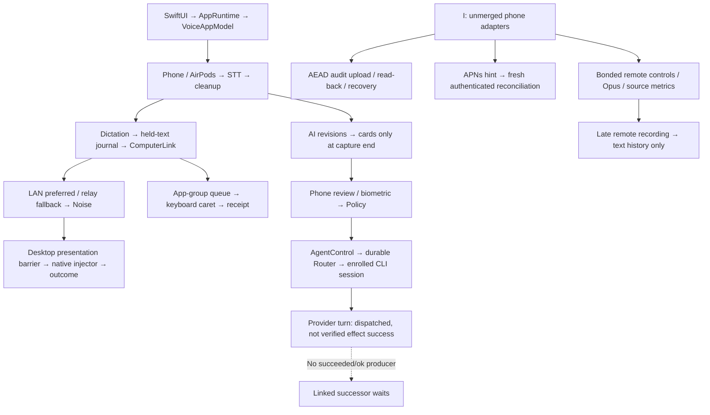

# Requirements audit 2 — what code still cannot do, and what the owner must prove

**Purpose:** Repeat the first audit after the gap-closing work; separate reachable implementation, synthetic evidence, outstanding code and device acceptance.

**Inputs:** `AI/SYS/2026-11-02-requirements-audit.md` and its marks/method; `SYS/requirements.md`; `SYS/product-definition-v0.2.md` §9; current app, desktop, relay, schemas, tests and release workflows; the wake/audit/BLE worktree; the two firmware-thread remote-tracking branches named below. Owner decisions supplied with this task take precedence over older notes.

**Verification:** Source traces plus the local checks recorded below. Physical iPhone/AirPods, Apple framework compilation, native GUI insertion, installed providers, deployed relay/APNs, BLE interoperability, electrical safety and performance acceptance remain **unverified**. No real keys, transcripts or audio were read, generated or logged.



**Conclusion:** The phone now has a production route to enrolled Claude/Codex CLI sessions, with phone approval, status queries, cancellation and honest offline holds. Dictation outcomes, Auto activity age, tray presentation, signed cloud clients and account-switch prevention are implemented. This removes many first-audit reachability gaps. No P0–P4 milestone is fully accepted. Positive scoped wake execution, ambient cards during uninterrupted listening, linked execution completion and configured routing priorities still have code gaps. I adds missing phone archive/wake/BLE adapters, but also contains a wake-registration/socket conflict. Device checks cannot close those gaps.

## Basis, marks and assumptions

| Input | Exact basis / interpretation |
|---|---|
| Merged baseline | `HEAD`, local `dev/integration` and the I worktree's committed HEAD are `6cc481b767f5b158fad891d6ff7ed64bbd9b7103` (`SW: AI Control end to end (#32)`). Initial current-worktree status was clean. No fetch, checkout, merge, commit, push or PR. |
| `I:` | Existing dirty/untracked files in `/home/harrison/Documents/Projects/voiceremote/.claude/worktrees/codex-feat-wake-audit-ble`, read on 2026-11-03. `I:SW/...:line` refers to that worktree, not this note's checkout. Includes untracked `AuditArchiveRuntime.swift`, `PhoneWakeDelegate.swift`, `ArchiveHTTP.swift`, `PhoneArchive.swift`, `PhoneWake.swift`, `RemoteControls.swift`, `CaptureMetrics.swift` and adapter tests. Working files are volatile; this is a source snapshot, not an accepted commit. |
| `FW@e6ed9de` | Read with `git show origin/codex/feat-fw-stopwatch:...`; full tip `e6ed9de4b8652a1c73494fe477774d71dbbc775e`. These are branch sources and recorded evidence, not merged firmware or a fresh hardware run. |
| `BLE@0f8041f` | Read with `git show origin/codex/docs-remote-ble:...`; full tip `0f8041fc6a28ac94c973f2d8c8dd644bd42021e6`. Draft binary BLE contract, requirement amendments and prototype exception. Its last acknowledgement-freshness change is newer than the firmware branch's merged contract; compare implementations, not branch ancestry alone. |
| Counting unit | Exactly the **61 baseline requirements**. One mark for each whole requirement, plus a second mark for the same baseline requirement with I applied. Firmware deltas are described explicitly; neither firmware branch is silently substituted into baseline. Partial implementation never means accepted compliance. |
| Computer use | Owner definition: dispatch to installed Claude and ChatGPT/Codex apps **or CLIs** on that computer. The installed exact-session CLI adapter qualifies as an implementation approach. A custom Windows GUI automation engine is not a missing requirement. Opening/prefilling a Desktop composer does not prove unattended submission or the requested effect. |
| Test boards | Owner waived independent microphone power cutoff **on test boards only**. Software OFF and `hw_mic_cut=0` are honest prototype behavior; final REQ-49 remains unmet. This does not waive privacy, recording consent, array evaluation or P3's performance gate. |
| Late recordings | Owner decided deferred remote recordings become **text in history**. They never re-enter Brain, the old target, an execution queue or Send automatically. Temporary audio needed for this workflow is not silently declared compliant with the older no-raw-audio proposal. |
| Authority / targets | Existing requirements remain draft. No approval of the proposed 25% accuracy improvement, latency targets, retention exceptions or default wake scope is inferred. “No inbound ports” is interpreted operationally as no public listener/router forwarding for the checklist; literal wording remains an owner question. |
| Scope | Only this research note changes. README edits are excluded by the explicit single-file scope. Test/build caches and transient logs are outside tracked content; no product files are repaired here. |

| Mark | Same evidence standard as audit 1 |
|---|---|
| **D** | Done and proven by a real test of that requirement's scope. Does not certify a larger journey. |
| **F** | Built; proof at a required external boundary uses fakes. Device/service behavior and any stated limitation remain **unverified**. |
| **U** | Built, but the required production path is unreachable/incomplete. Package tests do not supply the missing caller or executor. |
| **M** | Missing, including a required portion of a compound requirement. |
| **O** | Requires owner device/account/key/decision/measurement. Software or policy prerequisites are stated, not hidden. |

**Counts:** merged **3 D · 29 F · 8 U · 6 M · 15 O**; with I **3 D · 32 F · 5 U · 6 M · 15 O**. Both total 61. F/U/M/O remain **unverified as whole-requirement compliance**. The first audit had 2 D / 16 F / 23 U / 9 M / 11 O; movement into O means software is ready for owner evidence, not that the evidence exists.

## Production traces and stopping points

| Journey | Trace from the real entry point |
|---|---|
| Capture and dictation | `SW/ios/App/VoiceRemoteApp.swift:10` → `AppRuntime.swift:48`/`:82` → `PhoneCapture.swift:41` → `Packages/AppModel/Sources/AppModel.swift:238`/`:291` → STT/cleanup → `HeldDictation.swift` → `ComputerLink.swift:388`/`:406`. Desktop CLI/tray enters shared `SW/desktop/crates/app/src/desktop_receiver.rs`; target presentation at `:205` precedes core insertion. Phone keyboard route is `AppRuntime.swift:211` → app-group queue → `KeyboardExt/KeyboardViewController.swift:112`. Neither socket write nor keyboard enqueue is treated as verified caret insertion. |
| Pair, resume, cloud | `DevicesView.swift` → `PairingFlow` → `ComputerLink.swift:130`/`:176`. Signed relay redemption/resume is installed; `:301` tries LAN before relay. `AppRuntime.swift:92` constructs signed cloud Brain transport; `:157` constructs signed speech sockets. Tray `SW/desktop/crates/tray/src/backend.rs:342` creates a provisioned room using a separately supplied provisioning secret. No live account or deployment was used. |
| Agent control | Phone enables command capability explicitly during pairing; `ComputerLink.swift:248` receives authenticated inventory/status, `:274` requests inventory → `AgentControl.swift:84` validates account/actor/epoch/capability intersection. User selects a session in `VoiceRemoteApp.swift:187`; model review at `AppModel.swift:391` pins that session → phone Policy/biometric → `:502` → `AgentControl.enqueue` → `Router` reserves before send → `PairedAgentTarget` sends `AgentDispatch`. Desktop receiver → `agents/src/lib.rs:197` verifies preview/session/permit → `:736` → `process.rs:389` launches installed CLI with bounded stdin/argv and containment. |
| Agent truthfulness | `agents/src/lib.rs:760` reports a successful CLI turn as **dispatched/dispatched**, with an optional expiring app reply. It does not report verified effect success. `AppModel.swift:426` requires predecessor **succeeded/ok** before reviewing a linked successor. No production CLI path supplies that result: the dependency guard is safe, but linked plans cannot advance. |
| AI capture / explicit activation | `AppModel.swift:315` submits the same utterance ID/revisions with `complete:false` at slice boundaries. `SuggestionEngine.swift:148` refuses inference until complete; `AppModel.swift:328` supplies complete only when the capture stream ends. Thus uninterrupted meeting capture produces no ambient cards. `:383` reaches Policy only through the UI's Start/review action; wake is always marked ambiguous at `:431`, and only target-selection grants are exposed (`:635`). No positive wake-to-allowlisted-action path is supplied. |
| Desktop state and controls | `AppRuntime.swift:114`/`:119` → `ComputerLink.synchronizeState` → `PhoneConnection.publishState`; desktop receives capture/mode and correlated control results. `AppModel.swift:558` deliberately refuses desktop requests to start the phone mic; stops are accepted. Do not mistake the tray's toggle label for a tested general remote-start/hold/double-tap implementation. |
| I archive and wake | `I:AppRuntime.swift:178`/`:197` schedules AEAD replication/read-back with per-room protected keys/anchors. `I:VoiceRemoteApp.swift:18` exposes startup recovery; `I:AuditArchiveRuntime.swift:86` requires fresh phone authentication and preserves originals. `I:PhoneWakeDelegate.swift:17` registers a token; a content-free hint calls `reconcileWake`, which queries existing durable task IDs after a fresh connection. **Defect:** `I:Packages/AppModel/Sources/PhoneWake.swift:33` opens a second member socket, while `SW/relay/src/room.ts:213` closes the old socket for that member. Registration can evict active relay Noise transport and consume queued frames before a Noise reader is installed. This is a source-derived integration defect; not reproduced against a live service. |
| Remote / I | Merged enrollment already has protected GATT access, matching system-number confirmation and an enrollment pin; it is no longer the permanently-false flag described in audit 1. Merged live control edges still only change a label. `I:RemoteBLELink.swift:494` applies `RemoteControls` edges to capture/mode/target and buffers short HOLD audio pending qualification. `I:AppRuntime.swift:190` wraps selected capture in metrics; selection uses recent **previous** observations, not simultaneous current-utterance streams. Deferred sync → `AppModel.saveOfflineText` is history-only. |

Paths without a full prefix in this trace table are under `SW/ios/App/` unless stated otherwise. The numbered requirement table below uses full paths for the main evidence.

## Every baseline requirement

| Requirement | Merged | With I | Evidence, limitation and remaining acceptance |
|---|---|---|---|
| [REQ-1] Remote-independent fundamentals | **F** | **F** | `SW/ios/App/AppRuntime.swift:82` constructs phone capture/Policy without remote; real `AgentControl` now supplies executors. `SW/ios/Packages/AppModel/Tests/AgentControlTests.swift` and app-model tests exercise the path with fake speech/model/biometric/transport. Phone-to-installed-provider acceptance remains unverified. |
| [REQ-2] Phone/AirPods capture and visible stop | **O** | **O** | `SW/ios/App/PhoneCapture.swift:41` selects HFP input; `VoiceRemoteApp.swift:73`/`:96` shows capture and Stop. Physical routing, interruption recovery and actual stop behavior need the phone/headset. |
| [REQ-3] OFF/HOLD/CONTINUOUS | **F** | **F** | `SW/ios/Packages/Core/Sources/AppState.swift:22`, `AppModel/Sources/AppModel.swift:185` and capture tests implement modes/thresholds. Synthetic tests do not prove a microphone ceases recording. I also wires remote positions; no hardware run credited. |
| [REQ-4] Independent mode/target; mode everywhere | **F** | **F** | Phone controls are independent; `SW/ios/App/ComputerLink.swift:282` publishes mode/capture, and remote presentation encodes mode (`Packages/AppModel/Sources/RemoteContract.swift:226`). Tray and display are now reachable. I adds incoming remote mode handling. UI/display agreement needs real devices. |
| [REQ-5] Dictation versus Brain→Policy→tools | **F** | **F** | `SW/ios/Packages/AppModel/Sources/AppModel.swift:314` separates dictation from proposals; `:502` queues only a Policy permit. `dictationNeverCallsBrainAndDestinationPrecedesAudio` and `AgentControlTests` use fakes at external boundaries. Deferred remote history is the explicit owner-decided exception, not a tool path. |
| [REQ-6] Listening while tasks execute | **F** | **F** | `SW/ios/Packages/AppModel/Sources/CaptureSegmenter.swift:31` owns capture independently; `AgentControl` sends asynchronously after durable admission, and desktop receiver reads cancellation concurrently. Listening can be started while a task runs. Sustained live capture/provider concurrency is unverified; uninterrupted ambient proposal generation separately fails P1 build acceptance (G6). |
| [REQ-7] Action Button/lock/cold-start evaluation | **O** | **O** | `SW/ios/App/ListeningActivity.swift:46` resolves the same runtime and prepares it before recording; `coldIntentAndViewShareExactlyOneRuntime` tests the bootstrap. Actual locked/unlocked/cold behavior and documented limitations have no device record. |
| [REQ-8] Consistent hold/short-tap/double-tap | **M** | **M** | Phone `CaptureTrigger` has the 300 ms boundary and 500 ms double-tap window. Merged remote has no operational input handling; I `RemoteControls.swift:19` qualifies HOLD but intentionally has **no tap-lock**. Desktop controls supply correlated stop requests, not the shared gesture behavior. BLE draft §Input leaves lock rules TBD. G4; do not mark firmware presence as closure. |
| [REQ-9] Swappable streaming STT candidates | **U** | **U** | `SW/ios/App/AppRuntime.swift:152` registers Apple/WhisperKit and signed cloud engines. Argmax's `ArgmaxBuild.install` exists (`Packages/SttApple/Sources/ArgmaxEngine.swift:65`) but has no app caller; licensing/build enablement alone does not populate `engine`. G2 is conditional on the owner's SDK access. Every native/vendor candidate remains live-unverified. |
| [REQ-10] Local default/cloud conditions/offline | **F** | **F** | `SW/ios/Packages/Stt/Sources/EngineRouter.swift:26` now applies heat/low-battery/max-accuracy before preference and silently stays local offline. Runtime supplies battery level and Low Power Mode (`AppRuntime.swift:101`). Router tests prove selection with fixtures; real battery/thermal/offline behavior needs owner checks. |
| [REQ-11] Vocabulary and meaning-preserving cleanup | **F** | **F** | `SW/ios/Packages/Stt/Sources/EngineRouter.swift` passes vocabulary and cleans a complete utterance; `CleanupTests`/`RouterTests` protect split negation and raw fallback. Acoustic vocabulary benefit and meaning on the owner's set are unverified. |
| [REQ-12] Engine picker and same-audio A/B | **F** | **F** | Active `SW/ios/App/Settings/SettingsView.swift:19`/`:29` reaches recorder; `BenchmarkRecorder.swift:135` calls `ABRunner` with the same recorded PCM for both engines. Export/interrupt tests use fake engines. I extends named remote capture; Apple UI/inference unverified. |
| [REQ-13] 200-phrase mic benchmark and metrics | **O** | **O** | `SW/ios/Packages/AppModel/Sources/BenchmarkRecorder.swift:63`/`:98` supports clipping judgement and separate battery cohorts; recorder UI exposes both. First/final/cleanup timings and schema/scorer exist. Two real 200-phrase microphone cohorts and controlled battery measurements are absent; this is no longer the missing-export-fields gap from audit 1. |
| [REQ-14] Beat Apple / proposed personal-term target | **O** | **O** | `SW/bench/benchkit/scoring.py` implements gates. No named-device owner run in `AI/SW/` selects an engine. The proposed 25% fewer personal-term errors remains **TBC**, not an approved shipping promise. |
| [REQ-15] Stage and end-to-field latency | **O** | **O** | `SW/ios/Packages/Stt/Sources/ABRunner.swift:50` exports ordered stage offsets; `Settings/SettingsView.swift:143` accepts independently correlated delivery/field observations. Recorder deliberately does not inject; native paste can remain unconfirmed. Owner must measure actual live field effects with an independent correlated observation. All target numbers in REQ-15 remain **TBC**; blank fields are TBD. |
| [REQ-16] Focused insertion, never Send/Enter | **F** | **F** | Production desktop core selects native injectors; `ComputerLink.swift:418` distinguishes inserted/unavailable/unconfirmed. Keyboard polls the actual insertion receipt. Sanitization/control-scalar tests are real logic tests, but GUI inputs use doubles locally. Native correct-field/no-Send behavior unverified. |
| [REQ-17] Named/Auto and ≤60 s real activity | **D** | **D** | `SW/ios/Packages/Core/Sources/TargetPicker.swift:61` ranks receipt-minus-activity-age and expires real activity, not heartbeats. Fresh Core tests `testIdleHeartbeatCannotRefreshActivityDespiteClockSkew`, `testAutoRanksActivityAgeAcrossTwoDevicesAndIdleHeartbeats` and fixed/fallback cases pass. This proves picker logic, not OS activity sampling or display timing. |
| [REQ-18] Private focus and announcement before insertion | **F** | **F** | `SW/ios/App/ComputerLink.swift:388` presents phone/remote and waits for `PhoneConnection.prepare`; desktop `desktop_receiver.rs:205` waits for tray readiness. `stalled_tray_prevents_insertion_until_display_ready` tests the actual receiver with a synthetic presenter. Merged remote has a display barrier; I fixes acknowledgement freshness during non-control snapshots. Actual pixels/native focus remain unverified. |
| [REQ-19] Windows named apps / GNOME Wayland / X11 | **O** | **O** | Real Windows/Linux injectors are selected from desktop CLI/tray. No fresh Notepad/Chrome/Teams/GNOME/X11 acceptance is supplied. A smoke test of an owned edit box or an ignored X11 display test is not this matrix. |
| [REQ-20] Clipboard restore/fallback/portal/uinput | **F** | **F** | `SW/desktop/crates/inject-windows/src/policy.rs`, `inject-linux/src/{lib,native}.rs` implement paste/typing/restoration and Linux alternatives. Native policy is tested with doubles; GNOME portal permissions, uinput access, actual layouts and clipboard managers remain unverified. Queued paste is correctly allowed to remain unconfirmed. |
| [REQ-21] Rewrite fallback / overlay preserves focus | **F** | **F** | STT `CleanupPass.swift` fails back to raw text; tray overlay show does not request focus (`SW/desktop/crates/tray/src/main.rs`). Synthetic cleanup/presenter tests do not prove native overlay focus. No arbitrary LLM rewrite is required to close the optional feature. |
| [REQ-22] QR/token/Noise/no manual IP/LAN or relay | **F** | **F** | `SW/ios/App/ComputerLink.swift:130` handles signed QR enrollment, `:301` LAN preference/relay fallback; desktop tray/CLI constructs real offers. Pairing has real Noise/transport tests, but scanned phone/tray interoperability is unverified. The misleading short code was removed; a short-code lookup service is not an outstanding QR requirement. |
| [REQ-23] Same phrase / both confirmations / role/caps | **O** | **O** | `SW/ios/Packages/Pairing/Sources/PairingConnection.swift` gates enrollment on both confirmations. Phone command capability is separate from Agent/Both role; tests reject role-only authorization. Owner must compare both screens, deliberately refuse one end, and inspect enrolled role/capabilities. |
| [REQ-24] Per-device keys / Noise / relay ciphertext | **F** | **F** | `SW/ios/Packages/Pairing/Sources/{NoiseXX,ApplicationSession,RelayRecords}.swift` and desktop core implement identity, encrypted app frames and stale-generation filtering. Relay tests exercise actual local Worker. This does not prove public-network setup or the literal no-inbound wording: private LAN listeners exist. Cloud proxy inputs are explicitly plaintext at the Worker/vendor, separate from opaque room frames. |
| [REQ-25] Immediate revoke / key removal / replay rejection | **F** | **F** | `SW/ios/App/ComputerLink.swift:323`/`:360` removes local enrollment and relay membership; receiver checks current enrollment and closes transport. One-use/expiry/revoke tests exist. A dormant relay room object need not be physically deleted for membership rejection; literal whole-room deletion is not an API. Owner must verify both directions and idle connections immediately fail. |
| [REQ-26] Rooms/presence/APNs/encrypted offline queue | **U** | **F** | Actual local Worker queue/presence/APNs request logic passes synthetic tests; merged phone has no token/delegate/background reconciliation caller. I adds these callers and bounded ID reconciliation, but registration opens a conflicting member socket (G1). APNs provider transport, signed entitlements, OS scheduling and offline delivery remain unverified even after that fix. |
| [REQ-27] Home/external pairing under one minute | **O** | **O** | Production phone now supports both network paths. No human QR/phrase timing on the owner's home LAN and unrelated network is recorded. Loopback programmatic confirmation is not evidence of the under-one-minute goal. |
| [REQ-28] Tier 1 never queues without approval | **F** | **F** | App calls real `PolicyGate`; `suggestionCannotExecuteUntilPhoneTapAndSensitivePolicyAuthentication`, decoder/gate tests and `AgentControlTests` check denial/admission. Fake Brain/biometric/executor boundaries remain. No inferred action bypass was found; owner corpus acceptance is still unverified. |
| [REQ-29] Trusted wake/PTT scope; sensitive phone approval | **U** | **U** | Real LA adapter is wired, and phone PTT has trusted evidence. However Policy submission is inside `review` reached by a card tap; all text wake events are downgraded as ambiguous. The only exposed grant is target selection. No positive automatic allowlisted wake path, before a card tap, exists (G5). Sensitive CLI delegation still correctly requires phone authentication. |
| [REQ-30] Fully scoped expiring grants / no expansion | **F** | **F** | `AppModel.swift:635` exposes limited target-selection grant/revoke; Policy `installGrant` and `grantsRequireEveryScopeDimensionAndExpiry` enforce dimensions/expiry and forbid sensitive/global grants. No model setter. Real settings/expiry/revoke usability unverified. A narrow grant is not permission to delegate arbitrary work. |
| [REQ-31] Model cannot set authority fields | **D** | **D** | `SW/ios/Packages/Brain/Sources/ProposalDecoder.swift` rejects authority/extra fields; `SYS/codegen/test_contract.py:79` proves structural exclusion. Policy's `AuthorityBoundaryTests.swift` typechecks an external caller to reject decoding/construction. Fresh SYS checks and default-layout Policy/Brain checks below delimit this proof; it is not speaker recognition. |
| [REQ-32] Exact immutable approval preview | **F** | **F** | `VoiceRemoteApp.swift` renders operation/destination/data/consequences; `AppModel.swift:391` pins selected session before review; `AgentControl.swift:145` rejects route change after approval. Hash/revision/ABA/authentication tests use fake biometric/display. Real Face ID/passcode and preview legibility remain unverified. |
| [REQ-33] Voice/content/playback never authority | **F** | **F** | `WakePhraseDetector.swift` defaults to ambiguous; `AppModel.swift:431` explicitly downgrades wake and remote buttons cannot approve. `playbackWakeWithScopedGrantStaysInferredAndGrantCanBeRevoked` passes with synthetic speech. No curated real meeting/TV/replay corpus has been run. Safe rejection alone does not prove the positive Tier 2 journey. |
| [REQ-34] Idempotency/status/cancel/reconnect | **F** | **F** | Live `AgentControl` supplies transport, authenticated inventory/status, query and fresh cancellation permits; Router/file stores reserve before I/O and require restored-task reapproval. Desktop durable receipts deduplicate. Fake-CLI/transport tests prove logic, not actual provider cancellation or Windows Job cleanup. I adds explicit sleep/wake query completion, not replay execution. |
| [REQ-35] Append-only phone audit / encrypted relay copy | **U** | **F** | Merged `Policy/Audit.swift`, `AuditArchive.swift`, relay `archive.ts` implement the journal/archive contract but merged `AppRuntime.swift:73` only opens the local log. I supplies real AES-GCM, signed HTTP, maintenance, read-back and authenticated recovery UI. Adapter tests exercise real crypto with fake HTTP/storage services. Actual Keychain/deployed archive/recovery remains unverified; lost anchors/suffix are not silently recovered. |
| [REQ-36] Brain proposes; deterministic phone controls execution | **F** | **F** | `AppModel.swift:383` → Policy → `AgentControl` → real paired dispatch now exists. Provider output is returned as data, never a permit. Model/biometric/provider acceptance remains synthetic; no claim of requested-effect success from a model reply. |
| [REQ-37] Brain settings / hybrid simple route | **F** | **F** | Settings reaches `BrainRouter`; `SuggestionEngine.swift:167` now sets `.automatic` in command context and `.multiStep` for linked work. Hybrid simple-route tests exist. Real Apple Foundation Models availability/quality and signed Anthropic operation remain unverified; this is no longer a missing workload-tag caller. |
| [REQ-38] Review/dismiss/edit/dedupe/rate/mute | **F** | **F** | Real AI UI reaches `SuggestionEngine` and edit/dismiss/mute paths. `StreamingRegressionTests`, suggestion/app tests cover rate/dedupe/revision. These work after utterance completion; ambient card creation before continuous capture ends is missing (G6). Actual meeting UI/model behavior unverified. |
| [REQ-39] 50 spoken commands / correctness/latency/battery | **O** | **O** | `BenchmarkRecorder.swift:43` imports exactly 50 prompts, records actual spoken STT output and calls `BrainBenchmark.writeRun` at `:86`. UI exports Foundation Models proposals without execution and accepts separately measured battery cohorts. Fake-engine all-50 test passes. Owner spoken set and measured device report absent; export currently evaluates the named local Brain, not every cloud Brain automatically. |
| [REQ-40] Linked dependencies / cancellation / corrections | **U** | **U** | Stable IDs/revisions now prevent a split correction from launching early; actual authorized predecessor IDs reach Router. `commandCorrectionsAcrossSilenceSlicesWaitForUtteranceCompletion` and dependency tests pass. No installed CLI executor emits verified **succeeded/ok**, so every real linked successor remains blocked (G8). Reply/turn completion is correctly not enough. |
| [REQ-41] Claude/Codex/cloud + project/session registry | **F** | **F** | Desktop owner TOML → authenticated inventory → phone selection → exact session dispatch is now reachable. Opt-in independent cloud adapter exists (`agents/src/cloud.rs`, `process.rs`), off by default. Tests substitute CLIs/provider environments. Live local session continuity, cloud account/environment mapping and actual installed app capabilities are unverified. CLI dispatch meets the owner's computer-use definition; Desktop-only surfaces remain explicitly unsupported. |
| [REQ-42] Explicit provider/machine/configured fallback | **U** | **U** | Chosen provider/host/project/session are visible and pinned. But `AgentControl.swift:145` always builds explicit singleton rules and hard constraints; no app fallback configuration is fed into the resolver. Explicit cloud selection is not configured automatic fallback. G7; no custom Windows GUI driver is requested. |
| [REQ-43] Honest offline hold/redirect | **F** | **F** | `AgentControl.swift:109` marks the enrolled destination unavailable; Router holds rather than claiming unrelated cloud success. Restarted queued work visibly needs reapproval. Fake connection tests prove hold behavior; awake/offline/provider reconnection needs owner evidence. Fallback policy is separately incomplete under REQ-42. |
| [REQ-44] Full session identity / honest cloud handoff | **F** | **F** | Inventory validates provider/account/host/project/provider ID/profile (`AgentControl.swift:93`); local CLI resumes that exact ID. Cloud creates a separate task and never claims local continuity. Identity/pinning tests use fake CLIs; genuine named-project continuity and cloud status compatibility remain unverified. |
| [REQ-45] Five-step routing priority | **U** | **U** | `SW/ios/Packages/Router/Sources/Routing.swift:79` implements the preference table. Production `AgentControl.resolve` requires exactly one selected match and supplies only it; no recent-project/default/fallback settings population. Resolver fixtures do not close this caller gap (G7). |
| [REQ-46] iOS caret/Messages/Mail/no Send | **O** | **O** | `SW/ios/KeyboardExt/KeyboardViewController.swift:112` calls proxy insert; app waits for an insertion receipt. Portable fake inserter tests do not prove Messages/Mail or caret behavior. Physical keyboard enablement and field checks remain. |
| [REQ-47] App-group/Darwin/no keyboard mic/network | **F** | **F** | `SW/ios/project.yml` restricts keyboard dependency/open access; keyboard drains app-group queue on Darwin notifications, without capture/network adapters. Portable tests exercise queue/receipts, not Apple entitlements or Darwin delivery. |
| [REQ-48] Rejecting-field copy/share fallback | **O** | **O** | Real Copy/Share controls and `CommittedTextFallback` exist. Owner must test a field that refuses custom keyboards, then deliberately copy/share; arbitrary iOS insertion is not promised. |
| [REQ-49] Independent physical mic power cut | **M** | **M** | Baseline has no compliant board. `FW@e6ed9de` stops capture in software; both test boards report `hw_mic_cut=0`. Owner waived this **only for tests**. Final independent cut is still hardware work plus electrical proof, not a phone-code backlog item. |
| [REQ-50] Opus/display/PTT/three-or-four PDM mic rig | **M** | **M** | `FW@e6ed9de` contains actual StopWatch board/audio/BLE/display implementation, one onboard mic; C6 is a build-only stub. I adds usable phone controls/decoder/recorder. No array/stand or iPhone-radio proof. BLE branch proposes deferring the array and changing REQ-50; that amendment is unmerged and not one of the supplied owner decisions. Firmware thread owns its state, not an invented nRF5340 implementation task. |
| [REQ-51] Current-utterance scoring and three-source comparison | **M** | **M** | Merged `SourceQuality` has no runtime caller. I `CaptureMetrics.swift:30` estimates envelope SNR/clipping, marks interruptions, fixes proximity at **unknown/zero**, and chooses from past single-source observations. That is useful instrumentation, not scoring valid competing streams for the current utterance. G9 plus owner benchmarks; coefficients/quality are TBC. |
| [REQ-52] Remote target cycle / recording/destination display | **U** | **F** | Merged `RemoteBLELink` accepts enrollment and writes presentation, but input edges do not call target/capture controls. I `RemoteControls.swift:72` cycles displayed order; `RemoteBLELink.swift:494` applies edges and writes acknowledged display state. Firmware branch implements controls/render barrier. Actual phone/board/display agreement is unverified. |
| [REQ-53] Whisper/comfort inclusion gate | **O** | **O** | No three-source realistic-whisper/comfort acceptance record. A working StopWatch microphone is not evidence it beats the best off-the-shelf source. Owner comparison and inclusion decision remain mandatory; result may be to omit the accessory. |
| [REQ-54] Approved HIL design before code | **O** | **O** | `SYS/hil-safety-review.md` is a written review awaiting owner approval. No HIL adapter code is supplied. Draft approval cannot be inferred from software-only agent work or from a device test runner named “hil”. |
| [REQ-55] Allowlisted HIL / physical interlocks/E-stop | **M** | **M** | No physical-actuation adapter/interlock evidence. Policy rejects hardware destinations. `FW/tools/hil` on the PR branch is a remote firmware test harness, not the appliance gateway. Keep P4 implementation gated by REQ-54 and owner lab approval. |
| [REQ-56] Audio/text retention and cloud indicator | **O** | **O** | Ordinary phone capture is memory-only; cloud indication and seven-day ordinary text expiry exist. `AppHistoryStore.swift:73` deliberately retains held/failed/unconfirmed text until Keep/Delete review; remote sync persists pending audio until transcription/discard. These are **not** strict seven-day/no-audio compliance. Owner late-history decision resolves routing, not retention/encryption. Owner must approve exceptions or require a default-policy code change; do not describe the old policy gap as closed. |
| [REQ-57] Minimal metadata / no password/app contents | **F** | **F** | OS samplers use focus/activity states, not field contents; Windows UIA password/read-only denial and Linux role/state sampling are present. Receiver tests use fake sampler/native driver doubles. Password-field and unrelated-app behavior on real OS sessions remain unverified. |
| [REQ-58] Consent/privacy/encryption policy before release | **O** | **O** | Real consent/default-off/withdrawal UI and storage protections exist. No approved participant/cloud-provider policy or encrypted test-board flash proof. BLE draft explicitly documents unencrypted flash and logical deletion. Mic-cut waiver grants no privacy exception. |
| [REQ-59] Generated Swift/Rust/TS and round trips | **D** | **D** | Fresh `make -C SYS check` passes freshness, 11 invariants, Rust 4 round trips, Swift 6, relay/TS 435 tests. Tests execute actual generated codecs. This covers the JSON family, not generation of the separate prose/binary BLE draft. No schema changed in this audit. |
| [REQ-60] Five extension interfaces | **F** | **F** | `SttEngine`/`CaptureSource`, `LlmBrain`, Router `Target`/`AgentAdapter` exist; `PairedAgentTarget` is now a real runtime adapter, not an empty target array. Portable test implementations exercise seams; Apple/native/provider implementations remain externally unverified. |
| [REQ-61] Account-bearing records and tenant rooms | **M** | **M** | Relay namespaces/wire messages and task records carry account IDs; actual Worker tests reject cross-tenant traffic. `SecureStore.swift:11` pins one installation account and refuses switching, closing the prior account-reinterpretation defect. However `Core/Sources/HistoryStore.swift:9`, `Policy/Audit.swift:104` and offline-sync local records still lack `account_id`. A single-account UI mitigates isolation risk but does not satisfy the literal record requirement (G3). |

## Firmware-thread state, including its unmerged requirement changes

| Branch / requirement area | What exists | What it does not establish |
|---|---|---|
| `FW@e6ed9de`: controls/audio/storage | `FW/app/main.c:49` initializes board/UI/offline/audio/BLE; `:77` debounces physical input. `boards/m5stopwatch/board.c:190` configures actual ES8311/I2S input; `app/audio_runtime.c` encodes and `app/ble.c` gates encrypted bonded GATT. Offline journal/fetch/confirmed-delete and corruption/power-loss fixtures are implemented. FW README records ESP-IDF builds and host/render tests. | Not merged. This audit did not rebuild ESP-IDF, run a board or reproduce recorded timing. C6 microphone/display/control path is a stub. No three/four-mic array, near-mouth stand, physical mic cut, whisper/battery/comfort acceptance or final release acceptance. |
| Enrollment/display safety | `FW/app/ble.c:58`/`:69` checks trusted authenticated bond; `:124` renders before final ATT acknowledgement. FW tests cover stale/layout/enrollment handoff and display failure. I tracks control revisions so ordinary audio/status snapshots do not invalidate arming. | A phone asserting protected access plus matching entered numbers is source-level enrollment evidence, not a fresh independent Apple-radio test. Numeric Comparison, bond reset, GATT cache and display acknowledgement need real phone/board interoperability. |
| `BLE@0f8041f`: contract | `SYS/protocol/remote-ble.md` documents v1.1 UUIDs/layouts, MTU fragmentation, reconnect resets, control acknowledgement, Opus profile, offline record IDs/checksums/resume, provenance and history-only routing. Latest change invalidates acknowledgements on control events rather than every snapshot. | Document still says draft/unimplemented; that heading is stale relative to branch implementations, not proof they are absent. Binary schema/codegen and positive/negative cross-implementation contract fixtures remain open in that branch; JSON codegen tests do not cover them. Firmware thread owns that mechanical contract work. |
| REQ-49 / REQ-50 | Test-board mic-cut waiver is documented at contract lines 603–608. Branch requirements propose a single-mic Proto 1 and defer the array. | Waiver does not satisfy final REQ-49. REQ-50 amendment must be reviewed/promoted; this audit retains the baseline 61-row requirement text. |
| Additional proposed REQ-62 | BLE branch adds offline capture/resume/durable-confirm-before-delete and OFF/full-storage checks. FW implements the journal/protocol; merged phone implements sync/history, and I adds fuller live control/measurement integration. | Not counted as a 62nd baseline row. Logical deletion is not forensic erasure. Real disconnection, flash-full/power-loss, duplicate transfer, short-record disposition, interrupted metadata and sync/live preemption remain owner-device checks. Raw-audio privacy conflict is explicitly open. |

No generic “firmware is missing” or “write a custom Windows computer-use driver” task is justified by the inspected sources. The remaining hardware/contract qualifications above must not disappear merely because they belong to another thread.

## P0–P4 acceptance against current paths

No entire milestone is D. Marks below assess each acceptance item, not PR completion.

| Milestone / item from product §9 | Mark / evidence / remaining gate |
|---|---|
| P0 build: capture, streaming STT, pairing, signed Windows receiver, presence, modes, keyboard POC | **F/O.** Reachable capture/transport/insertion and signing workflow exist. Actual Apple compile/device, signed installer and OS runtime are unverified. Licensed Argmax host setup is still U (G2). |
| P0: scanned pair on home LAN and external network | **O.** LAN/relay app paths now exist; measure both, including no-LAN fallback. No human timing evidence. |
| P0: revoked pair immediately fails | **F/O.** Disk/key/relay checks and replay tests exist; prove both directions, including idle connected peers, on real networks. |
| P0: no manual IP entry | **F/O.** Phone uses QR/discovery/relay. Operator deployment may choose a bind interface; the pairing user does not type an IP. Actual discovery/firewall behavior unverified. |
| P0: headset stays on iPhone | **O.** HFP preference source exists; no AirPods/phone/PC run. |
| P0: Windows text reaches correct field | **O.** Native path exists; use Notepad, Chrome and Teams, verify caret and no fallback to a different device. |
| P0: insertion never sends | **F/O.** Real sanitization/key-plan guards; owner must verify every actual target, especially chat composers, plus Messages/Mail. |
| P0: clear on-screen destination | **F/O.** Target-ready barrier, mode/capture publication and overlay are reachable; real visible-before-insert and no-focus-theft proof absent. |
| P0: Action Button limitations documented from device | **O.** Intent/bootstrap built; required lock/cold-state results and limitations are absent. |
| P1 build: incremental hypotheses, committed segments, cards, Tier 2, audit, concurrent listening/tasks, dedup/cancel | **U/F.** Durable dispatch/cancel/revisions now wired. Ambient cards only appear at capture end (G6), positive wake execution is absent (G5), linked successors cannot receive verified completion (G8). Merged audit copy is U; I adds phone replication/recovery, still device-unverified. |
| P1: curated meetings/TV do not dispatch without authorization | **F/O.** Synthetic downgrade tests pass; owner corpus not run. A system that dispatches nothing cannot satisfy the separate positive-wake item. |
| P1: unaddressed proposal never autoexecutes | **F/O.** Inferred evidence requires approval. Verify on phone with an available real executor so a disabled/disconnected executor cannot conceal a bypass. |
| P1: wake command runs only allowlisted actions | **U.** Negative rejection is built. Positive allowlisted wake execution without a card tap is not (G5). Owner cannot pass this by confirming every card manually. |
| P1: multiple commands independently tracked / at most once after reconnect | **F/U/O.** Separate explicit tasks have durable IDs/status/cancel and restart reapproval. Live-provider/reconnect proof absent; a linked batch additionally stalls forever at its predecessor-success gate (G8). |
| P1: every high-risk candidate waits for correct approval | **F/O.** Sensitive floor, immutable preview and LA wiring exist. Real Face ID/passcode, denial, expiry, destination edits, background/remote attempts need acceptance. |
| P2: named project continues in place | **F/O.** Exact enrolled CLI session is reachable. Installed-provider continuity on that project remains unverified; no Desktop chat ID is translated into a Code ID. |
| P2: offline Windows request visibly held/fallback | **F/O.** Existing destination becomes unavailable/held. Actual awake/sleep/offline observation unverified. |
| P2: generic cloud-capable task uses configured fallback | **U.** Explicit opt-in cloud dispatch exists, but production app never supplies the fallback/priorities policy (G7). |
| P2: Windows action only on awake/authorized host | **F/O.** Dispatch requires live authenticated inventory/enrollment and fresh phone-sensitive approval. Under the owner's definition, verify installed CLI handoff; verify the actual requested UI effect only if that app exposes the necessary capability. Unsupported Desktop-only tasks stay explicitly unsupported. |
| P2: tasks/outcomes traceable | **F/O.** Phone task IDs/routes/status and bounded app replies exist. CLI delivery is dispatched, not success. Actual provider outcomes unverified; generic verified-effect completion missing for linked work (G8). |
| P3 build and inclusion gate | **M/O.** Single-mic prototype FW exists unmerged, I adds live controls/metrics. Current-utterance multi-source quality scoring is incomplete (G9); array/stand, full whisper/name/number/negation/clipping/latency/false-activation/battery/audibility/privacy comparison and comfort evidence absent. Mic-cut test waiver is not the inclusion gate. |
| P4 design-before-actuation / independent safety | **O/M.** Draft safety review exists; approval and independent interlocks/E-stop/gateway do not. Do not start appliance actuation to make a software acceptance table greener. |

## List 1 — remaining non-owner code gaps, smallest first

Order is an implementation-effort estimate, **unverified**, not measured scheduling. These are residual gaps **after crediting I as source**, rather than requests to rebuild work already present there. Merged-only archive/wake/BLE reachability still requires coordinator integration of I and an Apple build; that integration boundary is not a duplicate feature backlog. Hardware, measurements and owner policy choices are in List 2. A conditional task is explicitly identified.

| Order | Real gap / smallest concrete closure | Files and meaningful test |
|---|---|---|
| **G1** | **Wake registration must not replace the active relay socket.** Register through the existing authenticated member connection, or add a separately authenticated control operation that does not replace/drain the Noise connection. Do not “fix” it by ignoring disconnects. | `I:SW/ios/Packages/AppModel/Sources/PhoneWake.swift:33`, `I:SW/ios/App/ComputerLink.swift:93`, `SW/relay/src/room.ts:212`. **Test:** actual local Worker + live member Noise transport; register/update token while focus, dictation and task-status frames are in flight. Original connection stays usable, no queued frames are lost, repeated registration does not create a reconnect loop, revoked member cannot register. Extend relay integration plus `SignedPhoneTransportTests.swift`; run `HEAVY_CPUS=4 heavy npm --prefix SW/relay test` and AppModel tests. |
| **G2** | **Conditional: finish licensed Argmax host initialization.** There is no caller of `ArgmaxBuild.install`; setting the build flag/obtaining a licence is insufficient. After SDK access, load the actual model/vocabulary and install the adapter through the real model-preparation path, or visibly keep it unavailable. | `SW/ios/App/AppRuntime.swift:152`/`:190`, `SW/ios/Packages/SttApple/Sources/ArgmaxEngine.swift:65`, `SttApple/Package.swift`, active Settings. **Test:** licensed Apple build plus preparation success/failure/consent cases; picker lists only a loaded candidate; same captured PCM reaches it and Apple in A/B. Portable tests prove availability gating only. Owner SDK/licence is a prerequisite; private SDK compilation/inference stays unverified until supplied. |
| **G3** | **Carry account identity in persisted local records.** Keep installation pinning, but add validated account identity to history/offline/audit record envelopes and migrations. An owner-only single-account setting does not satisfy REQ-61's record contract. | `SW/ios/Packages/Core/Sources/HistoryStore.swift:9`, `AppModel/Sources/{AppHistoryStore,RemoteOfflineSync}.swift`, `Policy/Sources/Policy/Audit.swift:104`, app construction. Preserve old audit hashes through an explicit versioned wrapper/migration, not by rewriting forensic history. **Test:** reopen/migrate legacy fixtures under the pinned account; reject mixed/wrong-account records before display/dispatch; archive round trips retain the binding. Run Core/AppModel/Policy tests; schema/codegen/round trips in the same change if the wire/archive contract changes. |
| **G4** | **Complete shared trigger semantics.** I's HOLD qualification deliberately omits double-tap lock; the desktop entry supplies only stop/toggle requests. Use the phone's tested short-tap/hold/double-tap rules on the remote and the supported desktop user-control surface. Keep capture control separate from command approval; do not grant a peer mic-start authority merely by sharing a classifier. | `I:SW/ios/Packages/AppModel/Sources/RemoteControls.swift:19`, `RemoteBLELink.swift:494`, `SW/ios/Packages/Core/Sources/AppState.swift:22`, desktop control/tray entry, `BLE@0f8041f:SYS/protocol/remote-ble.md:132`. **Test:** identical timed traces through actual phone/remote/desktop event adapters: 299/300 ms, one/two taps, hold-between-taps, reconnect, clock wrap, batch delay, OFF and mode changes. No short audio commits, no stale lock restart or authority event. Run Core/AppModel and desktop control tests; firmware thread maintains matching protocol fixtures. |
| **G5** | **Make a positive scoped Tier 2 path reachable without reviewing a suggestion first.** Deliberate phone PTT can carry trusted evidence; wake text alone cannot authenticate the owner. Establish the trusted armed context/scope separately, submit explicit complete commands to Policy directly, and execute only the allowlisted low-risk operation. Preserve ambiguity downgrade and mandatory phone-sensitive approval. | `SW/ios/Packages/AppModel/Sources/AppModel.swift:383`/`:431`/`:635`, `Brain/Sources/WakePhraseDetector.swift`, Policy trusted-input boundary and AI settings. **Test:** a matching granted low-risk explicit command changes the real model state without `review()`/`approve()`; inferred/recorded/ambiguous input, wrong device/project, expired/revoked grant and edited preview cannot. Sensitive delegate always waits for fresh LA. Include positive and negative app-entry tests, not a direct `PolicyGate` fixture alone. Run AppModel/Policy/Brain suites. Owner phrase/default-scope choices remain separately open. |
| **G6** | **Produce safe ambient hypotheses/cards while continuous capture stays open.** Current slice revisions always remain incomplete until the whole capture stream ends. Distinguish evolving hypotheses from committed intent boundaries; keep corrections replaceable and proposals non-executing. Do not solve this by marking every silence/time slice an executable complete command. | `SW/ios/Packages/AppModel/Sources/{AppModel,CaptureSegmenter}.swift`, `Brain/Sources/{SuggestionEngine,CommandSequence}.swift`. **Test:** use a still-open capture stream containing a complete ambient proposal followed by more speech; a card appears before capture ends, while partial/revised/negated commands never dispatch. Approving an earlier independent card leaves capture running; later correction invalidates the affected preview/dependency. Run AppModel/Brain tests with a controllable clock/stream. |
| **G7** | **Feed production routing priorities and fallback settings into the existing resolver.** Current singleton pinning cannot implement the five-step policy or configured local/cloud fallback. Populate selected/recent/default sessions and explicit constraints; show and reapprove any changed destination. Keep machine/file-dependent work held and cloud tasks explicitly independent. | `SW/ios/Packages/AppModel/Sources/AgentControl.swift:119`/`:145`, `Router/Sources/Routing.swift:79`, active session/settings UI and persisted settings. **Test:** drive the actual model/AgentControl with authenticated inventory for two hosts/providers plus one cloud route; exercise each priority, explicit-name constraints, unavailable targets, opt-in/denied cloud fallback and new approval when route changes. No unrelated cloud success or invented continuity. Run Router/AppModel tests and paired-agent E2E using fake providers for deterministic routing only. |
| **G8** | **Supply a trustworthy completion mechanism for linked plans.** Current CLI result is delivery/turn completion only; it never reaches the successor's `succeeded/ok` gate. Add narrowly supported effect verification or an explicit trusted completion workflow, bound to task/session/operation. Until then, explain that the chain is waiting for verified completion. Do not relabel a model reply or exit zero as verified effect success. | `SW/desktop/crates/agents/src/lib.rs:760`, `process.rs`, authorized status/verification contract if needed, `SW/ios/Packages/AppModel/Sources/AppModel.swift:426`, Router dependency handling/UI. **Test:** a real scoped test operation with independently checked postcondition releases exactly one approved successor; refusal, mere reply, exit zero without effect, cancellation, stale/wrong-session result and reconnect do not. Verify independent cancellation and no duplicate dispatch. Run agent/Router/AppModel tests and regenerate contracts if changed. Live provider effect verification remains separate owner evidence. |
| **G9** | **Finish source selection for the current utterance.** I measures a single selected source and compares recent prior observations; proximity remains unknown. Add bounded valid competing-stream measurements, loss/freshness/proximity evidence and a per-utterance pinned decision. Unknown values remain unknown, rather than invented speaker distance. | `I:SW/ios/Packages/AppModel/Sources/CaptureMetrics.swift:30`/`:40`, `RemoteContract.swift`, `I:SW/ios/App/AppRuntime.swift:58`/`:190`, remote audio loss path and benchmark export. **Test:** two source adapters with controlled current-utterance quality/loss, changed device identity and stale metrics; choose only a valid source, fail closed on loss, never mix words across sources or replay late audio. Record named-source diagnostics for owner three-mic-source comparison. Portable AppModel tests establish algorithm behavior; named-device calibration remains TBC. |

Missing array/stand, final mic power circuitry and HIL interlocks are real **hardware** gaps, not extra non-owner phone-code tickets. Retention exceptions need an owner policy decision before choosing between changing defaults and amending draft requirements. Full independent-effect verification may need a deliberately narrow supported operation; that is not permission for a general GUI driver.

## List 2 — owner's acceptance checklist

Everything below is **unverified** until recorded on named builds/devices. Record pass/fail, build/commit, device/OS, network, transport and timestamps; use content-free observations and aggregate benchmark metrics. Keep private recordings/transcripts/credentials out of commits and CI logs. A blocked positive test stays blocked; do not turn it into a pass by disabling its executor.

### What to sign up for, and which secrets to add

| Need | Owner action / where it goes / readiness check |
|---|---|
| iPhone installation and TestFlight | Apple Developer/App Store Connect access, app/bundle ID and app-group entitlement. Repository Actions secrets: **`APPLE_TEAM_ID`, `ASC_KEY_ID`, `ASC_ISSUER_ID`, `ASC_KEY_P8`** (`.github/workflows/ios.yml:42`). Use the protected secret UI, never a file in this repo. Coordinator runs the appropriate iOS CI/build; release tags require accepted-main ancestry and matching declared version. Pass: signed build installs and app/keyboard open without entitlement errors. |
| Signed Windows P0 receiver | Supply a suitable signing certificate through Actions **`WINDOWS_CERT`** (base64 certificate package) and **`WINDOWS_CERT_PASSWORD`** (`desktop.yml:97`). Coordinator builds tray/installer workflow. Pass: Windows reports the intended trusted publisher and installed receiver starts. An unsigned installer does not satisfy P0's signed-receiver build item. |
| External-network relay | Cloudflare account with Worker/Durable Objects deployment, HTTPS route/domain; Actions **`CLOUDFLARE_ACCOUNT_ID`, `CLOUDFLARE_API_TOKEN`** (`relay.yml:63`). Configure the route because `workers_dev` is false. Pass: coordinator deployment/health and signed room creation succeed at the configured HTTPS origin. Local Worker tests are not a deployed service. |
| Trusted provisioning / cloud eligibility | Worker **`RELAY_PROVISION_SECRET`**, at least 32 random characters per `SW/relay/README.md`; supply the same provisioning bearer to trusted desktop creation tooling through its protected provisioning input / `VOICEREMOTE_RELAY_BOOTSTRAP_SECRET`. Keep it off the phone. Pair a freshly provisioned room; legacy open rooms cannot spend. Pass: two current paired members can use configured cloud endpoints; unprovisioned/revoked members cannot. There is no product account sign-up UI: use the phone's displayed fixed account/IDs consistently. |
| Optional cloud speech and Brain | Relevant vendor accounts; Worker secrets **`ELEVENLABS_API_KEY`, `ASSEMBLYAI_API_KEY`, `ANTHROPIC_API_KEY`**. These are Worker secrets, not iPhone or repository Actions vendor-key fields. Set reviewed nonzero budgets/concurrency/reservation/body/frame/stream/duration/output caps and exact Anthropic model/API version in deployment configuration; checked-in zero values deliberately disable cloud. Match phone Settings model/version. Pass: each selected service works with visible cloud indication; consent-off prevents calls. Vendor billing/retention/caps require owner review, not guessed numbers. |
| Licensed candidate evaluation | Argmax SDK/licence/registry access if evaluating that requirement candidate. G2 must also supply the missing host initializer; merely buying access does not install a loaded engine. Pass: licensed build loads the model and shows it only when ready; otherwise explicitly unavailable. |
| APNs / I wake path | Apple push-enabled App ID and signed provisioning profile; Worker **`APNS_TEAM_ID`, `APNS_KEY_ID`, `APNS_PRIVATE_KEY`, `APNS_TOPIC`**. In I, opt into `SW/ios/App/Push.entitlements` and matching `VoiceRemotePushEnvironment`/build setting (`development` or `production`), with correct bundle topic. Default builds omit push entitlement. Fix G1 before testing relay wake. Pass: token registration, real background delivery and authenticated reconciliation work without dropping the active session. Production APNs HTTP/2/wake delivery is unverified; a synthetic fetch is insufficient. |
| Claude/Codex agents for P1/P2 | Install/authenticate the providers through their supported app/CLI login flows as the receiver service user. No adapter credential file is needed or inspected. Configure exact existing project/session IDs and a separate explicit cloud environment/repository only if testing cloud agents. Pass: those same installed CLIs can resume the owner's selected safe test project before phone control is attempted. No requirement to give this audit access to login stores. |
| Consent and open policies | Approve participant recording consent, provider retention/encryption and use of cloud; decide seven-day held-text review exceptions, temporary remote audio and unencrypted test-board flash. The hardware mic-cut waiver does not approve these. Confirm TBC performance gates, wake phrase/default scope and interpretation of no public inbound ports. Pass: recorded owner decisions and implemented defaults agree before release. |

### What to install and prepare

1. Install the coordinator-provided iPhone build on a supported physical iPhone, with its keyboard extension. Record phone model/iOS/build. Use a build containing I only after coordinator integration and a successful Apple build; Linux package passes do not compile the app. Keep the remote disconnected for P0/P1 fundamentals.
2. Launch the app, read the recording explanation, grant microphone/speech access, then use **Download / prepare speech models**. Confirm Apple and WhisperKit are available locally. Pair AirPods to the **iPhone**, not to the destination PC. For phone-mic runs, disconnect the headset so the actual input cannot remain HFP; record the observed route.
3. Enable the Voice Remote keyboard in iPhone Settings, select it in a test field, and verify the app-group bridge. The implementation does not need keyboard network/microphone access or Full Access for its bridge. Keep Copy/Share available for unsupported fields.
4. Install the signed Windows tray/receiver and needed runtime prerequisites from its package; prepare **Notepad, Chrome and Teams**. On Linux install the receiver and the dependencies/portal/input permissions documented in `SW/desktop/crates/inject-linux/README.md`; arrange separate **GNOME Wayland and X11** sessions. Do not claim Wayland from an X11 run or a headless terminal.
5. Configure the deployed relay HTTPS URL on phone and desktop **before pairing**. Give each desktop a recognizable name. Permit local discovery/private-network operation as needed; do not forward a public port. Have home Wi-Fi plus a genuinely separate cellular/hotspot/external network ready.
6. For agent checks, put the private owner-controlled TOML allowlist **outside agent workspaces/repository**. Match `account`, `host`, `phone_device`, `actor` to displayed paired IDs; list exact project directory/provider/session/profile. Start with read-only. Linux uses the same service user and working user systemd bus for confirmed tree cancellation. Windows uses Credential Manager and the documented current-user owner/DACL restrictions for config/discovery files. See `SW/desktop/crates/agents/README.md` and `SW/desktop/README.md#agent-nodes`.
7. Pair Agent/Both with **Allow agents** on the desktop and **Allow this phone to dispatch agent commands** on the phone. A role alone is insufficient; text-only existing pairs need fresh enrollment. Select the exact session in AI Control. Pass: the phone shows the expected provider, host, project and session from authenticated inventory, not a model-invented session.
8. Have the reviewed 200-phrase and 50-command sets available in Files, plus a private meeting/TV/playback test corpus made with appropriate consent. Prepare a safe test workspace and harmless actions with independently observable effects. Do not use live messages, accounts or physical machinery as test targets.

### P0 — step-by-step device checks and what passing looks like

| Step | Do this | Passing looks like |
|---|---|---|
| **P0-1 Permission, local capture and visible stop** [REQ-1–3, 10, 56, 58] | With no remote connected, test permission refusal first, then grant access and prepare local models. Try OFF, HOLD at/below/above 300 ms, double-tap lock and CONTINUOUS. Use Finish utterance versus Stop immediately; interrupt by a call/route change and return. | Refusal fails clearly without capture. OFF never captures; short tap does not commit; qualified hold/continuous shows recording. Finish commits the deliberate utterance; Stop discards unfinished work and stops the microphone/Live Activity. No late transcript arrives after cancellation. All capture indicators agree. |
| **P0-2 Pair on home LAN** [REQ-22–24, 27] | Start pairing in the desktop tray; scan its QR in the phone, compare the **same four words** and confirm on both ends. Time from pairing start to usable enrollment. Repeat once refusing one confirmation, once with an expired/reused code. | No manual IP entry. Both confirmations required; wrong/expired/replayed offer fails. Named role/capabilities recorded correctly. Home-LAN pairing goal under one minute is measured, not assumed. Encrypted private-LAN traffic carries app frames. |
| **P0-3 Pair and deliver externally** [REQ-22, 24, 27] | Remove/re-pair as needed with freshly provisioned relay room. Put phone on cellular/other network and desktop on home network; scan fresh QR and confirm phrases. Repeat delivery after network loss and LAN return. | Pairing and dictation work without manual IP/router forwarding; transport is observed as relay when LAN is unavailable and LAN is preferred when available. No stale-generation/replayed text inserts on reconnect. Record external pairing time separately. |
| **P0-4 Revoke in both directions** [REQ-25] | With an idle live pair, revoke on the phone; attempt dictation and agent dispatch without re-pairing. Freshly pair, revoke on desktop, try again. Replay old QR and attempt relay/cloud access with the old membership. | Immediate local refusal/connection closure and no new insertion/dispatch; peer cannot silently resume. Old QR/token and revoked relay/cloud membership fail. New work requires fresh verified pairing; no need to assert the Durable Object itself was physically erased. |
| **P0-5 Headset remains on phone** [REQ-2] | Use AirPods as input while dictating into each PC app; exercise unrelated PC audio. Then disconnect AirPods and repeat on phone mic. | Observed input route remains on the iPhone/headset during PC delivery; no headset re-pairing to PC. Removal/interruption is visible and does not commit a corrupted/late segment. Record actual routes for both cohorts. |
| **P0-6 Correct field, caret, no Send** [REQ-16, 19–21] | In Notepad, Chrome and Teams, place caret mid-text and dictate harmless punctuation/names/negation. Repeat with different keyboard layouts, multiline/control-character input, paste fallback and another clipboard value already present. Switch focus before/during delivery; try a password/read-only field. | Text goes only to the displayed selected focused field at the caret. **No Enter/Send** or message submission. No password/read-only insertion. Overlay never steals focus; old clipboard returns when restoration is supported and is not overwritten after another app takes ownership. Unsupported/uncertain insertion is visible and not retried automatically. |
| **P0-7 Linux matrix** [REQ-19–20, 57] | Repeat correct-field/no-Send/clipboard/fallback checks in GNOME Wayland and X11 separately. Exercise portal permission denial and configured uinput fallback; repeat with restored/changed clipboard ownership. | Each named session/method has its own result. Permission denial is visible and safe; no silent insertion into another field/device. Focus reporting contains booleans/activity metadata, not field text/title/password contents. Mark unsupported configurations as failed/unverified, not passed by unit tests. |
| **P0-8 Named/Auto and visible-before-insert** [REQ-4, 17–18] | Use two paired desktops with different names. Alternate actual text-field activity; select Auto, wait beyond 60 s with idle heartbeats, then use a fixed named device. Change mode while keeping target. Observe phone banner/tray before insertion; stall/close the tray presenter once. | Auto selects most recently active eligible text field, then falls back to iPhone after stale activity. Heartbeats alone cannot keep an idle PC selected. Named target stays pinned; mode change preserves target. Destination is visible before insertion; failed presentation holds/refuses. Tray mode/capture match phone. Tray mic-start refusal is a current limitation, not an accepted trigger feature. |
| **P0-9 Offline/uncertain delivery and relaunch** [REQ-16, 25, 56, 61] | Disconnect selected PC, dictate, reconnect; inspect History. Explicitly send held text once. Break connection around insertion and relaunch both ends; query uncertain text before resending. | Unavailable text is held for the original target; reconnection does not automatically send held text. Uncertain paste remains unconfirmed until actual evidence exists; no duplicate from retry/relaunch. Revoked target does not receive it. Installation account cannot be changed to reinterpret old private data; literal account-record closure still needs G3. |
| **P0-10 iPhone Messages/Mail and rejecting fields** [REQ-46–48] | Choose iPhone, select Voice Remote keyboard in Messages and Mail, put caret in the middle, dictate, then switch keyboards. Try a field refusing custom keyboards; use Copy/Share deliberately. | Committed text inserts once at the caret; no Send. Bridge notifications/receipts work without extension capture/network permission. Rejected-field fallback works explicitly; product never promises arbitrary iOS insertion. |
| **P0-11 Action Button/session matrix** [REQ-7] | Configure the Voice Remote recording shortcut. Test app open/unlocked, background/unlocked, locked with a previous session, after force quit/cold launch, and after reboot/before and after first unlock. Start and stop in each supported state. | Record every state/result and timing; one runtime/capture session only. Required permission/unlock/foreground steps are visible. No hidden recording or stale session. Publish actual Action Button limitations, including failures, before calling P0 accepted. |
| **P0-12 STT/vocabulary/cloud/offline/cleanup** [REQ-9–12, 21, 56, 58] | Try available local candidates and cloud candidates with consent on/off. Test prepared-model offline use, unavailable model offline, max accuracy and real low-battery/thermal conditions. Add owner vocabulary and negated phrases; simulate cleanup/provider failure. | Local default works; offline never sends cloud audio or shows a cloud error merely because no cloud exists. Consent-off prevents vendor traffic, consent withdrawal persists. Actual cloud use is visible. Cleanup preserves meaning/negation, never adds Send, falls back to raw text. Candidate unavailable/licensed-unloaded is reported honestly. |
| **P0-13 Speech benchmark and latency** [REQ-13–15] | Record the reviewed approximately 200 phrases on phone mic, then AirPods, using the same-audio A/B recorder. Annotate clipped first words by listening. Run separate controlled ≥10-minute single-engine battery cohorts; A/B battery cannot be assigned to one engine. Independently observe live LAN/relay delivery and real field arrival on a correlated clock/video; transport acceptance is insufficient. | Report WER, personal terms, clipping, first/final/cleanup timings, battery per 10 minutes, LAN/relay delivery and end-of-speech-to-field for named devices. Missing measurements remain TBD. Compare against Apple; choose no shipping winner without a real run. REQ-15 proposed limits (300/500/150 ms, 30/150 ms delivery, 800 ms LAN end-to-field) and 25% term target remain TBC until owner confirmation. Keep raw/private material outside logs/commits; record reproducible aggregate evidence. |
| **P0-14 Retention/privacy** [REQ-56–58] | Test ordinary seven-day expiry after relaunch/dormancy; test held/failed/unconfirmed Keep/Delete review, benchmark opt-in/export completion, cloud indicator/consent withdrawal, password fields and OS backup/protection settings. Review remote temporary-audio exception separately before using it. | Actual behavior matches the owner-approved policy. Current held-text indefinite-until-choice and temporary audio are disclosed, not passed as the original no-audio/seven-day requirement. No private contents in diagnostics; no keyboard mic/network activity. Logical deletion of board flash is not claimed as secure erase. |

### P1 — step-by-step device checks and what passing looks like

**Before positive tests:** use an available authorized real executor, selected exact session and a harmless test project. G5/G6/G8 block their indicated positive cases even if every negative test passes. I archive/wake requires coordinator integration, Apple build and G1 correction.

| Step | Do this | Passing looks like |
|---|---|---|
| **P1-1 Ambient meeting/TV corpus** [REQ-28, 33, 38; §9 first acceptance] | Run the curated meeting/TV/recorded-owner-voice corpus while continuously listening, including quoted wake phrases, names, ambiguous instructions, external text and provider replies asking to expand permissions. Leave the selected executor available. | No dispatch without explicit authorization, no grants created/expanded and no content/voice promoted to identity. After G6, useful cards can appear while the mic stays open. Log corpus case IDs/outcome counts, not transcript/audio. All rejection alone does not establish positive wake support. |
| **P1-2 Unaddressed suggestion lifecycle** [REQ-28, 32, 38; §9 second acceptance] | Speak an unaddressed actionable idea; leave it untouched, then dismiss/mute/repeat it. Start review on another card, edit target or operation during authentication, then deny or let it expire. | No untouched/dismissed/muted card executes; repeated ideas deduplicate/rate-limit. Preview names exact operation, destination/session, data and consequences. Edits/expiry invalidate old approval; a review tap does not by itself authorize a sensitive action. |
| **P1-3 Positive wake/PTT scope** [REQ-29–30, 37; §9 third acceptance] | **Blocked by G5 for positive automatic wake.** After closure, deliberately grant one narrow harmless operation, arm the trusted context, speak a directly addressed complete command, then test phone PTT. Repeat with wrong device/project/capability, expired/revoked grant and recorded/ambiguous speech. | The positive allowlisted operation runs without a suggestion-review tap only within its trusted scope. Wrong/expired/revoked/ambiguous cases suggest/refuse. No global always-allow or sensitive-action automation. A manual confirmation is not proof of this positive wake item. |
| **P1-4 Separate tasks and simultaneous listening** [REQ-6, 34, 38; §9 fourth acceptance] | Approve two independent harmless tasks to exact enrolled sessions. Start/continue listening while one runs; inspect their IDs/routes/replies. Cancel one using its own card while the other runs. Disconnect/reconnect and relaunch once around admission, once during provider execution. | Each task has its own visible identity/status; cancellation affects only that task and is called complete only after confirmed stop. Mic remains available; other task is unaffected. Each logical command is handed off at most once. Restored queued task requires review; running work is queried, not payload-resubmitted. Uncertain outcome stays uncertain. I background reconciliation does not renew authority. |
| **P1-5 Linked commands and corrections** [REQ-40; §9 multiple-command build] | **Blocked by G6/G8 for the full journey.** After closure, say a linked harmless sequence, revise/correct the first instruction across a pause, cancel a later instruction, then repeat with first operation refused, cancelled and successfully verified. | No incomplete/revised command launches early. Dependencies retain exact authorized predecessor IDs; a reply/exit zero is insufficient. Only verified first-effect completion releases its approved successor once. Independent cancellation and reconnect preserve this ordering. |
| **P1-6 High-risk exact approval** [REQ-29, 31–32, 36; §9 fifth acceptance] | Submit a harmless simulation of a sensitive operation/delegation. Check full immutable preview. Try no approval, cancel Face ID/passcode, expire it, change destination during authentication, replay approval and try remote/button/voice-only approval. Finally approve one unchanged exact operation on phone. | Every sensitive candidate waits for fresh action-specific phone Face ID/passcode; all negative cases fail without dispatch. Success uses the displayed immutable payload/session only. Remote buttons and model/provider output never confer authority. Failed biometrics do not silently use another credential class. |
| **P1-7 Audit copy and recovery** [REQ-35] | With I and deployed relay, create harmless policy events, force upload/read-back and relaunch. In a disposable test installation, test unavailable/damaged copy and local-journal recovery while retaining trusted keys/anchors; separately test missing anchor or unreplicated suffix. | UI claims verified copy only after authenticated decrypt/read-back of the current checkpoint. Recovery asks for fresh phone authentication, preserves originals and restores no old execution authority. Missing/damaged/unreplicated history is reported honestly and blocks unsafe approval; no “reset and continue” bypass. Merged-only build cannot pass encrypted-copy acceptance. |
| **P1-8 Sleeping phone / APNs / consent** [REQ-26, 34–35, 58] | After G1, register push with active relay traffic, then background/lock the phone while a harmless task changes status. Exercise delivered wake, missed wake, expired background time and ordinary foreground return. Repeat after revocation and cloud-consent withdrawal. | Registration does not evict Noise transport. Push contains only the fixed wake hint; phone obtains fresh authenticated inventory/status and reconciles existing IDs. No stale ciphertext/push text starts a task or renews a queued permit. Missed background time is recovered safely in foreground; unsupported locked states are documented. Actual APNs delivery is recorded separately from registration submission. |
| **P1-9 Spoken-command benchmark** [REQ-39] | Import the reviewed 50-command file, record **spoken** commands on the named phone, evaluate the actual local Brain export, and add separately controlled battery/latency measurements. Verify proposals only; do not dispatch benchmark actions. | All 50 spoken transcripts, expected/actual tool calls, correctness and latency are scored; battery per controlled cohort is measured or TBD. No substitution of written prompt for failed STT, no synthetic “winner”, no claim that this local-Brain export also evaluated cloud Brain. |

Later owner work, not a P0/P1 prerequisite: firmware-thread BLE enrollment/live/offline/full-storage/power-loss/display checks; realistic three-source whisper comparison and comfort gate; final independent mic-power measurement; approved HIL safety review and physical interlock/E-stop validation. Late remote text must arrive once in History with capture provenance and **no automatic action**, regardless of the mode recorded on the remote.

## Local verification and limits

Logs mentioned here are transient `/tmp/vr-audit2-*.log` files, not durable acceptance artifacts. Commands and source/test names make these synthetic checks reproducible. No owner measurement is claimed from them.

| Check actually attempted | Result / evidence boundary |
|---|---|
| `HEAVY_CPUS=4 heavy swift test -j 4 --package-path /home/harrison/Documents/Projects/voiceremote/.claude/worktrees/codex-feat-wake-audit-ble/SW/ios/Packages/AppModel` | Initial attempt failed: sibling worktree `.build/build.db` is read-only, Swift llbuild aborted. No product failure or test pass credited. No tracked current-worktree change resulted. |
| Same I suite with `--scratch-path /tmp/vr-audit2-i-build --cache-path /tmp/vr-audit2-swift-cache` | Next attempt failed resolving a manifest because default Clang module cache was unwritable. No pass credited. |
| `CLANG_MODULE_CACHE_PATH=/tmp/vr-audit2-clang SWIFTPM_MODULECACHE_OVERRIDE=/tmp/vr-audit2-clang HEAVY_CPUS=4 heavy swift test -j 4 --package-path /home/harrison/Documents/Projects/voiceremote/.claude/worktrees/codex-feat-wake-audit-ble/SW/ios/Packages/AppModel --scratch-path /tmp/vr-audit2-i-build --cache-path /tmp/vr-audit2-swift-cache` | **Passed: 118 tests.** Includes real AEAD/signed-request adapters with fake HTTP/socket peers, remote timing/buffering/source fixtures, retention and existing app logic. Does not compile `SW/ios/App`, exercise CoreBluetooth/Keychain/LA, or test against the actual Worker socket-replacement rule. |
| `CLANG_MODULE_CACHE_PATH=/tmp/vr-audit2-clang SWIFTPM_MODULECACHE_OVERRIDE=/tmp/vr-audit2-clang CARGO_TARGET_DIR=/tmp/vr-audit2-cargo CARGO_PROFILE_DEV_DEBUG=0 CARGO_PROFILE_TEST_DEBUG=0 CARGO_INCREMENTAL=0 RUST_TEST_THREADS=4 make -C SYS check` | **Passed:** generated files fresh; 11 Python invariants, Rust 4, Swift 6 and relay/TS 435 tests. Real generated codecs and actual local Worker runtime; APNs/vendor/native boundaries remain doubles. Locked Cargo invocation did not change lockfiles. |
| Core: `CLANG_MODULE_CACHE_PATH=/tmp/vr-audit2-clang SWIFTPM_MODULECACHE_OVERRIDE=/tmp/vr-audit2-clang HEAVY_CPUS=4 heavy swift test -j 4 --package-path SW/ios/Packages/Core --scratch-path /tmp/vr-audit2-m-build --cache-path /tmp/vr-audit2-swift-cache` | **Passed: 32 tests.** Includes actual Auto algorithm, idle-heartbeat/activity-age/fixed/fallback and account-pin logic. |
| Policy with that same scratch/cache layout | **Failed: 62 tests, one test with 8 diagnostic expectations failed.** `AuthorityBoundaryTests.swift:35` hardcodes the package's `.build/debug/Modules`, so relocated scratch output yields “no such module TrustedInput” instead of the expected inaccessible/Decodable diagnostics. This attempt does not prove the boundary. Default-layout retry is recorded below; no test source was changed. |
| For each `package` in `Policy Brain`: `CLANG_MODULE_CACHE_PATH=/tmp/vr-audit2-clang SWIFTPM_MODULECACHE_OVERRIDE=/tmp/vr-audit2-clang HEAVY_CPUS=4 heavy swift test -j 4 --package-path "SW/ios/Packages/$package" --cache-path /tmp/vr-audit2-swift-cache` | **Passed: Policy 62 tests; Brain 54 tests.** Policy external-module compiler-boundary test now passes with actual built modules; Brain rejects authority-field injection with real decoder logic. Archive/gate tests use fake biometric/client services. These are not live-model or device results. |

No desktop workspace/E2E, Xcode, signed installer, deployed relay/APNs, live vendor/provider, native window/compositor, physical BLE/board, microphone-power or HIL acceptance was run in this audit. Source inspection and existing branch build logs are not substituted for these runs.

The note itself is checked with the following inline script (kept here because the deliverable permits only one file). Expected counts are assertions, not estimates:

```sh
test -s AI/SYS/2026-11-03-requirements-audit-2.md
python3 - <<'PY'
from pathlib import Path
from collections import Counter
import re
s = Path("AI/SYS/2026-11-03-requirements-audit-2.md").read_text()
rows = re.findall(r"^\| \[REQ-(\d+)\].*?\| \*\*([DFUMO])\*\* \| \*\*([DFUMO])\*\* \|", s, re.M)
assert len(rows) == 61 and [int(r[0]) for r in rows] == list(range(1, 62))
a, b = Counter(r[1] for r in rows), Counter(r[2] for r in rows)
assert a == Counter(D=3, F=29, U=8, M=6, O=15)
assert b == Counter(D=3, F=32, U=5, M=6, O=15)
assert len(re.findall(r"^\| \*\*G\d+\*\*", s, re.M)) == 9
assert all(x in s for x in ["## List 1", "## List 2", "P0-14", "P1-9", "P2:", "P3 build", "P4 design"])
print("61 REQ rows; merged D3 F29 U8 M6 O15; with I D3 F32 U5 M6 O15")
print("9 code gaps; both lists and P0-P4 acceptance present")
PY
git diff --check -- AI/SYS/2026-11-03-requirements-audit-2.md
```

## Assumptions and open questions carried forward

| Topic | What remains open / effect |
|---|---|
| Owner scope already decided | CLI dispatch qualifies as computer use; test-board mic-cut exception is narrow; late remote recordings go to text history. No reconfirmation requested. |
| Privacy/retention | Approve or reject held-text Keep/Delete retention beyond seven days and temporary raw audio/unencrypted flash. If rejected, change implementation defaults; current wording cannot honestly be marked met. |
| Product gates | Confirm proposed personal-term accuracy/latency gates, wake phrase/trusted arming/default scope, suggestion timing/rate defaults and cloud spending/provider policies. All unconfirmed numbers stay TBC. |
| Array and extra requirement | Decide whether to accept the firmware branch's REQ-50 single-mic/deferred-array amendment and promote proposed REQ-62. Until then baseline 61 requirements remain the counted authority. |
| Transport / supported apps | Confirm no-public-inbound interpretation; document unsupported Desktop-only submission/control features and actual CLI/provider capability limits. Do not invent session continuity or effect success. |
| Lost audit history | I supports verified-copy recovery with retained keys/anchors. Missing trusted material or an unreplicated suffix cannot be restored by code assertion. Executor-fenced new-authority reset is not exposed by the app; whether to add that separately is a product recovery decision, not evidence that ordinary verified-copy recovery is absent. |
| Release / hardware | Signing, deployment and device acceptance remain unverified. Final mic cut, array/stand, source performance and HIL safety cannot be closed by this note or software unit tests. |

Only the requested note is left uncommitted for the coordinator. No unresolved question prevents completion of this audit; each limits a specific implementation or acceptance claim above.
