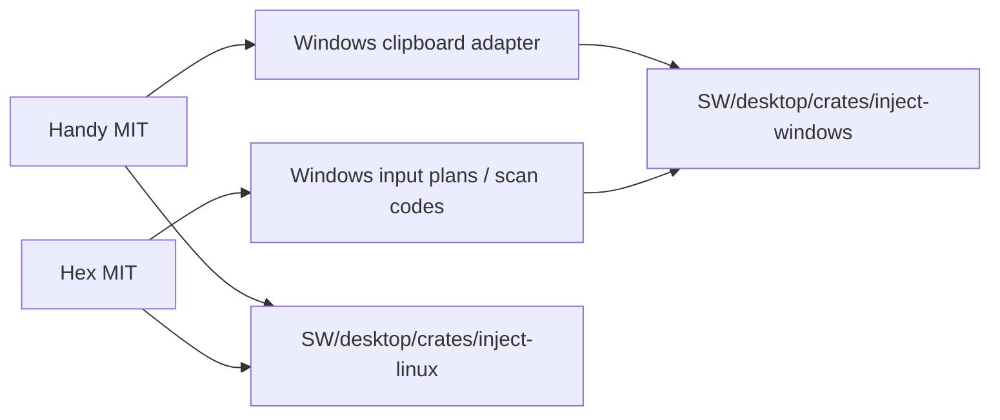
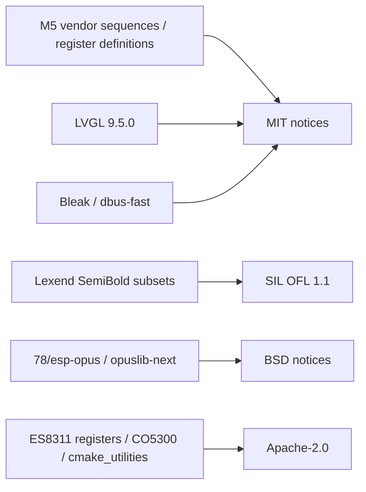

# Licences

## Desktop adaptations

| File / upstream | Local adaptation | Status |
|---|---|---|
| [Handy-MIT.txt](Handy-MIT.txt), copyright CJ Pais | `src/native/clipboard.rs`: HGLOBAL snapshot/allocation, delayed-render read receipt, privacy markers, owner window | ✅ licence retained |
| [hex-MIT.txt](hex-MIT.txt), copyright Christopher Langton | `src/policy.rs`, `src/native/input.rs`: Ctrl+V event order, foreground-layout scan codes, partial-send key release; `src/native/clipboard.rs`: sequence ownership guard | ✅ licence retained |
| [Handy-MIT.txt](Handy-MIT.txt), copyright CJ Pais | Linux `native.rs` helper protocol and `portal.rs` clipboard adaptation | ✅ licence retained |
| [hex-MIT.txt](hex-MIT.txt), copyright Christopher Langton | Linux `x11.rs` clipboard preservation and conditional restore | ✅ licence retained |

Windows paths are relative to [inject-windows](../../SW/desktop/crates/inject-windows/);
Linux paths to [inject-linux](../../SW/desktop/crates/inject-linux/).
No upstream file was copied wholesale; adaptation headers retain copyright and
link these full notices. Other implementation, tests and app wiring are original
to this repository. No GPL source was used.

Pinned source inputs reviewed online:

- [Handy `82dfab9`](https://github.com/cjpais/Handy/blob/82dfab9fda18c4bc24e1f6e56d36474d38eca0bc/src-tauri/src/paste_tx/windows.rs), plus [`clipboard.rs`](https://github.com/cjpais/Handy/blob/82dfab9fda18c4bc24e1f6e56d36474d38eca0bc/src-tauri/src/clipboard.rs) and [licence](https://github.com/cjpais/Handy/blob/82dfab9fda18c4bc24e1f6e56d36474d38eca0bc/LICENSE).
- [Hex `7c0b507`](https://github.com/anomalyco/hex/blob/7c0b507133d6c802780d4f6793c648fb27abbef3/src/windows/paste.rs), plus [`input.rs`](https://github.com/anomalyco/hex/blob/7c0b507133d6c802780d4f6793c648fb27abbef3/src/windows/input.rs) and [licence](https://github.com/anomalyco/hex/blob/7c0b507133d6c802780d4f6793c648fb27abbef3/LICENSE).

Upstream auto-submit, transcript logging, and paste-without-restoration paths
were excluded. Clipboard timing here is an implementation choice, **unverified**
for real applications; it is not an upstream performance claim.

## Firmware dependency notices

| Notice | Applies to | Status |
|---|---|---|
| `M5Stack-MIT.txt` | Vendor UserDemo/PowerDemo board sequence adaptation | ✅ Header retained in `FW/boards/m5stopwatch/board.c` |
| `M5IOE1-MIT.txt`, `M5PM1-MIT.txt` | Referenced register definitions | ✅ Notices retained |
| `LVGL-MIT.txt` | LVGL 9.5.0 code | ✅ Dependency licence checked |
| `Lexend-OFL.txt` | Supplied Lexend SemiBold target/pairing subsets; generation in `FW/app/fonts/` | ✅ OFL included |
| `Montserrat-OFL.txt`, `FontAwesome5.txt` | Bundled font glyphs: SIL OFL 1.1 (FontAwesome notice includes CC BY 4.0 / MIT) | ✅ Upstream notices included |
| `Opus-BSD.txt`, `Opus-IPR.txt` | libopus from `78/esp-opus` 1.0.5; upstream BSD terms and patent notice | ✅ Copied from pinned component |
| `opuslib-next-BSD.txt` | opuslib-next 1.3.1 Python ctypes binding; uses installed system libopus | ✅ Copied from locked wheel |
| `Bleak-MIT.txt`, `dbus-fast-MIT.txt` | Bleak 3.0.2 / dbus-fast 5.2.0 client dependencies | ✅ Copied from locked wheels |
| `Espressif-Apache-2.0.txt` | ES8311 register adaptation, CO5300 2.2.0 and cmake_utilities 0.5.3 | ✅ Dependency licences checked |

Start with the [board provenance](../../FW/boards/m5stopwatch/README.md). Preserve MIT
copyright/permission notices in distributed copies and Apache licence/notices
when redistributing dependencies. ESP-IDF/NimBLE retain their installed upstream
licences (Apache-2.0; not vendored). Python tooling dependencies remain in uv's
environment and are not copied into firmware. No GPL code copied.

These external notices live in `DOCS/licences/`; firmware dependency sources keep their per-file headers.

`78/esp-opus` registry metadata says MIT, but its libopus `COPYING`, source
headers and `LICENSE_PLEASE_READ.txt` specify BSD-family licences. We preserve
and follow those upstream terms; the manifest is not evidence that libopus is
MIT. Pinned package source commit: `5854a9f7de06ab3505b8fe6e8943db581c2cbe70`.
Dependency sources retain all original per-file notices in managed components.

Chosen over micro-opus 0.4.1 because the plain component already builds fixed-point
on both targets with alloca scratch and accepts caller-owned encoder state via
`opus_encoder_get_size` + `opus_encoder_init`; its create/destroy heap API is not
used. No shared PSRAM hooks, pseudostack/global scratch policy or wrapper changes
are needed. The 48 KiB internal stack budget is a starting allocation, with an
on-device watermark logged; runtime sufficiency is **unverified**.

The Python binding is BSD; system libopus uses the same upstream BSD family.
No av/FFmpeg dependency or GPL codec is introduced. The native real-codec test
uses libopus through ctypes and assumes no installed C development headers.
