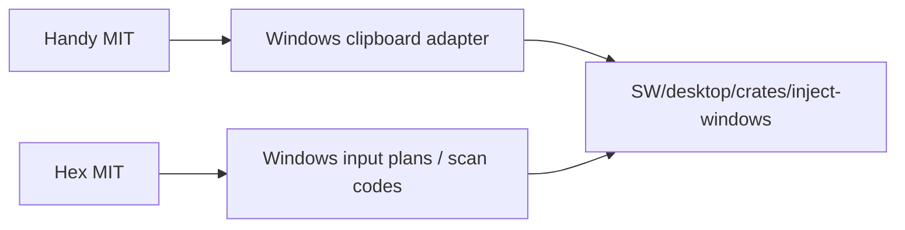

| File / upstream | Local adaptation | Status |
|---|---|---|
| [Handy-MIT.txt](Handy-MIT.txt), copyright CJ Pais | `src/native/clipboard.rs`: HGLOBAL snapshot/allocation, delayed-render read receipt, privacy markers, owner window | ✅ licence retained |
| [hex-MIT.txt](hex-MIT.txt), copyright Christopher Langton | `src/policy.rs`, `src/native/input.rs`: Ctrl+V event order, foreground-layout scan codes, partial-send key release; `src/native/clipboard.rs`: sequence ownership guard | ✅ licence retained |

Paths above are relative to [inject-windows](../../SW/desktop/crates/inject-windows/).
No upstream file was copied wholesale; adaptation headers retain copyright and
link these full notices. Other implementation, tests and app wiring are original
to this repository. No GPL source was used.

Pinned source inputs reviewed online:

- [Handy `82dfab9`](https://github.com/cjpais/Handy/blob/82dfab9fda18c4bc24e1f6e56d36474d38eca0bc/src-tauri/src/paste_tx/windows.rs), plus [`clipboard.rs`](https://github.com/cjpais/Handy/blob/82dfab9fda18c4bc24e1f6e56d36474d38eca0bc/src-tauri/src/clipboard.rs) and [licence](https://github.com/cjpais/Handy/blob/82dfab9fda18c4bc24e1f6e56d36474d38eca0bc/LICENSE).
- [Hex `7c0b507`](https://github.com/anomalyco/hex/blob/7c0b507133d6c802780d4f6793c648fb27abbef3/src/windows/paste.rs), plus [`input.rs`](https://github.com/anomalyco/hex/blob/7c0b507133d6c802780d4f6793c648fb27abbef3/src/windows/input.rs) and [licence](https://github.com/anomalyco/hex/blob/7c0b507133d6c802780d4f6793c648fb27abbef3/LICENSE).

Upstream auto-submit, transcript logging, and paste-without-restoration paths
were excluded. Clipboard timing here is an implementation choice, **unverified**
for real applications; it is not an upstream performance claim.
