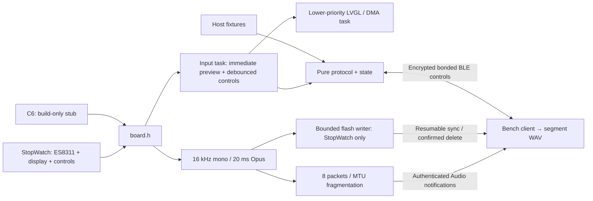

# FW: stage 2 Opus voice remote



| Path | What it is | Status |
|---|---|---|
| [app/](app/) | Independent input/render tasks, partial redraws, timing log + bounded Opus transport | ✅ Audio tested on StopWatch; speech-to-text untested |
| [boards/](boards/) | StopWatch ES8311/display driver and compiling C6 mic stub | ✅ StopWatch tested; C6 stub only |
| [tests/](tests/) | Pure C logic and Python wire tests; no board/adapter | ✅ Host verified |
| [tools/ui_preview/](tools/ui_preview/) | Real UI, native LVGL renderer, seventeen masked PNG fixtures | ✅ Host verified |
| [tools/hil/](tools/hil/) | Unattended USB-hook + BLE offline/live regression | ✅ 12 of 12 steps on StopWatch; always reads USB logs, so it can't see unread-log stalls |
| [tools/ble_client/](tools/ble_client/) | uv/Bleak Linux client, Numeric Comparison and segment WAV recorder | ✅ Used on hwgeekom |
| [licences](../DOCS/licences/) | External MIT / BSD / Apache / OFL notices | ✅ Relocated |
| `dependencies.lock.*` | Separate pinned dependency graph per board | ✅ Offline resolved |
| [partitions-stopwatch.csv](partitions-stopwatch.csv) | StopWatch-only 16 MiB layout; preserves NVS/PHY/app | ✅ Generated table checked |
| [app/offline-storage.md](app/offline-storage.md) | Journal/recovery, capacity arithmetic and flash timing limits | 🟡 Hardware unmeasured |
| [historical handoff](../AI/FW/2026-11-02-offline-handoff.md) | Build evidence, assumptions and hardware checklist | 🟡 Audio hardware unverified |

Start with [the contract](../SYS/protocol/remote-ble.md), then [hardware-fix evidence](../AI/FW/2026-11-02-hardware-fixes/README.md).
Traces to [REQ-8], [REQ-18], [REQ-49–53]; no claim of hardware compliance.
Firmware **0.3.0**, BLE contract **1.1**, advertised as **Voice Remote**. StopWatch reports required
capabilities 0–5 and 7 (`0xbf`) and a 512-byte encoder output bound; both boards keep `hw_mic_cut=0`.
Owner confirmed controls, pairing, Orb, screen speed and voice recordings on hardware;
speech-to-text, full storage and abrupt power loss remain **unverified on hardware**. The C6 remains a build-only mic/display/control stub.

Host tests, from the repository root (CMake, C compiler, Python ≥3.12):

```sh
heavy bash FW/tests/run.sh
```

Render all seventeen UI states from the repository root:

```sh
heavy bash FW/tools/ui_preview/run.sh
```


The preview includes immediate-feedback, rollback, partial/full pixel equality and
touch/display-barrier checks. All twelve baseline PNGs retain their visual design; five new offline states are added. See
[app](app/README.md) for producer-driven listening and font fallback.

Build from the repository root, using ESP-IDF **5.5.6**:

```sh
export PATH=$HOME/.local/share/uv/python/cpython-3.12.14-linux-x86_64-gnu/bin:$PATH
export IDF_TOOLS_PATH=$HOME/hw-tools/espressif
. ~/hw-tools/esp-idf/export.sh
# Sandbox only, after export: IDF_TOOLS_PATH=/tmp/voiceremote-espressif
# Use the supplied shell-only component mirror/cache variables when offline.
heavy idf.py -C FW -B FW/build-m5 -DIDF_TARGET=esp32s3 -DREMOTE_TIMING=ON -DREMOTE_TEST_HOOK=OFF -DREMOTE_RELEASE=ON reconfigure
heavy cmake --build FW/build-m5 -j 4
heavy idf.py -C FW -B FW/build-m5 build
heavy idf.py -C FW -B FW/build-c6 -DREMOTE_BOARD=waveshare_c6_169 -DIDF_TARGET=esp32c6 -DREMOTE_TIMING=ON -DREMOTE_TEST_HOOK=OFF -DREMOTE_RELEASE=ON reconfigure
heavy cmake --build FW/build-c6 -j 4
heavy idf.py -C FW -B FW/build-c6 -DREMOTE_BOARD=waveshare_c6_169 build
```

`REMOTE_TIMING` defaults **ON**. The commands above explicitly retain it for the
coordinator's flash. To compile out the five-second scheduling log, reconfigure
with `-DREMOTE_TIMING=OFF`, then rebuild with the same three-step sequence.
Both modes were built on S3; final S3/C6 builds use ON. Runtime timing, queue
headroom and the power effect of vendor-supported 80 MHz QSPI need hardware to tell.
Both targets use `CONFIG_COMPILER_OPTIMIZATION_PERF=y` (`-O2`). StopWatch alone
uses **240 MHz**; C6 stays **160 MHz**, without PSRAM. I2C stays 100 kHz.
The phone barrier waits up to **400 ms**, with one matching-completed-DMA check:
a draw completed before mutex reacquisition succeeds even after the wait expires.
See [evidence](../AI/FW/2026-11-02-hardware-fixes/README.md) for sizes, native
render timings and limits; press-to-pixel below 50 ms is **unverified on hardware**.

Test hook build (separate ignored directory, never a release):

```sh
heavy idf.py -C FW -B FW/build-m5-hook -DIDF_TARGET=esp32s3 -DREMOTE_TIMING=ON -DREMOTE_TEST_HOOK=ON -DREMOTE_RELEASE=OFF reconfigure
heavy cmake --build FW/build-m5-hook -j 4
heavy idf.py -C FW -B FW/build-m5-hook build
# Expected configure failure, before any IDF/toolchain work:
heavy cmake -S FW -B FW/build-hook-release-reject -DREMOTE_TEST_HOOK=ON -DREMOTE_RELEASE=ON
```

`REMOTE_TEST_HOOK` defaults **OFF**. `REMOTE_RELEASE=ON`, `GITHUB_REF=refs/tags/fw-v…`
or `CI_COMMIT_TAG=fw-v…` forbids it. Release automation must retain that signal.
Normal builds add neither hook code nor a hook dependency; USB console support
already exists in IDF. Hook builds log TEST BUILD at boot and show a 6 px magenta
square at the bottom, including modal screens. Commands: `o/p/r` OFF/PTT/REC,
`d/u` PTT down/up, `h` haptic, `t` mode, `x` reboot. Inputs use normal debounce,
authorization and capture policy. [Unattended procedure](tools/hil/README.md).

Build directories must be **inside FW/**. `-B` is relative to the shell's working
directory, including with `-C`. Each build has its own generated sdkconfig. After changing defaults, move that
build's `sdkconfig` aside and reconfigure so the defaults are regenerated. The
StopWatch selects `partitions-stopwatch.csv`; C6 keeps the original single-app
table. `python3 FW/tests/check_partitions.py` checks both generated tables and
compares NVS against fixed historical values and IDF's old table. NVS
stays at **0x9000 / 0x6000**, so this update does not relocate bonds.
The source manifests use normal registry dependencies. For offline builds, set
the supplied mirror/cache environment variables in the shell only.

Client recording commands and the physical PTT/REC steps are in
[ble_client](tools/ble_client/README.md). The 20-byte **phone-write** budget does
not limit Audio fragments; firmware uses `ble_att_mtu()` at each frame boundary.

Only the coordinator flashes/tests hardware. From this worktree's root after setup:

```sh
# Normal firmware:
heavy idf.py -C FW -B FW/build-m5 -p /dev/ttyACM0 flash
# TEST BUILD only:
heavy idf.py -C FW -B FW/build-m5-hook -p /dev/ttyACM0 flash
```

In this sandbox, after export use `IDF_TOOLS_PATH=/tmp/voiceremote-espressif` for
the prepared writable metadata overlay. On a normal networked checkout, normal
registry manifests/board locks suffice. No offline mirror paths are committed.

StopWatch stores disconnected recordings in an unencrypted raw-flash journal,
then lists/fetches them on separate sync characteristics. Only durable phone
confirmation deletes a record. At assumed 24 kbit/s, calculated long-record
capacity is **69.12 minutes, unmeasured**; private overhead and record limits are
included in [the calculation](app/offline-storage.md). The bounded writer cannot
prove absence of flash-cache stalls. [Handoff](../AI/FW/2026-11-02-offline-handoff.md) covers hardware-only
measurements and re-enrollment protection. USB-hook unattended tests now live in
[hil](tools/hil/README.md); no device or adapter was accessed by this worker.

Fix-round host coverage includes factory-used partition initialization, recoverable
torn headers, traversable corrupt-record lists, failed-store live/pairing fallback,
OFF on touch-down, and acknowledged GATT layout delivery. The forget overlay commits
OFF before opening. No iPhone pairing/cache behavior or I2C fault recovery is hardware
verified; see [app](app/README.md) and [tests](tests/README.md).
