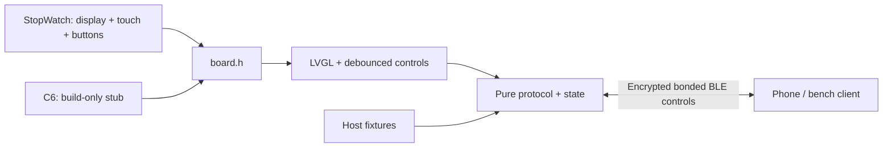

# FW: stage 1 voice remote



| Path | What it is | Status |
|---|---|---|
| [app/](app/) | Shared control firmware; Audio exists but never notifies | 🟡 Hardware unverified |
| [boards/](boards/) | StopWatch driver and compiling C6 stub | 🟡 Hardware unverified |
| [tests/](tests/) | Pure C logic and Python wire tests; no board/adapter | ✅ Host verified |
| [tools/ble_client/](tools/ble_client/) | uv/Bleak Linux client with Numeric Comparison agent | 🟡 Adapter unverified |
| [licences/](licences/) | Reused MIT notices and dependency licences | ✅ Included; coordinator relocates |
| `dependencies.lock.*` | Separate pinned dependency graph per board | ✅ Offline resolved |
| [handoff.md](handoff.md) | Build evidence, assumptions, contract conflicts, hardware checklist | 🟡 Hardware unverified |

Start with [the contract](../SYS/protocol/remote-ble.md), then [handoff](handoff.md).
Traces to [REQ-8], [REQ-18], [REQ-49–53]; no claim of hardware compliance.
Required Opus capability conflicts with stage 1: bit 0 is **clear**, maximum
packet field reserves 512; screen explicitly identifies this as stage 1.
A strict full-v1 phone must refuse capture. No microphone, codec or Opus initialization.

Host tests, from the repository root (CMake, C compiler, Python ≥3.12):

```sh
heavy bash FW/tests/run.sh
```

Build from the repository root, using ESP-IDF **5.5.6**:

```sh
export PATH=$HOME/.local/share/uv/python/cpython-3.12.14-linux-x86_64-gnu/bin:$PATH
export IDF_TOOLS_PATH=$HOME/hw-tools/espressif
. ~/hw-tools/esp-idf/export.sh
heavy idf.py -C FW -B FW/build-m5 -DIDF_TARGET=esp32s3 reconfigure
heavy cmake --build FW/build-m5 -j 4
heavy idf.py -C FW -B FW/build-m5 build
heavy idf.py -C FW -B FW/build-c6 -DREMOTE_BOARD=waveshare_c6_169 set-target esp32c6
heavy cmake --build FW/build-c6 -j 4
heavy idf.py -C FW -B FW/build-c6 -DREMOTE_BOARD=waveshare_c6_169 build
```

Build directories must be **inside FW/**. `-B` is relative to the shell's working
directory, including with `-C`. Each build has its own generated sdkconfig.
The source manifests use normal registry dependencies. For offline builds, set
the supplied mirror/cache environment variables in the shell only.

Only the coordinator flashes/tests hardware. From this worktree's root after setup:

```sh
heavy idf.py -C FW -B FW/build-m5 -p /dev/ttyACM0 flash
```
