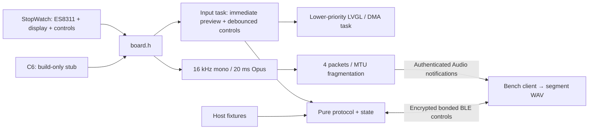

# FW: stage 2 Opus voice remote



| Path | What it is | Status |
|---|---|---|
| [app/](app/) | Independent input/render tasks, partial redraws, timing log + bounded Opus transport | 🟡 Audio hardware unverified |
| [boards/](boards/) | StopWatch ES8311/display driver and compiling C6 mic stub | 🟡 Audio hardware unverified |
| [tests/](tests/) | Pure C logic and Python wire tests; no board/adapter | ✅ Host verified |
| [tools/ui_preview/](tools/ui_preview/) | Real UI, native LVGL renderer, twelve masked PNG fixtures | ✅ Host verified |
| [tools/ble_client/](tools/ble_client/) | uv/Bleak Linux client, Numeric Comparison and segment WAV recorder | 🟡 Adapter unverified |
| [licences/](licences/) | MIT / BSD / Apache / OFL notices | ✅ Included; coordinator relocates |
| `dependencies.lock.*` | Separate pinned dependency graph per board | ✅ Offline resolved |
| [handoff.md](handoff.md) | Build evidence, assumptions and hardware checklist | 🟡 Audio hardware unverified |

Start with [the contract](../SYS/protocol/remote-ble.md), then [handoff](handoff.md).
Traces to [REQ-8], [REQ-18], [REQ-49–53]; no claim of hardware compliance.
Firmware **0.2.0**, advertised as **Voice Remote**. StopWatch reports required
capabilities 0–5 and a 512-byte encoder output bound; both boards keep `hw_mic_cut=0`.
Owner confirmed the existing controls, pairing and Orb on hardware; new audio is
**unverified on hardware**. The C6 remains a build-only mic/display/control stub.

Host tests, from the repository root (CMake, C compiler, Python ≥3.12):

```sh
heavy bash FW/tests/run.sh
```

Render all twelve UI states from the repository root:

```sh
heavy bash FW/tools/ui_preview/run.sh
```


The preview includes immediate-feedback, rollback, partial/full pixel equality and
touch/display-barrier checks. All twelve baseline PNGs retain their visual design. See
[app](app/README.md) for producer-driven listening and font fallback.

Build from the repository root, using ESP-IDF **5.5.6**:

```sh
export PATH=$HOME/.local/share/uv/python/cpython-3.12.14-linux-x86_64-gnu/bin:$PATH
export IDF_TOOLS_PATH=$HOME/hw-tools/espressif
. ~/hw-tools/esp-idf/export.sh
heavy idf.py -C FW -B FW/build-m5 -DIDF_TARGET=esp32s3 -DREMOTE_TIMING=ON reconfigure
heavy cmake --build FW/build-m5 -j 4
heavy idf.py -C FW -B FW/build-m5 build
heavy idf.py -C FW -B FW/build-c6 -DREMOTE_BOARD=waveshare_c6_169 -DIDF_TARGET=esp32c6 -DREMOTE_TIMING=ON reconfigure
heavy cmake --build FW/build-c6 -j 4
heavy idf.py -C FW -B FW/build-c6 -DREMOTE_BOARD=waveshare_c6_169 build
```

`REMOTE_TIMING` defaults **ON**. The commands above explicitly retain it for the
coordinator's flash. To compile out the five-second scheduling log, reconfigure
with `-DREMOTE_TIMING=OFF`, then rebuild with the same three-step sequence.
Both modes were built on S3; final S3/C6 builds use ON. Runtime timing, queue
headroom and the power effect of vendor-supported 80 MHz QSPI need hardware to tell.
CPU remains 160 MHz; I2C remains 100 kHz. See [handoff](handoff.md) for evidence,
size/RAM deltas, log field meanings and the 40 ms phone-render deadline.

Build directories must be **inside FW/**. `-B` is relative to the shell's working
directory, including with `-C`. Each build has its own generated sdkconfig.
The source manifests use normal registry dependencies. For offline builds, set
the supplied mirror/cache environment variables in the shell only.

Client recording commands and the physical PTT/REC steps are in
[ble_client](tools/ble_client/README.md). The 20-byte **phone-write** budget does
not limit Audio fragments; firmware uses `ble_att_mtu()` at each frame boundary.

Only the coordinator flashes/tests hardware. From this worktree's root after setup:

```sh
heavy idf.py -C FW -B FW/build-m5 -p /dev/ttyACM0 flash
```

In this sandbox, after export use `IDF_TOOLS_PATH=/tmp/voiceremote-espressif` for
the prepared writable metadata overlay. On a normal networked checkout, normal
registry manifests/board locks suffice. No offline mirror paths are committed.
