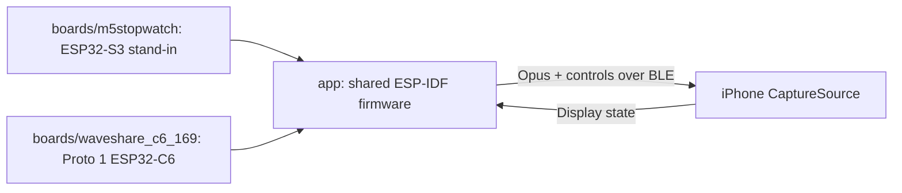

# FW: voice remote firmware

| Path / target | What it is | Status |
|---|---|---|
| `app/` | Planned shared ESP-IDF application | ⬜ Not started |
| `boards/waveshare_c6_169/` | Planned Proto 1 target: Waveshare ESP32-C6-Touch-LCD-1.69 | ⬜ Not started |
| `boards/m5stopwatch/` | Planned stand-in: M5Stack StopWatch (ESP32-S3) | ⬜ Not started |
| `~/hw-tools/esp-idf` | Planned ESP-IDF toolchain location; build: `idf.py build`, Unity test runner TBD | ⬜ Not started |

Start with the draft [BLE contract](../SYS/protocol/remote-ble.md) and
[REQ-49–53](../SYS/requirements.md#voice-remote). Proto 1 uses the board's single
mic; the PDM array moves to a later rig. Implementation and measurements are
unverified. Both supplied boards lack the required independent hardware OFF cut;
the owner granted a test-board exception on 2026-11-02 (see contract).
