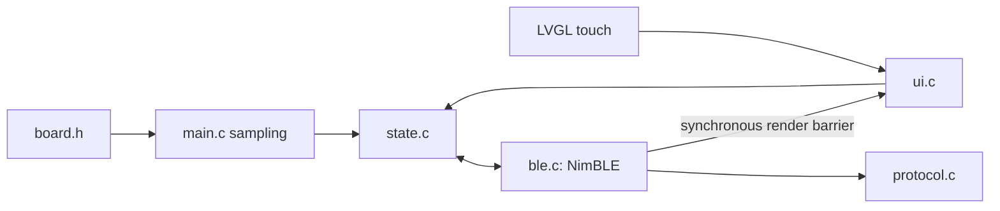

# Shared control firmware



| File | Purpose | Status |
|---|---|---|
| `protocol.[ch]` | LE codecs, strict text validation, fragments; audio framing fixtures only | ✅ Host tested |
| `state.[ch]` | Sampling/debounce, sequences, atomic phone state, arm/OFF rules | ✅ Host tested |
| `layout.h` | Screen-size layout, round safe rectangle | ✅ Geometry tested |
| `board.h` | Small synchronous board interface, no board includes | 🟡 Hardware unverified |
| `main.c`, `runtime.h` | Serialized runtime; recursive mutex supports synchronous NimBLE events | 🟡 Hardware unverified |
| `ble.c` | Secure Connections only; explicit Numeric Comparison, bonding and revoke | 🟡 Hardware unverified |
| `ui.c` | Capture/mode segmented selectors, phone labels, pairing overlay | 🟡 Hardware unverified |

Start with `protocol.h`, then `state.h`; [REQ-8], [REQ-18], [REQ-49–53].
All widgets fit an inscribed rectangle; long text scrolls as plain text.

```text
       Voice remote | stage 1: no audio
       [ OFF ] [ PTT ] [ REC ]
       [ TRANSCRIBE ] [ AI ]
       Target: Auto
       To: PC
       Phone: stopped | Audio: off
       BLE bench
       error text
       [ Pair ] [ Revoke bond ]
```

The 5 ms loop polls buttons; 25 ms stable debounce preserves the initial sample
timestamp across tick wrap. Touch choices use the same filter. No tap classification.
Input sequence advances only after a successful notify enqueue; failure disarms
and requires another snapshot. No input replay on reconnect.

Phone writes validate into a temporary state. Final application waits for LVGL
refresh and every DMA transfer. A visible pairing overlay rejects final application
with an ATT error. Transfer failure returns an ATT error and attempts to restore
previous labels. The physical scanout barrier remains **unverified**.

Pairing opens locally for 60 s; Numeric Comparison requires a screen confirmation
within 30 s. These are implementation choices, not measured timing requirements.
CCCDs require encryption, authentication and authorization; application authorization
also requires a bond and 16-byte keys. No automatic bond eviction or re-pairing.

The control gate fails closed for hold without PTT: the contract provides no
phone-qualified-lock field. Tap-lock remains disabled. UTF-8 is validated, but
the bundled Montserrat font covers ASCII and selected symbols; other glyphs use
placeholders. Full international destination rendering needs a font strategy.
