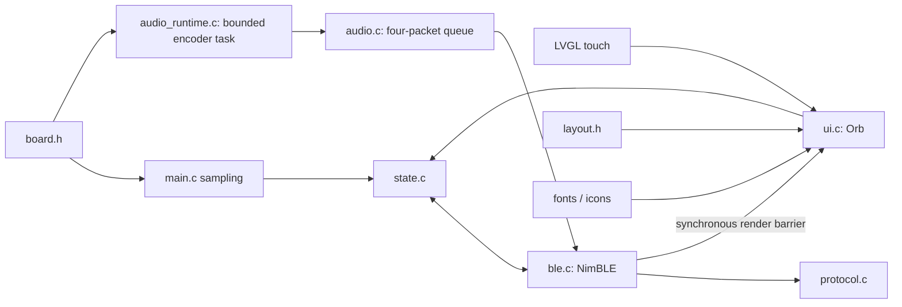

# Shared control and audio firmware

| File | Purpose | Status |
|---|---|---|
| `protocol.[ch]` | LE codecs, strict text validation, Phone/Audio framing | ✅ Host tested |
| `state.[ch]` | Sampling/debounce, sequences, atomic phone state, arm/OFF rules | ✅ Host tested |
| `layout.h` | Scaled Orb geometry, hit tests, streaming-bit listening, ASCII fallback | ✅ Host tested |
| `audio.[ch]` | Bounded packet queue, segment/frame IDs, MTU fragmentation, START/END/LAST | ✅ Host tested |
| `audio_runtime.c` | Dedicated encoder task, generation cancellation, gating, stop/backpressure and serial metrics | 🟡 Built; hardware unverified |
| `board.h` | Synchronous board interface and virtual/physical slider layout flag | 🟡 Hardware unverified |
| `main.c`, `runtime.h` | Serialized runtime; recursive mutex supports synchronous NimBLE events | 🟡 Hardware unverified |
| `ble.c` | Secure Connections, explicit Numeric Comparison, bonding/revoke | 🟡 Hardware unverified |
| `ui.c` | Orb capture/mode, destination/pips, pairing and forget modals | ✅ Native rendered; hardware unverified |
| [fonts/](fonts/), [icons/](icons/) | Lexend subsets and A8 sparkle; other icons are LVGL primitives | ✅ Native/IDF built |

Start with [the native preview](../tools/ui_preview/README.md), then `protocol.h`
and `state.h`; [REQ-8], [REQ-18], [REQ-49–53] traceability only.

| UI path | Behaviour | Status |
|---|---|---|
| Capture sectors | Direct OFF/PTT/REC selection outside orb up to screen edge; angular gaps do nothing | ✅ Geometry + pointer tested |
| Orb | Whole disc swaps mode; grey OFF/no link, outlined armed, filled/pulsed listening | ✅ Native rendered |
| Destination | Resolved name, Auto badge at index 0, list pips; tap cycles via `VR_CYCLE` | ✅ Native tested |
| No phone state/link | Bluetooth-off target tap opens enrollment | ✅ Pointer tested |
| Target long press | 3 seconds without leaving slot opens bin confirmation; recognition haptic | ✅ Pointer tested |
| Pair/forget | X/check lower zones, dead centre seam; both block phone display acknowledgments | ✅ Pointer tested |
| Error | Red target slot for 5 seconds or until a clearing phone update | ✅ Expiry tested |
| Physical-slider layout | Orb (120,112), radius 84; pips 222, name baseline 264 | ✅ 240×280 native rendered; C6 remains stub |

`virtual_sliders` comes from `board.h`: M5 shows the ring; C6 metadata omits it.
Layout scales and centres from board resolution. Pips and unassigned pixels do
nothing. Touch selections give a light haptic; physical buttons keep their flow.

`vr_ui_listening` reads `remote_state.input.streaming`: the producer sets it on
the first accepted Audio notification and clears it synchronously on stop. PTT
and REC positions alone never light the listening Orb. Preview tests independently
toggle the producer bit; runtime/UI timing still needs hardware verification.

| Audio policy | Implementation |
|---|---|
| Codec | `78/esp-opus` 1.0.5, fixed-point, mono 16 kHz / 320 samples; raw 20 ms packets, no DTX/FEC; 24,000 bit/s starting constant `VR_AUDIO_BITRATE`, complexity 0, CBR |
| Memory | Board allocates encoder state; 48 KiB internal task stack for alloca scratch; four encoded packets, each bounded to 512 bytes; board DMA also bounded |
| Gate | Fresh authenticated session + subscriptions/info/snapshot + complete current-ack arm; local OFF always wins; local or phone hold requires PTT; tap-lock disabled |
| OFF | Disable RX DMA, suspend in-flight computation, invalidate its generation, discard queues; only END then stopped Input; no data flush |
| Stop/loss | END sequence accounts for every encoded packet, including discarded queued tail. A lost tail is reported as interrupted by the client. Overflow/notify failure latches stop until snapshot resync and release/repress PTT or fresh REC selection |
| Transport | One pending data notification; reserve one extra pending slot for END. Actual ATT MTU per frame; 15–30 ms interval / zero latency / 4 s timeout requested, OS decides |
| Recovery | END retries at most 1 s, then disconnect; pending data timeout 200 ms; reconnect resets IDs and state; wrap closes segment / disconnects before segment reuse |
| Metrics | Once per segment: encoder mean/max µs, queue high-water, known discarded frames, notify failures, free internal/PSRAM + segment deltas, CPU Hz, stack watermark; boot allocation deltas separately |

All audio is transient RAM; no firmware audio files or audio-content logs.
Audio timing, runtime memory sufficiency, gain and quality are **TBC** on device.

The pulse runs at 5 Hz inside the orb bounds, using the existing 16-row internal
DMA strip. No shared PSRAM dependency. [Handoff](../handoff.md) records measured
native flush bounds, static sizes, timing choices and hardware-only checks.

REQ-18 waits for actual rendering and synchronous DMA before acknowledging a
phone update; either modal blocks it. Scanout visibility remains **unverified**.
Touch controls retain 25 ms debounce and `remote_event`; security and display-barrier behavior are retained.

UTF-8 rendering maps each unsupported code point to one ASCII `?`. Target names
shrink 42/30/24 px, then use ellipsis inside the full font-box chord. Pairing uses
84 px digits. Exact conversion commands and OFL are linked in [fonts](fonts/).
