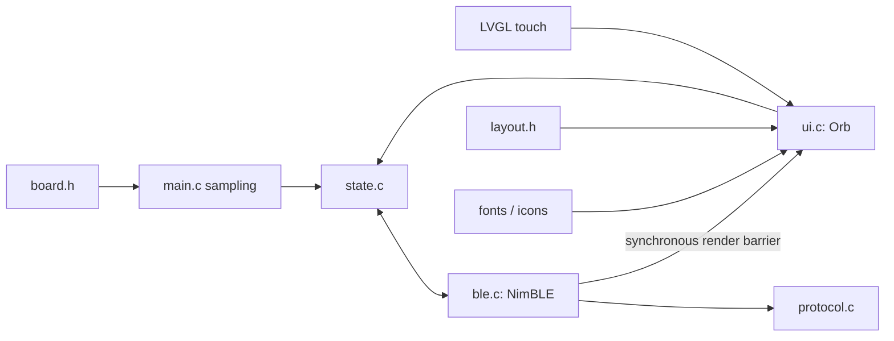

# Shared control firmware

| File | Purpose | Status |
|---|---|---|
| `protocol.[ch]` | LE codecs, strict text validation, fragments; audio framing fixtures only | ✅ Host tested |
| `state.[ch]` | Sampling/debounce, sequences, atomic phone state, arm/OFF rules | ✅ Host tested |
| `layout.h` | Scaled Orb geometry, hit tests, stage-1 listening, ASCII fallback | ✅ Host tested |
| `board.h` | Synchronous board interface and virtual/physical slider layout flag | 🟡 Hardware unverified |
| `main.c`, `runtime.h` | Serialized runtime; recursive mutex supports synchronous NimBLE events | 🟡 Hardware unverified |
| `ble.c` | Secure Connections, explicit Numeric Comparison, bonding/revoke | 🟡 Hardware unverified |
| `ui.c` | Orb capture/mode, destination/pips, pairing and forget modals | ✅ Native rendered; hardware unverified |
| [fonts/](fonts/), [icons/](icons/) | Lexend subsets and A8 sparkle; other icons are LVGL primitives | ✅ Native/IDF built |

Start with [the native preview](../tools/ui_preview/README.md), then `protocol.h`
and `state.h`; [REQ-8], [REQ-18], [REQ-49–53] traceability only.

| UI path | Behaviour | Status |
|---|---|---|
| Capture sectors | Direct OFF/PTT/REC selection outside orb up to screen edge; angular gaps do nothing | ✅ Geometry + pointer tested |
| Orb | Whole disc swaps mode; grey OFF/no link, outlined armed, filled/pulsed listening | ✅ Native rendered |
| Destination | Resolved name, Auto badge at index 0, list pips; tap cycles via `VR_CYCLE` | ✅ Native tested |
| No phone state/link | Bluetooth-off target tap opens enrollment | ✅ Pointer tested |
| Target long press | 3 seconds without leaving slot opens bin confirmation; recognition haptic | ✅ Pointer tested |
| Pair/forget | X/check lower zones, dead centre seam; both block phone display acknowledgments | ✅ Pointer tested |
| Error | Red target slot for 5 seconds or until a clearing phone update | ✅ Expiry tested |
| Physical-slider layout | Orb (120,112), radius 84; pips 222, name baseline 264 | ✅ 240×280 native rendered; C6 remains stub |

`virtual_sliders` comes from `board.h`: M5 shows the ring; C6 metadata omits it.
Layout scales and centres from board resolution. Pips and unassigned pixels do
nothing. Touch selections give a light haptic; physical buttons keep their flow.

`vr_ui_stage1_listening` is a **stage-1 visual approximation, with no audio**:
secured link + phone state AND (PTT + yellow held OR REC). Stage 2 must replace
it with real streaming state. UI "armed" is independent of the fail-closed gate.

The pulse runs at 5 Hz inside the orb bounds, using the existing 16-row internal
DMA strip. No shared PSRAM dependency. [Handoff](../handoff.md) records measured
native flush bounds, static sizes, timing choices and hardware-only checks.

REQ-18 waits for actual rendering and synchronous DMA before acknowledging a
phone update; either modal blocks it. Scanout visibility remains **unverified**.
Touch controls retain 25 ms debounce and `remote_event`; BLE/state/protocol are unchanged.

UTF-8 rendering maps each unsupported code point to one ASCII `?`. Target names
shrink 42/30/24 px, then use ellipsis inside the full font-box chord. Pairing uses
84 px digits. Exact conversion commands and OFL are linked in [fonts](fonts/).
