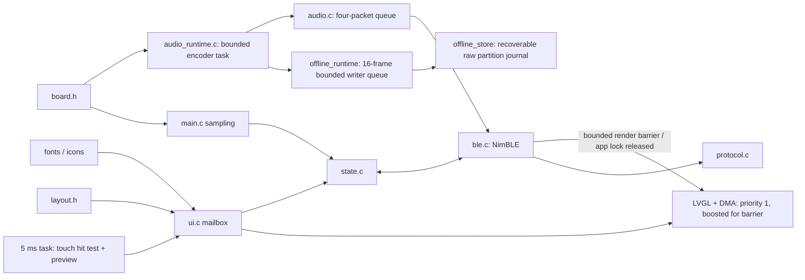

# Shared control and audio firmware

| File | Purpose | Status |
|---|---|---|
| `offline_capture.[ch]` | Pure owner/session/fresh-trigger/local-record policy | ✅ Host tested |
| `offline_store.[ch]`, [offline-storage.md](offline-storage.md) | Committed frame prefix, persisted IDs/boot and confirmed deletion | ✅ Fake-flash crash tested |
| `offline_runtime.c`, `offline.h` | Serialized writer, C1–C4/R1–R4/progress and capture preemption | ✅ Host scheduling harness; hardware timing TBC |
| `protocol.[ch]` | LE codecs, strict text validation, Phone/Audio framing | ✅ Host tested |
| `state.[ch]` | Sampling/debounce, sequences, atomic phone state, arm/OFF rules | ✅ Host tested |
| `layout.h` | Scaled Orb geometry, hit tests, live/offline producer-bit listening, ASCII fallback | ✅ Host tested |
| `audio.[ch]` | Bounded packet queue, segment/frame IDs, MTU fragmentation, START/END/LAST | ✅ Host tested |
| `audio_runtime.c` | Dedicated encoder task, generation cancellation, gating, stop/backpressure and serial metrics | 🟡 Built; hardware unverified |
| `test_hook.h` | Optional serial decoder; ordinary slider/button sampling, no authority override | ✅ Host decoder + UI debounce tests |
| `board.h` | Synchronous board interface and virtual/physical slider layout flag | 🟡 Hardware unverified |
| `main.c`, `runtime.h` | Priority 5 input/transport, priority 4 encoder, priority 1 renderer; short mailbox lock | 🟡 Hardware unverified |
| `ble.c` | Secure Connections, explicit Numeric Comparison, bonding/revoke | 🟡 Hardware unverified |
| `ui.c`, `ui_input.h` | Snapshot renderer, partial invalidation, immediate selection preview + gesture rollback; same Orb/modals | ✅ Native rendered; hardware unverified |
| `render_barrier.h`, `scheduling.h` | 400 ms completion deadline and render priority guard: C6 20 / S3 3, restored after wait | ✅ Native guard/barrier tests; device timing TBC |
| `timing.[ch]` | Compile-time scheduling aggregates every five seconds, default ON | 🟡 Hardware timing unverified |
| [fonts/](fonts/), [icons/](icons/) | Lexend subsets and A8 sparkle; other icons are LVGL primitives | ✅ Native/IDF built |

Start with [the native preview](../tools/ui_preview/README.md), then `protocol.h`
and `state.h`; [REQ-8], [REQ-18], [REQ-49–53] traceability only.

| UI path | Behaviour | Status |
|---|---|---|
| Capture sectors | Direct OFF/PTT/REC selection outside orb up to screen edge; angular gaps do nothing | ✅ Geometry + pointer tested |
| Orb | Whole disc swaps mode; grey OFF/idle no link, outlined armed, filled/pulsed live or offline listening | ✅ Native rendered |
| Destination | Resolved name, Auto badge at index 0, list pips; physical cycle button emits `VR_CYCLE` | ✅ Native tested |
| No phone state/link | Bluetooth-off target tap opens enrollment | ✅ Pointer tested |
| Target long press | 3 seconds without leaving slot opens bin confirmation; recognition haptic | ✅ Pointer tested |
| Pair/forget | X/check lower zones, dead centre seam; both block phone display acknowledgments | ✅ Pointer tested |
| Error | Red target slot for 5 seconds or until a clearing phone update | ✅ Expiry tested |
| Offline / storage | Bluetooth-off target while locally recording; small full, waiting and sync icons use the existing pip row; full/waiting survive OFF | ✅ Native rendered |
| Physical-slider layout | Orb (120,112), radius 84; pips 222, name baseline 264 | ✅ 240×280 native rendered; physical mode is status-only Orb |

`virtual_sliders` comes from `board.h`: M5 shows the round ring; C6 shows a compact rectangle ring only when its optional physical I/O board is absent. Physical mode keeps the larger status Orb.
Layout scales and centres from board resolution. Pips and unassigned pixels do
nothing. OFF commits on touch-down with a light haptic through `remote_event`; other touch selections keep release acceptance. Physical buttons keep their flow.
PTT/REC and Orb previews use their existing selected styles on touch-down; leaving
the original hit zone restores the prior view. OFF stays committed after a stray drag. Linked target taps stay inert.

`vr_ui_listening` reads the producer streaming **or offline** bit. Live starts
lighting after the first accepted Audio notification; local acquisition lights
the same Orb while disconnected and until the local record closes on reconnect.
The target remains Bluetooth-off during that record. PTT and REC positions alone
never light the listening Orb. Preview tests independently
toggle the producer bit; runtime/UI timing still needs hardware verification.

| Audio policy | Implementation |
|---|---|
| Codec | `78/esp-opus` 1.0.5, fixed-point, mono 16 kHz / 320 samples; raw 20 ms packets, no DTX/FEC; 24,000 bit/s starting constant `VR_AUDIO_BITRATE`, complexity 0, CBR |
| Memory | Board allocates encoder state; 48 KiB dual-core / 32 KiB single-core internal task stack for alloca scratch; four encoded packets, each bounded to 512 bytes; board DMA also bounded |
| Gate | Fresh authenticated session + subscriptions/info/snapshot + complete current-ack arm; local OFF always wins; local or phone hold requires PTT; tap-lock disabled |
| OFF | Disable RX DMA, suspend in-flight computation, invalidate its generation, discard queues; only END then stopped Input; no data flush |
| Stop/loss | END follows the last notification sent; entirely unsent queued tail consumes no wire sequence. A partially sent packet still reports interruption. Overflow/notify failure latches stop until snapshot resync and release/repress PTT or fresh REC selection |
| Transport | One pending data notification; reserve one extra pending slot for END. Actual ATT MTU per frame; 15–30 ms interval / zero latency / 4 s timeout requested, OS decides |
| Recovery | END retries at most 1 s, then disconnect; pending data timeout 200 ms; reconnect resets IDs and state; wrap closes segment / disconnects before segment reuse |
| Metrics | Once per segment: encoder mean/max µs, queue high-water, known discarded frames, notify failures, free internal/PSRAM + segment deltas, CPU Hz, stack watermark; boot allocation deltas separately |

Live audio uses transient RAM. Offline Opus frames persist unencrypted until phone confirmation; firmware never logs audio contents. See [storage format and capacity](offline-storage.md).
Audio timing, runtime memory sufficiency, gain and quality are **TBC** on device.

The pulse runs at 5 Hz in conservative horizontal bands outside the filled disc.
Sector arcs/icons and six static Orb styles rasterize once into optional board-
allocated opaque RGB565 tiles. StopWatch permits PSRAM cache allocation and a
32-row internal DMA strip; allocation failure uses the identical primitives.
C6 requires no PSRAM and keeps 8 rows. Its ≤7056-byte pre-scaled A8 glyph fixes a small-strip transformed-image clipping regression; sectors/Orbs remain primitives. All 17 PNGs match the original pixels;
[hardware-fix evidence](../../AI/FW/2026-11-02-hardware-fixes/README.md) records
native timing and RAM. Sub-50 ms control latency remains **hardware-unverified**.

REQ-18 waits for actual rendering and synchronous DMA before acknowledging a
phone update; either modal blocks it. Scanout visibility remains **unverified**.
PTT/REC and mode retain release acceptance and 25 ms debounce. OFF bypasses both
through `remote_event`; opening the forget overlay commits OFF before hiding the Orb.
`board_touch` distinguishes an I2C failure from an observed release. A failed
read preserves the previous gesture for less than 100 ms since the last good
sample; at 100 ms it cancels without activation and requires an observed finger
up before rearming. Invalid reads cannot recognize the target long hold.
PTT/REC and mode previews never change capture/arm/streaming state; OFF is an
immediate authoritative transition. PTT→OFF still goes directly to OFF.

`ui_poll` owns gesture/debounce state in the input task. C6 samples touch/expander I2C outside the app mutex via `board_sample_inputs`, then reads cached state; StopWatch keeps its original serialized sampling. `ui_tick`
reads a mailbox snapshot under the recursive app mutex, then owns all LVGL and
panel SPI/DMA work outside it. No core affinity or shared PSRAM dependency.
Capture invalidates the old/new sectors; mode/streaming invalidate the Orb;
destination/error/pips invalidate the target strip. Overlay transitions and
recovery after a failed flush redraw the whole screen.

`ui_phone` is called with the app mutex at depth one and releases it for a
maximum 400 ms semaphore wait (`PHONE_RENDER_WAIT_MS`). Success checks matching
completed DMA **within the 400 ms deadline** and no modal once, after reacquiring
the mutex. A 344 ms draw succeeds; 401 ms fails. On-time DMA remains accepted if
mutex reacquisition is late. Only the destination strip is invalidated during a
barrier with a valid baseline; pending Orb/sector/pulse work waits for the next
ordinary tick. Failed/overlay baseline recovery still redraws fully. The renderer
is boosted to C6 20 / S3 3 while waiting, then restored on every result path.
`ble_audio_ready` permits only one pending Audio notification (plus reserved END);
a blocked host stalls completion/backpressure rather than queuing 50 unchecked
Audio notifications. Its 200 ms pending timeout and eight-frame queue still make
short barriers necessary; sustained behavior remains **unverified on hardware**.
Failure restores the authoritative mailbox asynchronously. BLE rechecks security, then applies the existing ack/control-epoch
arm checks. Notifications still run once per main-loop pass; see
[handoff](../../AI/FW/2026-11-02-offline-handoff.md) for NimBLE callback source evidence and hardware limits.

`REMOTE_TIMING=ON` logs mean/max microseconds for redraws, sampled touch→DMA
estimate, loop work/period, I2C touch polling, DMA strips and phone barriers, plus
queue high-water and failures, every five seconds from the renderer. Idle ticks
are excluded from redraw means. No audio contents, names or transcripts are logged.
`-DREMOTE_TIMING=OFF` compiles these probes out. Physical latency/power and sustained
audio under UI load **need hardware to tell**.

UTF-8 rendering maps each unsupported code point to one ASCII `?`. Target names
shrink 42/30/24 px, then use ellipsis inside the full font-box chord. Pairing uses
84 px digits. Exact conversion commands and OFL are linked in [fonts](fonts/).

Offline capture needs an existing owner bond and a fresh local trigger while the
live handshake is unavailable, or physical capture still active at link loss.
A complete compatible phone pause remains effective. Reconnect preserves local
codec history and stored mode; the local boundary finalizes it. OFF immediately
stops DMA/encoding and discards queued frames. Recovery and full/write failure
preserve the verified prefix. Sync pauses before live capture, never uses Audio,
and keeps IDs/boot/capture-time snapshots across reconnect/reflash. Read
[offline-storage.md](offline-storage.md) before changing persistence; it records
flash-cache stalls and unmeasured timing/wear assumptions.

`REMOTE_TEST_HOOK=ON` adds USB input to the same slider mailbox/button debounce.
It logs TEST BUILD and adds a top-layer magenta mark; release signals reject it.
See [HIL](../tools/hil/README.md).

A mount failure refreshes the existing red storage indicator and disables offline
storage; it leaves pairing and live audio available. Healthy retained stores keep
the existing re-enrollment guard. Re-enrollment around a broken store persists an
offline hold across reboot; local erase then hold reset is required to enable
storage again. NVS hold-write failure prevents that enrollment attempt. Both OFF/mode queue paths tolerate a missing
writer. During capture, small-MTU progress completes without cancelling its tail;
the phone snapshot-request flag refreshes progress after a missed reconnect notice.

Service Changed uses the standard 0x1801/0x2a05 handle and saves the layout marker
only on NimBLE's indication acknowledgment (`BLE_HS_EDONE`), retrying on subscription.
It uses `gatt_acked`; the previous unacknowledged `gatt_layout` key is ignored.
iPhone behavior is **unverified**. Enrollment origin is latched at CONNECT: rejected enrollment deletes persisted keys,
including after timeout, while a rejected stranger preserves the owner bond. Boot
ownership requires an authenticated SC bond with a 16-byte LTK. Local NimBLE source
selects Just Works for NoIO even with MITM requested (`ble_sm_sc.c:174–192`), and
persists keys before the encryption callback (`ble_sm.c:1272–1288`). Host BLE events
cover cleanup, deletion failure and reboot ownership; real pairing remains unverified.

| Added boundary | Behavior / evidence |
|---|---|
| `scheduling.h` | Single core: Opus 22/32 KiB, writer 1; dual core unchanged at Opus 4/48 KiB, writer 2. Native lifecycle tests run both policies |
| Physical selector mailbox | Debounced board values bypass virtual debounce, unchanged fields use UINT8_MAX. OFF stops immediately, mode precedes fresh REC; no touch override of physical mode. Native C6 integration tests |
| Rectangle virtual controls | Same sector/icon/Orb design, ring radius 94/width 36, Orb radius 50; large target row. Native touch/modal/partial redraw checks |
| Timing | Encode mean/max and five-second wall-time load estimate (includes preemption); timing tag enabled on single-core builds when REMOTE_TIMING is ON. Logs execute in renderer outside app mutex |

The [C6 handoff](../../AI/FW/2026-11-11-c6-port/handoff.md) records flash guards,
RAM estimates and the device checklist. The BLE contract and wire layouts are unchanged.
