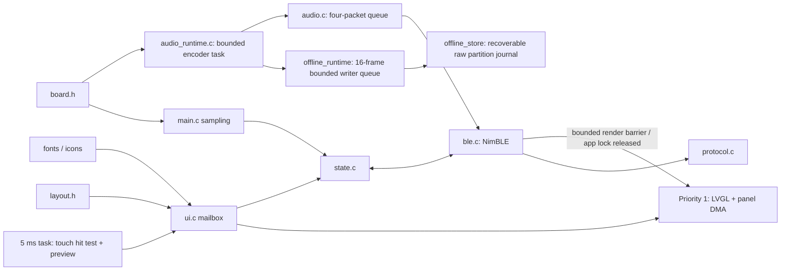

# Shared control and audio firmware

| File | Purpose | Status |
|---|---|---|
| `offline_capture.[ch]` | Pure owner/session/fresh-trigger/local-record policy | ✅ Host tested |
| `offline_store.[ch]`, [offline-storage.md](offline-storage.md) | Committed frame prefix, persisted IDs/boot and confirmed deletion | ✅ Fake-flash crash tested |
| `offline_runtime.c`, `offline.h` | Serialized writer, C1–C4/R1–R4/progress and capture preemption | ✅ Host scheduling harness; hardware timing TBC |
| `protocol.[ch]` | LE codecs, strict text validation, Phone/Audio framing | ✅ Host tested |
| `state.[ch]` | Sampling/debounce, sequences, atomic phone state, arm/OFF rules | ✅ Host tested |
| `layout.h` | Scaled Orb geometry, hit tests, live/offline producer-bit listening, ASCII fallback | ✅ Host tested |
| `audio.[ch]` | Bounded packet queue, segment/frame IDs, MTU fragmentation, START/END/LAST | ✅ Host tested |
| `audio_runtime.c` | Dedicated encoder task, generation cancellation, gating, stop/backpressure and serial metrics | 🟡 Built; hardware unverified |
| `board.h` | Synchronous board interface and virtual/physical slider layout flag | 🟡 Hardware unverified |
| `main.c`, `runtime.h` | Priority 5 input/transport, priority 4 encoder, priority 1 renderer; short mailbox lock | 🟡 Hardware unverified |
| `ble.c` | Secure Connections, explicit Numeric Comparison, bonding/revoke | 🟡 Hardware unverified |
| `ui.c`, `ui_input.h` | Snapshot renderer, partial invalidation, immediate selection preview + gesture rollback; same Orb/modals | ✅ Native rendered; hardware unverified |
| `timing.[ch]` | Compile-time scheduling aggregates every five seconds, default ON | 🟡 Hardware timing unverified |
| [fonts/](fonts/), [icons/](icons/) | Lexend subsets and A8 sparkle; other icons are LVGL primitives | ✅ Native/IDF built |

Start with [the native preview](../tools/ui_preview/README.md), then `protocol.h`
and `state.h`; [REQ-8], [REQ-18], [REQ-49–53] traceability only.

| UI path | Behaviour | Status |
|---|---|---|
| Capture sectors | Direct OFF/PTT/REC selection outside orb up to screen edge; angular gaps do nothing | ✅ Geometry + pointer tested |
| Orb | Whole disc swaps mode; grey OFF/idle no link, outlined armed, filled/pulsed live or offline listening | ✅ Native rendered |
| Destination | Resolved name, Auto badge at index 0, list pips; physical cycle button emits `VR_CYCLE` | ✅ Native tested |
| No phone state/link | Bluetooth-off target tap opens enrollment | ✅ Pointer tested |
| Target long press | 3 seconds without leaving slot opens bin confirmation; recognition haptic | ✅ Pointer tested |
| Pair/forget | X/check lower zones, dead centre seam; both block phone display acknowledgments | ✅ Pointer tested |
| Error | Red target slot for 5 seconds or until a clearing phone update | ✅ Expiry tested |
| Offline / storage | Bluetooth-off target while locally recording; small full, waiting and sync icons use the existing pip row; full/waiting survive OFF | ✅ Native rendered |
| Physical-slider layout | Orb (120,112), radius 84; pips 222, name baseline 264 | ✅ 240×280 native rendered; C6 remains stub |

`virtual_sliders` comes from `board.h`: M5 shows the ring; C6 metadata omits it.
Layout scales and centres from board resolution. Pips and unassigned pixels do
nothing. Touch selections give a light haptic on accepted release; physical buttons keep their flow.
Capture and Orb previews use their existing selected styles on touch-down; leaving
the original hit zone restores the prior view. Linked target taps stay inert.

`vr_ui_listening` reads the producer streaming **or offline** bit. Live starts
lighting after the first accepted Audio notification; local acquisition lights
the same Orb while disconnected and until the local record closes on reconnect.
The target remains Bluetooth-off during that record. PTT and REC positions alone
never light the listening Orb. Preview tests independently
toggle the producer bit; runtime/UI timing still needs hardware verification.

| Audio policy | Implementation |
|---|---|
| Codec | `78/esp-opus` 1.0.5, fixed-point, mono 16 kHz / 320 samples; raw 20 ms packets, no DTX/FEC; 24,000 bit/s starting constant `VR_AUDIO_BITRATE`, complexity 0, CBR |
| Memory | Board allocates encoder state; 48 KiB internal task stack for alloca scratch; four encoded packets, each bounded to 512 bytes; board DMA also bounded |
| Gate | Fresh authenticated session + subscriptions/info/snapshot + complete current-ack arm; local OFF always wins; local or phone hold requires PTT; tap-lock disabled |
| OFF | Disable RX DMA, suspend in-flight computation, invalidate its generation, discard queues; only END then stopped Input; no data flush |
| Stop/loss | END sequence accounts for every encoded packet, including discarded queued tail. A lost tail is reported as interrupted by the client. Overflow/notify failure latches stop until snapshot resync and release/repress PTT or fresh REC selection |
| Transport | One pending data notification; reserve one extra pending slot for END. Actual ATT MTU per frame; 15–30 ms interval / zero latency / 4 s timeout requested, OS decides |
| Recovery | END retries at most 1 s, then disconnect; pending data timeout 200 ms; reconnect resets IDs and state; wrap closes segment / disconnects before segment reuse |
| Metrics | Once per segment: encoder mean/max µs, queue high-water, known discarded frames, notify failures, free internal/PSRAM + segment deltas, CPU Hz, stack watermark; boot allocation deltas separately |

Live audio uses transient RAM. Offline Opus frames persist unencrypted until phone confirmation; firmware never logs audio contents. See [storage format and capacity](offline-storage.md).
Audio timing, runtime memory sufficiency, gain and quality are **TBC** on device.

The pulse runs at 5 Hz inside the orb bounds, using the existing 16-row internal
DMA strip. No shared PSRAM dependency. [Handoff](../handoff.md) records measured
native flush bounds, static sizes, timing choices and hardware-only checks.

REQ-18 waits for actual rendering and synchronous DMA before acknowledging a
phone update; either modal blocks it. Scanout visibility remains **unverified**.
Touch controls retain release acceptance, 25 ms debounce and `remote_event`.
`board_touch` distinguishes an I2C failure from an observed release. A failed
read preserves the previous gesture for less than 100 ms since the last good
sample; at 100 ms it cancels without activation and requires an observed finger
up before rearming. Invalid reads cannot recognize the target long hold.
Previews never change capture/arm/streaming state; PTT→OFF still goes directly to OFF.

`ui_poll` owns touch/I2C and gesture/debounce state in the input task. `ui_tick`
reads a mailbox snapshot under the recursive app mutex, then owns all LVGL and
panel SPI/DMA work outside it. No core affinity or shared PSRAM dependency.
Capture invalidates the old/new sectors; mode/streaming invalidate the Orb;
destination/error/pips invalidate the target strip. Overlay transitions and
recovery after a failed flush redraw the whole screen.

`ui_phone` is called with the app mutex at depth one and releases it for a
maximum 40 ms semaphore wait. Success requires matching completed DMA, no modal,
and completion observed before the deadline; failure restores the authoritative mailbox
asynchronously. BLE rechecks security, then applies the existing ack/control-epoch
arm checks. Notifications still run once per main-loop pass; see
[handoff](../handoff.md) for NimBLE callback source evidence and hardware limits.

`REMOTE_TIMING=ON` logs mean/max microseconds for redraws, sampled touch→DMA
estimate, loop work/period, I2C touch polling, DMA strips and phone barriers, plus
queue high-water and failures, every five seconds from the renderer. Idle ticks
are excluded from redraw means. No audio contents, names or transcripts are logged.
`-DREMOTE_TIMING=OFF` compiles these probes out. Physical latency/power and sustained
audio under UI load **need hardware to tell**.

UTF-8 rendering maps each unsupported code point to one ASCII `?`. Target names
shrink 42/30/24 px, then use ellipsis inside the full font-box chord. Pairing uses
84 px digits. Exact conversion commands and OFL are linked in [fonts](fonts/).

Offline capture needs an existing owner bond and a fresh local trigger while the
live handshake is unavailable, or physical capture still active at link loss.
A complete compatible phone pause remains effective. Reconnect preserves local
codec history and stored mode; the local boundary finalizes it. OFF immediately
stops DMA/encoding and discards queued frames. Recovery and full/write failure
preserve the verified prefix. Sync pauses before live capture, never uses Audio,
and keeps IDs/boot/capture-time snapshots across reconnect/reflash. Read
[offline-storage.md](offline-storage.md) before changing persistence; it records
flash-cache stalls and unmeasured timing/wear assumptions.
