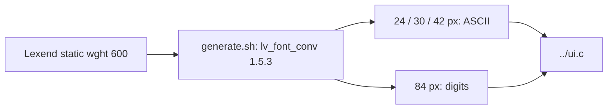

# Lexend SemiBold subsets



| File | Purpose | Status |
|---|---|---|
| `lexend_24.c`, `lexend_30.c`, `lexend_42.c` | Uncompressed 4 bpp U+0020–007E destination/error subsets | ✅ Native/IDF built |
| `lexend_84.c` | Uncompressed 4 bpp U+0030–0039 pairing subset | ✅ Native/IDF built |
| `generate.sh` | Exact converter flags and deterministic header normalization | ✅ Regenerated offline |
| [Lexend-OFL.txt](../../../DOCS/licences/Lexend-OFL.txt) | Supplied font's SIL OFL notice | ✅ Included |

Purpose: reproducible display assets. Inputs: owner-supplied static
`Lexend-SemiBold.ttf`, instantiated at wght=600 from `Lexend[wght].ttf` with
fontTools. Native PNGs and both firmware builds verify compilation/rendering;
panel appearance remains unverified. No runtime font loading.

From the repo root, with the supplied offline inputs present:

```sh
bash FW/app/fonts/generate.sh \
  "$PWD/AI/scratch/fw-ui-assets/conv/node_modules/lv_font_conv/lv_font_conv.js" \
  "$PWD/AI/scratch/fw-ui-assets/font/Lexend-SemiBold.ttf"
```

The conversion command for each size is:

```sh
node "$conv" --bpp 4 --size "$size" --no-compress --format lvgl \
  --font "$font" -r 0x20-0x7e -o "lexend_${size}.c" --lv-include lvgl.h
# Pairing: size=84, range=0x30-0x39, output=lexend_84.c.
```

`layout.h` maps each unsupported UTF-8 code point to one ASCII `?` before
measurement/drawing. Names shrink through these sizes, then use `...`; no scrolling
or clipping at the round rim. The script requires Node and Python 3.
