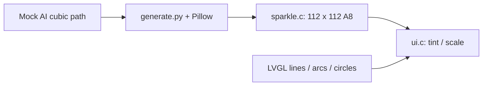

# Orb sparkle

| File | Purpose | Status |
|---|---|---|
| `generate.py` | Supersample the supplied mock's four cubic curves; no external artwork | ✅ Reproduced |
| `sparkle.c` | 12,544-byte alpha mask, tinted black/grey/mode colour by LVGL | ✅ PNG/IDF verified |

Purpose: preserve the mock sparkle without triangle antialiasing seams. Inputs:
`icon('ai')` in the owner-supplied mock; Pillow. All other icons use LVGL primitives,
including Bluetooth, mic-off, hold, record, type, Auto badge, bin, X and check.
Panel sharpness remains unverified. [REQ-8]/[REQ-18] display support only.

Regenerate from the repo root: `python3 FW/app/icons/generate.py`.
