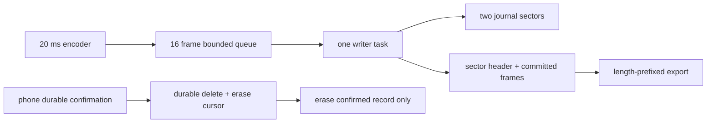

# Offline flash journal

Purpose: explain the StopWatch raw-flash store and its limits. Inputs: draft 1.1
[BLE contract](../../SYS/protocol/remote-ble.md), `partitions-stopwatch.csv`,
[core](offline_store.c), fake-flash tests. **Verified:** host crash/integrity tests
and generated partition comparison. **Unverified:** physical timing, endurance,
capacity, acoustic quality and hardware power-loss behavior.

| Property | Choice / evidence |
|---|---|
| Format | Small raw partition journal, no filesystem or PSRAM dependency; every frame has length, payload CRC and a separate commit word. Explicit boundaries keep recovery host-testable |
| Ownership | All flash calls serialize on the writer task; producer only copies packets into a bounded queue. Queue overflow stops capture rather than overwriting audio |
| Compiled allocation | Store/index is 49,232 bytes, board PSRAM preference with internal fallback; 18 × 544-byte internal queue jobs + 6144-byte writer stack, excluding RTOS overhead. C6 allocates none |
| RAM bounds | At most 4096 sector ownership/ordinal entries, 128 records, 512-byte packets; writer queue 18 jobs reserves two control slots around the 16-frame limit |
| Fetch index | Two uint16 arrays (next sector/exported bytes), 16 KiB RAM only, rebuilt at mount; resumed fetch skips earlier sectors without flash reads. No on-flash format change |
| Counter journal | First two 4096-byte sectors; 48-byte CRC-protected entries with separate commit words, 85 slots per bank; high-water recording ID, boot ID, pending deletion and physical erase cursor |
| Data sector | 64-byte CRC-protected committed header: ID, boot, start tick/UTC, mode, sector ordinal; first sector reserves immutable size/count/CRC and closed/interrupted bits |
| Frame | 8-byte length/reserved/CRC, payload padded to four bytes, 4-byte commit word; export strips CRC, padding and commit, retaining only u16 length plus packet |
| Recovery | Verify committed packets, export the prefix, mark interrupted, recompute summary; remove empty records. A torn final summary is retried with identical values. Finalized corruption stays retained and errored |
| Invalid headers | Quarantine rather than recycle unknown data; a storage error disables new capture. No silent formatting or overwritten old audio |
| Deletion | Persist ID and physical sector before each erase, then clear intent before R4. Torn erase cannot orphan an unidentified tail. No historical tombstones; missing allocated IDs confirm successfully |
| Exhaustion | Never wrap IDs/boot. Missing valid journal with dirty bytes fails closed, even with no records; continuity is unknowable. Explicit recovery requires a new enrollment identity; firmware does not silently reset counters |
| Boundaries | One sector cannot mix records. At most 128 simultaneous recordings; short recordings consume at least one sector. New capture needs a fresh trigger after full/failure |

The two-bank journal survives power loss during bank rotation: erase the other bank
before committing a successor; retain the last committed bank. Deletion replay
resumes from its durable physical-sector cursor even when an interrupted erase has
removed the target header. This is transient recovery state, not a tombstone list.
Counter persistence assumes firmware updates preserve the data partition. A full
flash erase destroys continuity and needs explicit re-enrollment with a new identity.

| StopWatch partition | Offset | Size |
|---|---:|---:|
| NVS (unchanged) | `0x9000` | `0x6000` |
| PHY (unchanged) | `0xf000` | `0x1000` |
| Factory app (unchanged) | `0x10000` | `0x177000` |
| Offline data | `0x187000` | `0xe79000` = 15,175,680 bytes |

The StopWatch-only CSV fills 16 MiB exactly. The C6 keeps its 4 MiB-compatible
single-app table and does not advertise bit 7. `tests/check_partitions.py` compares
generated NVS offset/size against ESP-IDF's original single-app-large CSV and checks
both generated board tables. Preserving offsets permits existing NVS bonds to
survive an ordinary firmware/partition-table update; it is not a hardware bond test.

**Capacity calculation only; unmeasured.** The data partition has 3705 sectors,
minus two journal sectors = 3703 data sectors. Subtracting each 64-byte header leaves
3703 × 4032 = **14,930,496 bytes** of frame storage area, reported as total capacity.
Free capacity is the corresponding currently unallocated area plus an active
sector's unused tail. It includes space still needed for frame bookkeeping and
cannot promise an equal number of exported bytes.

At assumed 24 kbit/s CBR / 50 frames/s, each Opus packet is 60 bytes: exported
rate = (60 + 2) × 50 = 3100 bytes/s. Dividing the storage area by 3100 yields
4816.29 s, but omits private frame overhead. A stored packet instead uses
8 + 60 + 4 = 72 bytes; floor(4032 / 72) = 56 frames/sector, hence
3703 × 56 / 50 = **4147.36 s (69.12 min)** of long-record audio. Equivalent
export capacity is 12,856,816 bytes. Additional partly filled final sectors,
128-record exhaustion, quarantined sectors and actual packet sizes reduce this.
No throughput, commit-latency or power-loss-tail bound is measured.

A writer task does **not** make SPI1 flash operations nonblocking: ESP32 flash
writes/erases can disable caches and stall code on both CPUs, including the
flash-resident encoder, BLE host and display/input work. The 16-frame queue
absorbs writer scheduling delays only while the producer can execute. Erases are
restricted to confirmed deletion while capture is idle; a trigger can race an
already started erase and must wait for its completion. Hardware must measure
maximum write/erase stalls, DMA overrun, BLE responsiveness and display/touch
latency under simultaneous recording/UI activity. Timing safety is **unverified**.
At-rest flash remains unencrypted under the prototype limitation; deletion is
logical, with no forensic-erasure guarantee.
