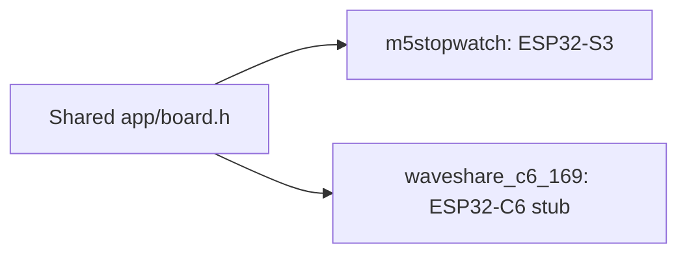

# Board adapters

| Folder | Hardware | Status |
|---|---|---|
| [m5stopwatch/](m5stopwatch/) | CO5300, CST820, IOE1/PM1, buttons, ES8311 mic | 🟡 Controls owner-confirmed; audio unverified |
| [waveshare_c6_169/](waveshare_c6_169/) | No pin claims; mic functions return unsupported; encoder allocation is internal RAM | ✅ Compiled stub; hardware unverified |

Start with `app/board.h`, then the selected board's README.
[REQ-49–53] remain unverified; both prototypes report `hw_mic_cut=0`.

The shared app calls only `board_mic_start/stop/read` and `board_audio_alloc`.
StopWatch permits encoder-state PSRAM with an internal fallback; C6 never requests
PSRAM. Both keep the Opus task stack internal. No codec pins leak into shared code.
