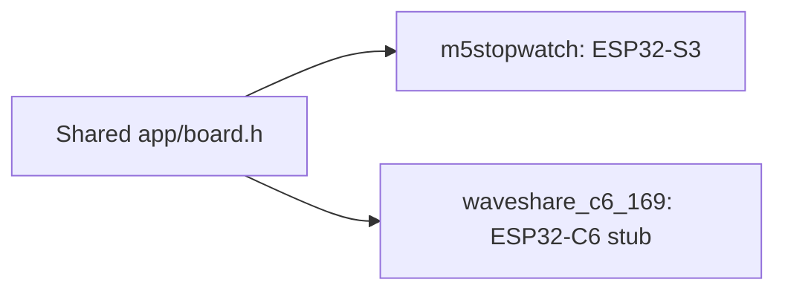

# Board adapters

| Folder | Hardware | Status |
|---|---|---|
| [m5stopwatch/](m5stopwatch/) | CO5300 AMOLED, CST820 touch, IOE1/PM1, two GPIO buttons | 🟡 Compiled; hardware unverified |
| [waveshare_c6_169/](waveshare_c6_169/) | No pin claims or drivers in this stage | ✅ Compiled stub; hardware unverified |

Start with `app/board.h`, then the selected board's README.
[REQ-49–53] remain unverified; both prototypes report `hw_mic_cut=0`.
