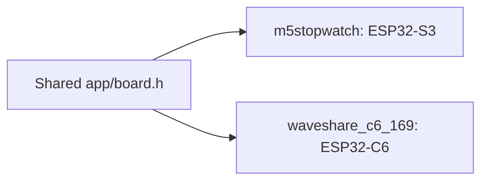

# Board adapters

| Folder | Hardware | Status |
|---|---|---|
| `es8311_mic.h` | Shared 16 kHz RX-only register table: DAC powered down, HP disabled, ADC unchanged | ✅ Host register test; analog behavior unverified |
| [m5stopwatch/](m5stopwatch/) | CO5300, CST820, IOE1/PM1, buttons, ES8311 mic | 🟡 Controls owner-confirmed; audio unverified |
| [waveshare_c6_169/](waveshare_c6_169/) | ST7789/CST816T, ES8311, optional TCA9554; BOOT/PWR fallback | ✅ Built/host tested; hardware unverified |

Start with `app/board.h`, then the selected board's README.
[REQ-49–53] remain unverified; both prototypes report `hw_mic_cut=0`.

The shared app calls only `board_mic_start/stop/read` and `board_audio_alloc`.
StopWatch permits encoder-state PSRAM with an internal fallback; C6 never requests
PSRAM. Both keep the Opus task stack internal. No codec pins leak into shared code.

Panel SPI/DMA belongs to the lower-priority renderer, outside the app mutex.
C6 samples touch/expander I2C outside the audio mutex; StopWatch retains its serialized I2C path. Codec setup happens before C6 task startup. StopWatch QSPI now
matches the vendor’s 80 MHz; StopWatch CPU is 240 MHz, I2C stays 100 kHz and C6 stays 160 MHz.

Offline recording uses separate 16 MiB partition CSVs on both boards. C6 checks
physical flash coverage before advertising bit 7 or allocating offline storage.
Both preserve NVS/PHY/app offsets and use an IRAM-safe I2S ISR.
Generated tables are checked by `FW/tests/check_partitions.py`.

StopWatch uses optional PSRAM artwork and a 32-row DMA strip. C6 uses primitives,
a ≤7056-byte A8 glyph and an 8-row strip; no PSRAM. The generic single-core policy
puts audio above the BLE host, then input, then renderer/writer; dual-core
priorities remain unchanged. See [C6 scheduling/pins](waveshare_c6_169/README.md).

Phone barriers temporarily boost render priority to C6 20 / S3 3 and draw the
destination first; ordinary rendering stays priority 1. See [app](../app/README.md).
