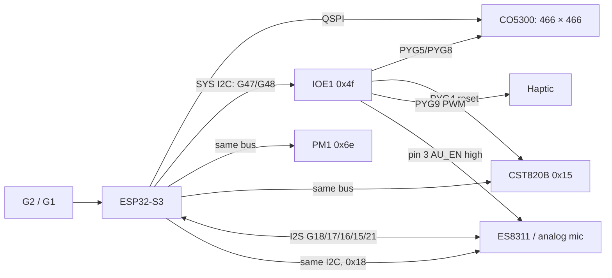

# M5Stack StopWatch (C152)

| File / resource | Purpose / provenance | Status |
|---|---|---|
| `board.c` | Own IDF C display/control driver + vendor-derived ES8311 register setup / bounded RX DMA | 🟡 Controls owner-confirmed; mic hardware unverified |
| `sdkconfig.defaults` | 16 MB flash, octal PSRAM; 240 MHz; optional PSRAM artwork, 32-row internal strip | 🟡 Hardware unverified |
| `idf_component.yml` | Espressif CO5300 2.2.0, Apache-2.0 | ✅ Offline resolved |
| `BUTTON_GPIOS` in `board.c` | Single mapping constant: G2 yellow/PTT, G1 blue/cycle; logs GPIO edges | 🟡 Colour mapping unverified |

Start at `board_init`; [REQ-8], [REQ-18], [REQ-49–53] not hardware proven.
AU_EN (IOE pin 3) stays high as in vendor `hal_ioe`; amp IOE pin 10 and GPIO 14
are held low before enabling the audio rail. The prototype OFF exception applies;
this is a DMA/encoder stop, with no independent hardware mic cut. No expander reset.
`board_touch` reports read failure separately from finger-up; the shared UI
holds the last good state for less than 100 ms, then cancels until a real release
is observed. Synthetic host/native tests reproduce the prior false activation;
real I2C fault timing remains **unverified**.
I2C runs at 100 kHz, serially under the app mutex; touch is polled (G13 configured
as input), QSPI uses 80 MHz, matching UserDemo `hal_display.cpp:83` (previously the
Espressif macro’s 40 MHz default), TE G38 is an input, not used to synchronize scanout. Driver checks all
initialization writes and stops boot on failure. LCD DMA waits up to 1 s/strip.

Source inputs (prefetched read-only references; none executed):

| Vendor source | Facts reused |
|---|---|
| [UserDemo](https://github.com/m5stack/M5StopWatch-UserDemo), `main/hal/hal_display.cpp`, `hal_ioe.cpp`, `drivers/cst820/` | QSPI pins, panel command sequence, x gap 6, touch registers/reset |
| [PowerDemo](https://github.com/m5stack/M5StopWatch-PowerDemo), `modules/m5sw_display/`, `modules/m5sw_power/` | Display reset high → rail on → 10 ms → low 8 ms → high 2 ms |
| [M5IOE1](https://github.com/m5stack/M5IOE1), `src/M5IOE1.{h,cpp}` | GPIO mode/pull/drive/output RMW; PWM1 PYG9, 5000 Hz |
| [M5PM1](https://github.com/m5stack/M5PM1), `src/M5PM1.h` | Address 0x6e; power 0x06, I2C config 0x09 |

UserDemo pins M5IOE1 1.0.8, M5PM1 1.0.6, M5GFX 0.2.19; register references
were supplied default-branch clones, so exact tag equivalence is **unverified**.
Vendor uses 468 logical columns with x gap 6; this adapter exposes the requested
466 with the same gap. Alignment, RGB order, touch orientation and scanout are
**unverified** until flashed. Haptic is 20% PWM for 25 ms; perceived strength TBC. Runtime PWM/start/stop
I2C faults log instead of rebooting; a failed stop retries after 25 ms. Boot-time
checks remain fatal. Fault injection is **unverified on hardware**.
CPU now uses 240 MHz, as UserDemo `sdkconfig.defaults:10` does; both board
builds use `-O2`. The C6 stub retains 160 MHz. QSPI switching power / shorter bus duty and
net battery impact **need hardware to tell**; no current estimate is claimed.
The shared renderer keeps one 32-row internal DMA strip and runs outside the app
mutex; the I2C reset-retry sequence is preserved. [Timing evidence](../../../AI/FW/2026-11-02-hardware-fixes/README.md)
separate panel DMA from touch polling and overall redraw wall time.
See [licences](../../../DOCS/licences/) for retained MIT and Apache notices.

Reports `virtual_sliders=true`: the shared UI draws the Orb capture ring.

| Mic detail | Source / implementation |
|---|---|
| Bus / pins | Vendor `hal_audio.cpp`: I2C 7-bit 0x18 (driver constant 0x30 is 8-bit), MCLK 18, BCLK 17, ASDOUT 16, LRCK 15, DSDIN 21 |
| Registers | Espressif `esp_codec_dev/device/es8311/es8311.c` supplied inside PowerDemo: open → 16-bit Philips → 16 kHz / 4.096 MHz coefficient → start; MCLK present during reset |
| Route / gain | Vendor analog mic, slave clock, 30 dB gain (`0x16=5`); `0x44=0x58` routes mic left / DAC reference right; only left enters Opus; DAC powered down, HP selection cleared |
| DMA | Stereo 16-bit, 320 stereo samples × four descriptors; nonblocking reads under app mutex; queue-overflow callback fails closed; disable resets DMA cursor and next enable resets RX queue (IDF `i2s_common.c`) |
| Allocation | Encoder state prefers PSRAM, falls back to internal; task stack and DMA stay internal |

The vendor uses 44.1 kHz for its demo; this profile uses the same driver's 16 kHz
clock coefficient. Register values were compared with supplied source; PCM polarity,
left-channel route, clipping/gain, continuous clocks and restart transients are
**unverified** until the coordinator records/plays audio. No speaker playback added.

Offline capability bit 7 is set (`0xbf`); firmware/contract are 0.3.0/1.1.
The board-specific defaults select the 16 MiB CSV while preserving NVS at
0x9000/0x6000, PHY and the existing factory image. The I2S ISR/overflow callback
is IRAM-safe; four DMA descriptors retain an 80 ms nominal sample horizon.
Encoder and storage-index allocations prefer PSRAM with an internal fallback;
writer queue, flash IO buffers, task stacks and DMA remain internal. Flash
operations still stall flash/PSRAM execution, BLE and display work; this config
does not prove 20 ms timing. See [storage](../../app/offline-storage.md).

`board_ui_alloc` uses PSRAM only and may return NULL; cache misses render the
same primitives. No internal-memory fallback for optional artwork. Strip growth
costs up to 14,912 additional internal heap bytes (falls back to 16 rows if
allocation fails); cache sizing is in the linked evidence.

The C6 port adds no-op `board_sample_inputs`/`board_physical_controls` adapters here;
StopWatch retains its original input I2C, base priorities, 48 KiB Opus stack, artwork
cache and 32-row strip. The C6 evidence includes a base-commit PNG comparison for
all existing fixtures and normal/hook StopWatch builds.

The shared [RX-only codec table](../es8311_mic.h) also fixes the identical DAC
power-up here (`0x12=0x02`, `0x13=0x00`); ADC/PGA/mic writes are unchanged.
Both amplifier enable lines remain low. Host register tests cover the table;
analog behavior remains unverified. Phone barriers temporarily raise render from
priority 1 to **3** (Opus stays 4) and draw the destination before other changes.
