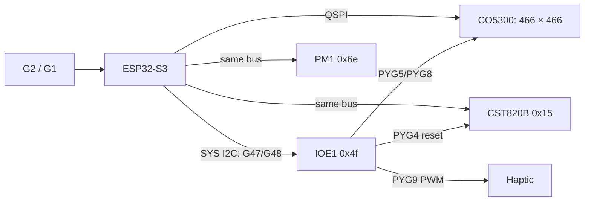

# M5Stack StopWatch (C152)

| File / resource | Purpose / provenance | Status |
|---|---|---|
| `board.c` | Own IDF C driver, vendor-derived init sequence/register use | 🟡 Hardware unverified |
| `sdkconfig.defaults` | 16 MB flash, octal PSRAM; UI strip stays internal | 🟡 Hardware unverified |
| `idf_component.yml` | Espressif CO5300 2.2.0, Apache-2.0 | ✅ Offline resolved |
| `BUTTON_GPIOS` in `board.c` | Single mapping constant: G2 yellow/PTT, G1 blue/cycle; logs GPIO edges | 🟡 Colour mapping unverified |

Start at `board_init`; [REQ-8], [REQ-18], [REQ-49–53] not hardware proven.
No access to PYG3/AU_EN, codec, I2S or microphones. No expander factory reset.
I2C runs at 100 kHz, serially under the app mutex; touch is polled (G13 configured
as input), QSPI uses the Espressif driver macro’s 40 MHz default (vendor uses 80 MHz), TE G38 is an input, not used to synchronize scanout. Driver checks all
initialization writes and stops boot on failure. LCD DMA waits up to 1 s/strip.

Source inputs (prefetched read-only references; none executed):

| Vendor source | Facts reused |
|---|---|
| [UserDemo](https://github.com/m5stack/M5StopWatch-UserDemo), `main/hal/hal_display.cpp`, `hal_ioe.cpp`, `drivers/cst820/` | QSPI pins, panel command sequence, x gap 6, touch registers/reset |
| [PowerDemo](https://github.com/m5stack/M5StopWatch-PowerDemo), `modules/m5sw_display/`, `modules/m5sw_power/` | Display reset high → rail on → 10 ms → low 8 ms → high 2 ms |
| [M5IOE1](https://github.com/m5stack/M5IOE1), `src/M5IOE1.{h,cpp}` | GPIO mode/pull/drive/output RMW; PWM1 PYG9, 5000 Hz |
| [M5PM1](https://github.com/m5stack/M5PM1), `src/M5PM1.h` | Address 0x6e; power 0x06, I2C config 0x09 |

UserDemo pins M5IOE1 1.0.8, M5PM1 1.0.6, M5GFX 0.2.19; register references
were supplied default-branch clones, so exact tag equivalence is **unverified**.
Vendor uses 468 logical columns with x gap 6; this adapter exposes the requested
466 with the same gap. Alignment, RGB order, touch orientation and scanout are
**unverified** until flashed. Haptic is 20% PWM for 25 ms; perceived strength TBC.
See [licences](../../licences/) for retained MIT notices.

Reports `virtual_sliders=true`: the shared UI draws the Orb capture ring.
