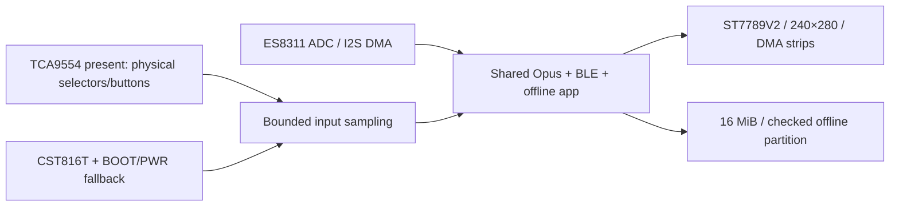

# Waveshare ESP32-C6-Touch-LCD-1.69 / Proto 1

| File | Purpose | Status |
|---|---|---|
| `board.c` | Display, touch, codec/DMA, physical/fallback inputs, flash guard | ✅ Built; hardware **unverified** |
| `controls.c`, `controls.h` | Pure Rev G decode, debounce, safe boot/fault recovery, bounded stuck-INT polling | ✅ Host tested |
| `storage.h` | Overflow-safe physical flash bound check | ✅ Host tested |
| `sdkconfig.defaults`, `CMakeLists.txt` | 160 MHz, no PSRAM, USB console, 16 MiB partitions; IDF drivers only | ✅ Build checked |

Start with [build commands](../../README.md) and [handoff/checklist](../../../AI/FW/2026-11-11-c6-port/handoff.md).
Same BLE 1.1 layouts and firmware 0.3.0; traces [REQ-8], [REQ-18], [REQ-49–53].
Bit 7 is enabled (`0xbf`) when the partition fits physical flash; missing/out-of-bounds
storage clears it before offline initialization/BLE registration. Both input modes
report `hw_mic_cut=0` under the existing prototype exception. No hardware acceptance claim.

## Pins and source evidence

Reference root **R** is the MAIN checkout's `AI/scratch/waveshare-c6-169-ref/`.
**D** = `R/demo/ESP-IDF/01_factory/components/esp_bsp/`. Pin values are reference
data, not copied implementations. `R/SOURCES.txt` records download URLs/SHA-256;
[Waveshare schematic](https://files.waveshare.com/wiki/ESP32-C6-Touch-LCD-1.69/ESP32-C6-Touch-LCD-1.69-Schematic.pdf)
net names below are authoritative when demos disagree.

| Signal | GPIO / policy | Source (D file:line; schematic net) |
|---|---|---|
| LCD SCLK / MOSI | 1 / 2 | `bsp_display.h:16` / `:15`; `LCD_SCLK` / `LCD_MOSI` |
| LCD CS / DC | 5 / 3 | `bsp_display.h:18` / `:19`; `LCD_CS` / `LCD_DC` |
| LCD reset | 4, active low | `bsp_display.h:20`; `LCD_RST` |
| Backlight | 6, high after panel init | `bsp_display.h:21`; `LCD_BL`, Q3 |
| Touch INT | 11, external pull; polling | `bsp_touch.h:8`; `TP_INT` |
| Touch reset | **shares GPIO4** | Schematic `LCD_RST`→R33 **0 Ω**→`TP_RST`; demo `bsp_touch.h:9` says NC (no separate pin). Panel reset also resets touch |
| I2C SDA / SCL | 8 / 7, 100 kHz; internal pulls OFF | `bsp_i2c.h:7–8`; shared `TP_*`, `CODEC_*`, `RTC_*`, `IMU_*`; R2/R3 4.7 kΩ. Owner's 2026-11-11 probe verified bus/address presence |
| I2S MCLK / BCLK | 19 / 20 | `bsp_es8311.c:21–22`; `I2S_MCLK` / `I2S_SCLK` |
| I2S WS | 22 | `bsp_es8311.c:23`; `I2S_LRCK` |
| MCU DOUT / DIN | 23 / 21 | `bsp_es8311.c:24–25`; `I2S_DSDIN` / `I2S_ASDOUT`. DOUT intentionally **unassigned** in RX-only driver |
| Amp enable | **no GPIO** | Schematic U7 NS4150B `CTRL`→R27 10 kΩ→VSYS. Hardware keeps amp powered; firmware powers down DAC (`0x12=0x02`), clears HP selection (`0x13=0x00`) and sends no speaker data. Cannot assert amp power OFF |
| PWR / battery latch | 18 active low / 15 high | `bsp_pwr.h:5–6`, `bsp_pwr.c:40–44`; `PWR_KEY` / `BAT_EN`. No blocking wait for PWR release |
| BOOT | 9, active low | Schematic K1/R17; GPIO table also names `IMU_INT` on 9. IMU stays unconfigured; verify interrupt does not drive this net |
| USB Serial/JTAG | 12 / 13 | Schematic `USB_N` / `USB_P`; sole console, no UART on pads |
| TCA9554 INT / unused TX | 17 input / 16 unused | Rev G `MAIN/AI/HW/2026-11-06-proto1g/firmware-note.md`, schematic `ESP_RXD` / `ESP_TXD`; external 10 kΩ INT pull is on Rev G |
| TXT/AI selector (S2) | TCA9554 P2 | I/O board G2: P2 low = AI, high or open = TXT, superseding Rev G's note. Source `MAIN/AI/HW/2026-11-19-ioboard-g2/FIRMWARE-NOTE-S2.md` (owner-approved printed caps). OFF/PTT/REC on P1:P0 unchanged |
| Battery ADC | 0, unused | Schematic `BAT_ADC`; owner measured ~4.2 V on USB, **not** a battery-presence detector |

ST7789 setup uses SPI mode 0, **40 MHz**, RGB565 and inversion on
(D `bsp_display.c:39–65`). Rotation **0** uses **gap (0,20)**, swap XY **false**,
mirror X/Y **false**: `R/demo/ESP-IDF/03_lvgl_example_v9/main/main.c:18,131–134,158`
and `R/demo/ESP-IDF/01_factory/main/main.c:29,196–199,223`. The commented `(0,34)`
in `bsp_display.c` is superseded by those active main-level calls.

**Partial updates: no additional coordinate alignment is needed for the offset.**
IDF 5.5.6 `components/esp_lcd/src/esp_lcd_panel_st7789.c:203–229` adds the gap to
both window endpoints, sends pixel-address CASET/RASET (exclusive ends become
inclusive `end-1`), and transfers exactly width × height × 2 bytes for RGB565.
That driver imposes no even/odd coordinate constraint. The existing shared
`LV_EVENT_INVALIDATE_AREA` even-start/odd-end rounding is retained; **+20 is even**,
so panel row parity, window dimensions and DMA byte counts are preserved. No
CO5300-specific rounding change is needed. Actual borders/colors and partial
scanout remain hardware **TBC**.

Touch reads seven bytes from 0; register `0xfe=1`
disables automatic sleep. Touch orientation/held release remain hardware TBC.

The demo archive has no top-level/BSP licence grant (bundled libraries have their
own licences); no Waveshare source code is reused. The codec sequence is adapted
from the existing StopWatch implementation's attributed Espressif Apache-2.0
sequence; its header and existing `DOCS/licences/` notice remain applicable.

## Input and scheduling

| Situation | Policy |
|---|---|
| 0x20 present | Physical sliders (`slider=0`): P1:P0 01 OFF, 11 PTT, 10 REC; P2 TXT=0/AI=1; P3/P4 active-low PTT/target. Touch keeps pairing/forget/modals; Orb cannot override mode |
| Initialization | Output=0, polarity=0, config=0x1f, baseline input read. Failed initialization stays physical/OFF |
| Debounce / INT | Whole byte unchanged ≥20 ms; OFF/00/I2C failure/stale ≥100 ms stop immediately. Poll low INT and debounce every 10 ms, idle every 50 ms. No ISR storm or read-until-high loop; lost edges covered by polling |
| Boot / recovery | REC at boot stays OFF until a stable selector transition; held buttons require release. Fault recovery in the same detent cannot restart. Shared reconnect policy requires a fresh trigger |
| 0x20 absent today | Virtual ring (`slider=1`) adapted to rectangle: Orb radius 50, sector width 36, target row ≥236. BOOT=PTT, readable PWR=target cycle; no physical slider claim |
| Audio | Single-core task priority **22**, 32 KiB internal stack; I2S IRAM-safe ISR and 4×320-frame stereo DMA buffers; no I2C in audio read/stop |
| BLE / input | Default NimBLE host **21**, radio controller **23** (IDF); input **5**. Touch/expander transactions timeout at 2 ms and run outside the audio/state mutex |
| Render / writer | Both normally priority **1**; phone barrier temporarily raises render to **20**, below BLE/audio. One 8-row **3840-byte** DMA strip; yield one tick after each completed transfer. No app mutex across LVGL/SPI/flash. S3 uses barrier priority **3** and keeps its 32-row strip |
| Artwork | Direct primitives; only a **2500-byte** touch-mode / **7056-byte** physical-mode A8 glyph avoids LVGL small-strip transform clipping. No full artwork cache or PSRAM allocation |

Owner's exact-unit synthetic Opus bench (2026-11-11) measured **11.48 ms mean /
17.06 ms worst**, ~22 KiB of 32 KiB stack, production 24 kbit/s settings
(`MAIN/AI/scratch/c6-probe/RESULTS.md`, `c6-opus-bench/main/main.c`). These are supplied
measurements, not a run of this port. `REMOTE_TIMING` logs encode wall-time load
estimate (includes preemption), mean/max, loop/touch/DMA and queue metrics from
the renderer. Task priorities leave nominal ~40% for other work; sustained timing
is **unverified**. Ordinary SPI1 writes can stall flash code despite task priority;
no runtime erase during capture. Confirm queue/overflow/write maxima on hardware.
Boot logs physical flash, store/encoder allocation sizes and free internal heap.
The [handoff](../../../AI/FW/2026-11-11-c6-port/handoff.md) gives link sizes and RAM estimates.
`REMOTE_ENCODE_BENCH` was omitted to avoid another boot/encoder lifecycle; use the
supplied standalone bench and production timing metrics. Opus uses fixed-point,
`DISABLE_FLOAT_API`, alloca scratch, `-O2`, VOIP, complexity 0, 24 kbit/s CBR,
16 kHz mono 20 ms, wideband, DTX/FEC off; no Xtensa optimization on C6.

## App / offline map update

| Name | Offset | Size |
|---|---|---|
| NVS | `0x9000` | `0x6000` |
| PHY | `0xf000` | `0x1000` |
| factory | `0x10000` | `0x1c0000` |
| offline | `0x1d0000` | `0xe30000` |

Bonds retain their NVS location. **Offline data on boards flashed before this map
change will be reformatted: export recordings first, then reformat the relocated
offline partition during the update.** No migration is implemented; residual old
record magic can make mount refuse automatic formatting. The physical-flash guard
still clears offline capability if the partition does not fit.
Shared [codec table](../es8311_mic.h) and host assertions keep ADC/PGA settings
unchanged while disabling DAC/HP; speaker noise/current and mic PCM need hardware.
