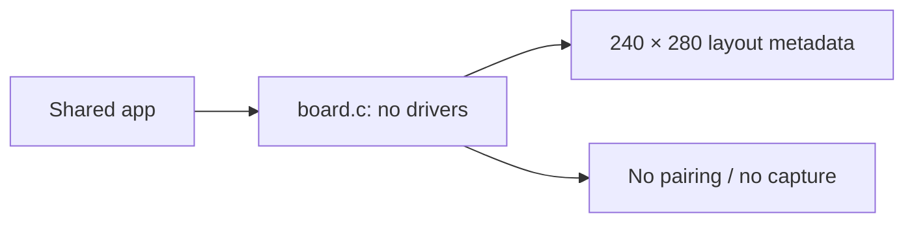

# Waveshare ESP32-C6 1.69: build-only stub

| File | Purpose | Status |
|---|---|---|
| `board.c` | Board ID 2, no capabilities, no touch/buttons/display transfers (`board_touch` reports UP); mic start/read return unsupported | ✅ Build-only implementation |
| `sdkconfig.defaults` | C6 defaults, no PSRAM; 4 MB flash placeholder, not a board claim | 🟡 Hardware unverified |

Start with the C6 build command in [FW/README](../../README.md).
The BLE service compiles, but enrollment and display-barrier writes are disabled.
Version/info reports screen dimensions zero because screen capability is absent;
240 × 280 is layout metadata only. No [REQ-49–53] compliance claim.

Reports `virtual_sliders=false`: the shared UI uses the 240×280 orb/pips/target layout without a capture ring; this does not add physical slider drivers.

Stage 2 links the same fixed-point Opus encoder but adds no C6 codec or pin driver.
`board_audio_alloc` uses internal RAM only. Its successful build/size is not an
encode benchmark: single core at 160 MHz, no PSRAM. S3 timings cannot establish
C6 throughput or heap sufficiency; measure on C6 after its real board driver lands.

Firmware 0.3.0 reports contract 1.1. Offline bit 7 stays clear, the three offline
characteristics are omitted and no flash store/queue/task is allocated. Its 4 MiB
build retains the original single-app-large partition table, checked against the
16 MiB-only StopWatch table by `tests/check_partitions.py`. No PSRAM assumption
enters the shared storage/policy code.
