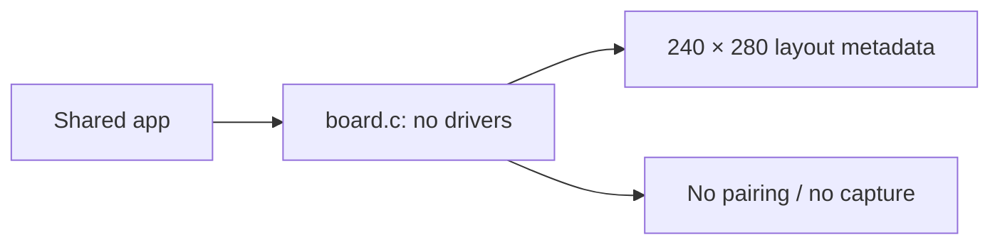

# Waveshare ESP32-C6 1.69: build-only stub

| File | Purpose | Status |
|---|---|---|
| `board.c` | Board ID 2, no capabilities, no touch/buttons/display transfers | ✅ Build-only implementation |
| `sdkconfig.defaults` | C6 defaults, no PSRAM; 4 MB flash placeholder, not a board claim | 🟡 Hardware unverified |

Start with the C6 build command in [FW/README](../../README.md).
The BLE service compiles, but enrollment and display-barrier writes are disabled.
Version/info reports screen dimensions zero because screen capability is absent;
240 × 280 is layout metadata only. No [REQ-49–53] compliance claim.
