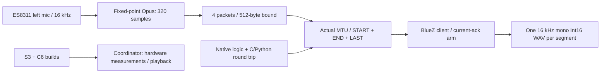

# Stage 2 handoff — 2026-11-02



Purpose: reproducible Stage 2 handoff. Inputs: current `SYS/protocol/remote-ble.md`,
owner-confirmed control/Orb baseline `dd3db68`, supplied vendor sources and offline
component/Python caches, ESP-IDF 5.5.6. Host framing/codec/render/build checks are
verified; **new on-device audio, heap and timing remain unverified**. Existing
pairing/buttons/touch/Orb were confirmed by the owner before this change.
No flash, serial device, Bluetooth adapter, commit, push, PR or extra review used.

| Change | Entry point |
|---|---|
| Mic / allocation | `boards/m5stopwatch/board.c`: vendor ES8311 register setup, I2C 0x18, G18/17/16/15/21, analog left mic, 30 dB; AU_EN high, both speaker enable lines low; four RX DMA descriptors. C6 mic returns unsupported, allocation internal only |
| Codec / queue | `app/audio.h`, `audio.c`, `audio_runtime.c`: fixed-point mono 16 kHz / 20 ms raw Opus, starting 24 kbit/s CBR / complexity 0, max 512 bytes; dedicated 48 KiB internal-stack task, four-packet queue |
| Transport / gate | Actual `ble_att_mtu()` per frame, segment starts 1 and never reuses IDs; END/sequence exhaustion; arm + local not OFF + PTT for hold; subscription/security/info/snapshot prerequisites retained |
| OFF / failures | RX disable and task suspension immediately under app mutex; old computation resumes only for a new generation, then its output is discarded. No queued data flush. END reserved slot, then stopped Input; END failure disconnects after 1 s. Overflow/notify failure requires resync + a fresh trigger |
| UI | Producer sets `input.streaming` after first accepted data notification, clears on stop; Orb and Input read the same bit. Preview checks it independently of PTT |
| Version / link | 0.2.0; name `Voice Remote`; S3 caps 0x3f, `hw_mic_cut=0`, maximum packet 512; C6 capabilities remain zero because it is a stub. Requests MTU 247, 15–30 ms interval, zero latency, 4 s supervision; phone/OS decides |
| Client | `tools/ble_client/{client,wire,audio}.py`: fresh-snapshot recovery, coalesced current-ack writes after every Input, `--arm` follows local capture/mode, WAV decode, duplicate/loss checks and 1 s watchdog, including missing START |

At most one data notification is pending in NimBLE plus one reserved empty END.
Data already accepted by the controller cannot be retracted on OFF; no new data
notification is submitted after OFF. Queued tail packets own frame sequences, so
an END following discarded tail data produces a reported gap rather than a splice.
There is no tap-lock, PLC, FEC, DTX, audio storage or audio-content serial logging.

| Verification | Result |
|---|---|
| `heavy bash FW/tests/run.sh` | Four ctest suites pass: 687 control/layout C checks, 373 transport C checks, 4 Python wire cases and 9 Python audio cases. Suites cover control/layout, Python wire, fake-encoder transport, Python reassembly/codec/WAV. C transport covers MTU 23/247, frame flags, arm/hold/OFF, queue overflow, MTU changes and ID/sequence exhaustion; C/Python round trips also use MTU 64/517 |
| `heavy bash FW/tools/ui_preview/run.sh` | All 12 PNG states and pointer/render-barrier/pulse checks; producer bit controls listening |
| S3 and C6 build commands below | Both succeed; C6 remains build-only |
| Locked uv Python tests below | Wire, recovery, duplicate/conflict/gap/watchdog and WAV cases pass (13 total); real libopus round trip, no C development headers |

Static baseline `idf.py size` was run **before edits**, rebuilding the stale C6
UI object first. Final size uses the same build configurations plus GATT-client
support needed to request MTU exchange. Image sizes exclude `.bin` padding.
These link-time remainders are **not free runtime heap**.

| Bytes | S3 before | S3 after | Delta | C6 before | C6 after | Delta |
|---|---:|---:|---:|---:|---:|---:|
| Total image | 968,837 | 1,158,317 | +189,480 | 1,036,470 | 1,231,534 | +195,064 |
| Padded `.bin` | 968,960 | 1,158,432 | +189,472 | 1,036,816 | 1,231,872 | +195,056 |
| DIRAM used | 166,591 | 171,739 | +5,148 | 151,574 | 154,394 | +2,820 |
| `.bss` + `.data` | 73,980 | 77,484 | +3,504 | 65,612 | 67,804 | +2,192 |
| DIRAM remainder | 175,169 | 170,021 | −5,148 | 300,538 | 297,718 | −2,820 |
| Runtime internal heap before/after/delta | TBC | TBC | TBC | TBC | TBC | TBC |
| Runtime PSRAM before/after/delta | TBC | TBC | TBC | No PSRAM | No PSRAM | N/A |

Both images fit the existing 1,536,000-byte app partition. Once per segment serial
logs encoder mean/max µs, queue high-water, known dropped encoded frames, notify
failures, source error code, free internal and PSRAM heap + deltas from segment start, CPU Hz and
encoder stack watermark. Boot logs allocation deltas across encoder/task creation.
The first mic start allocates I2S/DMA and is visible in its segment heap delta.
Capture-overflow loss counts beyond known discarded packets remain unknown.

Both current configs select 160 MHz; S3 has two cores and PSRAM while C6 has one
core and no PSRAM. S3 encode timings include its own architecture/memory/scheduler
and cannot establish C6 capacity by clock scaling. C6 links the same fixed-point
code with internal allocation but cannot capture until its real driver lands.
Compare frame time against the chosen 20 ms profile on each named board; throughput,
heap sufficiency, acoustic quality, power and sustained MTU-23 capacity are TBC.

Run from the repository root; setup in [README](README.md), at most four compiler
jobs and one heavy job at a time. Offline mirror/cache environment belongs only in
the shell; sandbox metadata overlay after IDF export is `/tmp/voiceremote-espressif`.

```sh
heavy bash FW/tests/run.sh
heavy bash FW/tools/ui_preview/run.sh
heavy idf.py -C FW -B FW/build-m5 -DIDF_TARGET=esp32s3 reconfigure
heavy cmake --build FW/build-m5 -j 4
heavy idf.py -C FW -B FW/build-m5 build
heavy idf.py -C FW -B FW/build-m5 size
heavy idf.py -C FW -B FW/build-c6 -DREMOTE_BOARD=waveshare_c6_169 -DIDF_TARGET=esp32c6 reconfigure
heavy cmake --build FW/build-c6 -j 4
heavy idf.py -C FW -B FW/build-c6 -DREMOTE_BOARD=waveshare_c6_169 build
heavy idf.py -C FW -B FW/build-c6 size
UV_CACHE_DIR=/tmp/voiceremote-uvc-s2 UV_OFFLINE=1 UV_LINK_MODE=copy uv run --project FW/tools/ble_client python -m unittest discover -s FW/tools/ble_client -p 'test_*.py' -v
```

Coordinator-only flash command, **not executed**:

```sh
heavy idf.py -C FW -B FW/build-m5 -p /dev/ttyACM0 flash
```

Coordinator-only recordings (substitute scanned address; choose fresh file prefixes):

```sh
uv run --project FW/tools/ble_client python FW/tools/ble_client/client.py --address AA:BB:CC:DD:EE:FF --capture 1 --recording 1 --arm --save /tmp/ptt.wav --seconds 60
uv run --project FW/tools/ble_client python FW/tools/ble_client/client.py --address AA:BB:CC:DD:EE:FF --capture 2 --recording 1 --arm --save /tmp/rec.wav --seconds 60
```

PTT: select PTT, release then hold yellow and speak, release to close. REC: start
OFF, wait for connection/snapshot, deliberately select REC, then OFF to close.
The phone options do not move physical controls. Files are `ptt-seg00000001.wav`,
etc.; loss adds `-interrupted.wav`, preserves earlier PCM for diagnosis and reports
gap events. The client never silently joins later audio or overwrites a file.
It retains provisional short PTT presses for bench listening, with no STT/actions.

| Assumption / contract question | Handling |
|---|---|
| Prototype hardware cut | Owner's documented exception; AU_EN stays powered, `hw_mic_cut=0`. No [REQ-49] hardware compliance claim |
| Hold lock field absent | Require physical PTT for local or phone hold; tap-lock remains disabled |
| Draft bounds unspecified | Starting bitrate 24 kbit/s, four-packet queue, 48 KiB task stack, requested MTU/interval and 200 ms pending deadline are engineering starting points, **unverified** on device |
| New START after a lost tail | Client disarms, resets decoder, requests snapshot and needs fresh release/press or OFF→REC; no automatic REC from a recovered snapshot |
| Contract feasibility | No blocking firmware contract problem found. Binary schema/codegen, phone trigger-lock timing and iOS interruption signalling remain open in the contract; SYS untouched |
| BlueZ MTU | **Yes**, public D-Bus AcquireNotify/AcquireWrite returns FD + actual MTU. Bleak 3.0.2 default public `mtu_size` reports 23; source evidence and method locations are in [client README](tools/ble_client/README.md). This client keeps StartNotify, prints public MTU and observed lower bound; firmware logs actual MTU. Phone writes' 20-byte budget never sizes Audio |
| Licences | `78/esp-opus` 1.0.5 metadata says MIT; actual libopus COPYING/source terms are BSD and retained. ES8311 registers Apache-2.0; M5 adaptation MIT; opuslib-next BSD; Bleak/dbus-fast MIT. No av/FFmpeg/GPL. Details in [licences](licences/README.md) |

Hardware-only: verify ES8311 left mic/gain, intelligible playback and restart
transients; OFF while held/REC/mid-fragment; accepted MTU/connection interval,
backpressure/recovery and END order on BlueZ/iOS; authenticated subscriptions,
bond/revoke/reconnect; encode mean/max, dropped frames, real heap/stack and CPU;
BLE/input/Orb responsiveness while encoding, display scanout, battery/power and
[REQ-51]/[REQ-53] source-quality/whisper benchmarks. Preserve owner-confirmed
controls/pairing/touch/Orb while checking these. No hardware compliance claimed.
