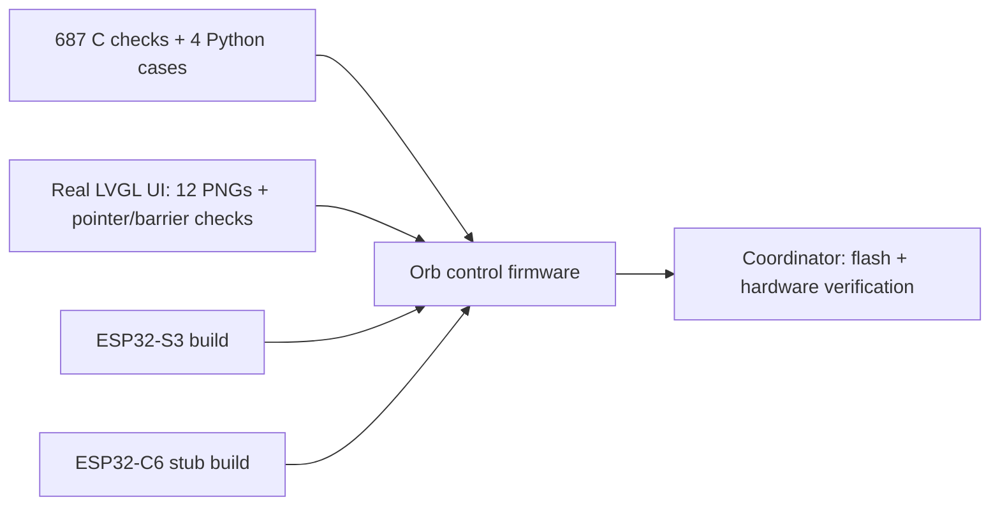

# Firmware handoff — 2026-11-02



Purpose: reproducible stage-1/Orb handoff. Inputs: the BLE contract, owner-supplied
`AI/FW/stopwatch-screen-mockup.html` (drawA), Lexend SemiBold/OFL, ESP-IDF 5.5.6,
LVGL 9.5.0 and supplied vendor sources. Native logic/render/build results verified;
**all hardware behavior remains unverified**. No audio, flash, adapter access,
commit, push, PR or additional review performed.

| Result | Evidence |
|---|---|
| Pure host tests | `heavy bash FW/tests/run.sh`: 2/2 ctest suites; 687 C checks + 4 Python cases |
| Real UI preview | `heavy bash FW/tools/ui_preview/run.sh`: pointer/barrier checks + all 12 masked PNGs |
| StopWatch | `build-m5/voice_remote.bin`: 968,704 bytes; firmware build succeeds |
| C6 stub | `build-c6/voice_remote.bin`: 1,036,736 bytes; firmware build succeeds; no working display/sliders/pairing |
| Scope | `FW/` only; pre-existing untracked mock unchanged; protocol/state/BLE unchanged |
| Branch | Existing `codex/feat-fw-stopwatch`, baseline `e5c866e`; all changes uncommitted |

Static sizes from `idf.py size`, captured **before editing** and after the Orb
change. Image totals exclude padding; DIRAM includes resident code and static
`.bss`/`.data`. These are **not runtime heap measurements**.

| Board / size (bytes) | HEAD | Orb | Delta |
|---|---:|---:|---:|
| S3 total image | 866,677 | 968,585 | +101,908 |
| S3 DIRAM used | 166,127 | 166,591 | +464 |
| S3 `.bss` + `.data` | 73,516 | 73,980 | +464 |
| S3 DIRAM remainder | 175,633 | 175,169 | −464 |
| C6 total image | 930,494 | 1,036,388 | +105,894 |
| C6 DIRAM used | 151,040 | 151,574 | +534 |
| C6 `.bss` + `.data` | 65,168 | 65,612 | +444 |
| C6 DIRAM remainder | 301,072 | 300,538 | −534 |

The C6 image fits its existing 1,536,000-byte app partition within the configured
4 MB flash. Lexend uses three ASCII sizes (42/30/24) and one digits-only size (84);
the generated sparkle is 12,544 bytes. Commands live beside [fonts](app/fonts/)
and [icons](app/icons/), with the supplied OFL in [licences](licences/).

Reproduce from the worktree root after [README toolchain setup](README.md).
Keep one heavy job at a time and compiler parallelism at four or less:

```sh
heavy bash FW/tests/run.sh
heavy bash FW/tools/ui_preview/run.sh
heavy idf.py -C FW -B FW/build-m5 -DIDF_TARGET=esp32s3 reconfigure
heavy cmake --build FW/build-m5 -j 4
heavy idf.py -C FW -B FW/build-m5 build
heavy idf.py -C FW -B FW/build-m5 size
heavy idf.py -C FW -B FW/build-c6 -DREMOTE_BOARD=waveshare_c6_169 -DIDF_TARGET=esp32c6 reconfigure
heavy cmake --build FW/build-c6 -j 4
heavy idf.py -C FW -B FW/build-c6 -DREMOTE_BOARD=waveshare_c6_169 build
heavy idf.py -C FW -B FW/build-c6 size
```

Build directories, logs, managed components and generated sdkconfigs are ignored.
Offline builds use the supplied mirror/cache environment variables **only in the
shell**. The existing `/tmp/voiceremote-espressif` writable metadata overlay is
still needed in this sandbox: after normal export set
`IDF_TOOLS_PATH=/tmp/voiceremote-espressif`. No registry/lock mirror paths committed.

Coordinator-only flash command, **not executed**:

```sh
heavy idf.py -C FW -B FW/build-m5 -p /dev/ttyACM0 flash
```

| Orb decision / assumption | Implementation / limit |
|---|---|
| Link | Secured BLE plus a received phone state; before that the target offers pairing |
| Listening | Clearly named `vr_ui_stage1_listening`: linked AND (PTT + yellow held OR REC); **visual approximation, no audio**. Stage 2 must use real streaming state |
| Target actions | Tap cycles via existing `VR_CYCLE`; 3-second hold opens forget, including when a bonded phone is disconnected; a moving finger cancels the hold |
| Error lifetime | Phone error occupies the target slot in red for 5 s, or until cleared by a new phone state |
| Text | Resolved destination only. Auto index 0 adds circled A; unsupported UTF-8 code points each become `?`; shrink then ellipsis inside the full font-box chord |
| Pulse | One gentle ring, 1.8 s period, 5 Hz; only the 268×268 orb bounds invalidate at 466×466. Same 16-row internal DMA strip; no extra framebuffer/PSRAM dependency |
| Native pulse evidence | Five redraws / 359,120 pixels / 718,240 RGB565 bytes in one simulated second; flush bounds (99,99)–(366,366). Hardware frame rate and scheduling remain TBC |
| Mock adaptations | One pulse instead of the CSS mock's two; confirmation backgrounds fill the physical lower screen rather than retaining its side insets. Primitive mic/bin/Auto strokes approximate SVG paths; RGB565 quantizes colours |
| Portability | Board metadata controls virtual ring vs physical-slider layout; C6 metadata is 240×280 with orb (120,112), radius 84, pips 222, name baseline 264; no new pin claims |

REQ-18 still waits for a synchronous render and every DMA completion before the
final Phone-state write response. Both pairing and forget overlays reject a
hidden-destination update. The native harness checks changed target pixels,
success/failure flush returns, modal guards, direct selection, error expiry,
long-press cancellation/recognition, haptics and pulse flush bounds. Physical
scanout visibility is unverified because TE is not used.

Retained stage-1 limits: G2=yellow/PTT, G1=blue/cycle (colour mapping unverified);
25 ms debounce / 5 ms polling; enrollment 60 s / comparison 30 s; one bond,
no eviction; 20%/25 ms candidate haptic. Required Opus capability bit 0 remains
clear and no Audio notifications exist; strict full-v1 phones must refuse capture.
The gate fails closed for hold without PTT because the contract has no phone-lock
field; tap-lock stays disabled. Microphone power/control and the protocol are untouched.

Hardware-only: boot/rails; 466-vs-vendor-468 alignment with x gap 6; RGB order;
touch orientation; button colour/debounce; haptic feel; QSPI 40 MHz throughput;
pulse frame rate and BLE/input responsiveness; runtime heap; authenticated CCCDs;
iOS/BlueZ Numeric Comparison, bond persistence/revoke, MTU/errors and reconnect;
physical REQ-18 scanout visibility. No device or adapter was accessed.
