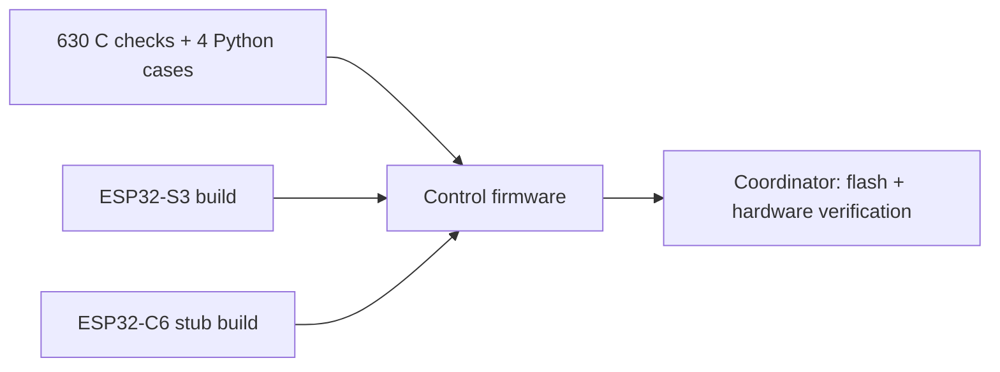

# Stage 1 handoff — 2026-11-02



Purpose: reproducible handoff. Inputs: `SYS/protocol/remote-ble.md`, supplied vendor
sources, ESP-IDF 5.5.6. Software/build results verified; **all hardware behavior unverified**.

| Item | Result |
|---|---|
| Worktree | `/home/harrison/Documents/Projects/voiceremote/.claude/worktrees/codex-feat-fw-stopwatch` |
| Branch | `codex/feat-fw-stopwatch`; uncommitted, no push/PR/review |
| StopWatch `.bin` | `build-m5/voice_remote.bin`: 866,800 bytes |
| C6 `.bin` | `build-c6/voice_remote.bin`: 930,832 bytes |
| Static RAM remainder | S3 DIRAM 175,633 bytes; C6 DIRAM 301,072 bytes, from `idf.py size`, **not runtime free heap** |
| Host | `heavy bash FW/tests/run.sh`: 2/2 ctest tests; 630 C checks and 4 Python cases |
| Python 3.12 | Offline uv wire tests and CLI `--help` pass; no adapter accessed |

Commands from the worktree root, after the [README environment setup](README.md):

```sh
heavy idf.py -C FW -B FW/build-m5 -DIDF_TARGET=esp32s3 reconfigure
heavy cmake --build FW/build-m5 -j 4
heavy idf.py -C FW -B FW/build-m5 build
heavy idf.py -C FW -B FW/build-c6 -DREMOTE_BOARD=waveshare_c6_169 set-target esp32c6
heavy cmake --build FW/build-c6 -j 4
heavy idf.py -C FW -B FW/build-c6 -DREMOTE_BOARD=waveshare_c6_169 build
heavy bash FW/tests/run.sh
git status --short --untracked-files=all
git diff --stat
```

Both firmware builds succeed. Scope: only FW/ and AGENTS.md's FW test-command row.
Build outputs, sdkconfigs, managed components and Python environment are ignored.
Sandbox workaround: the C6 dependency resolver needs writable global metadata;
`/tmp/voiceremote-espressif` overlays installed `tools`/`python_env` with symlinks
and copies of `idf-env.json`/constraints, with its own writable root lock.
After normal export, set `IDF_TOOLS_PATH=/tmp/voiceremote-espressif` for this sandbox.
Registry manifests/board-specific locks contain no mirror paths.

Coordinator-only flash command (not executed), after environment setup:

```sh
heavy idf.py -C FW -B FW/build-m5 -p /dev/ttyACM0 flash
```

Assumptions/limits:

- G2=yellow/PTT, G1=blue/cycle; one mapping constant and GPIO logs. Colour pairing unverified.
- Vendor x gap 6 retained; requested 466 columns exposed versus vendor's 468.
  RGB/touch orientation unverified. QSPI 40 MHz driver default; I2C 100 kHz.
- Poll 5 ms, debounce 25 ms; enrollment 60 s, comparison 30 s; one bond, no eviction.
  Haptic 20%/25 ms is an unmeasured light-pulse candidate.
- One hardware mic reported, untouched; packet maximum 512 is reserved, not codec evidence.
  C6 has no working capabilities/pairing; 4 MB flash is a stub default.
- **Contract conflict:** v1 mandates Opus bit 0; stage 1 clears it honestly and never
  notifies Audio. A strict v1 phone cannot enable capture. Contract unchanged.
- No Phone-state lock field or compatible-version acknowledgment exists. Hold without
  PTT fails closed; tap-lock remains disabled. No audio is enabled under any state.
- Final write waits for rendering/DMA, not TE scanout; physical visible-destination
  barrier remains unverified. Unsupported Unicode glyphs show placeholders.

Hardware-only: boot/rails, display alignment/scanout, touch, button mapping/debounce,
haptics, authenticated CCCDs, Numeric Comparison with iOS/BlueZ, bond persistence/revoke,
MTU/fragment errors, reconnect/snapshots, and runtime heap. Neither device nor adapter accessed.

Licences: vendor adaptations MIT, LVGL MIT, bundled fonts SIL OFL 1.1 (FontAwesome
notice also lists CC BY 4.0/MIT), Espressif components Apache-2.0. Notices and retained
board header are in [licences/](licences/); coordinator relocates to DOCS/licences/.
