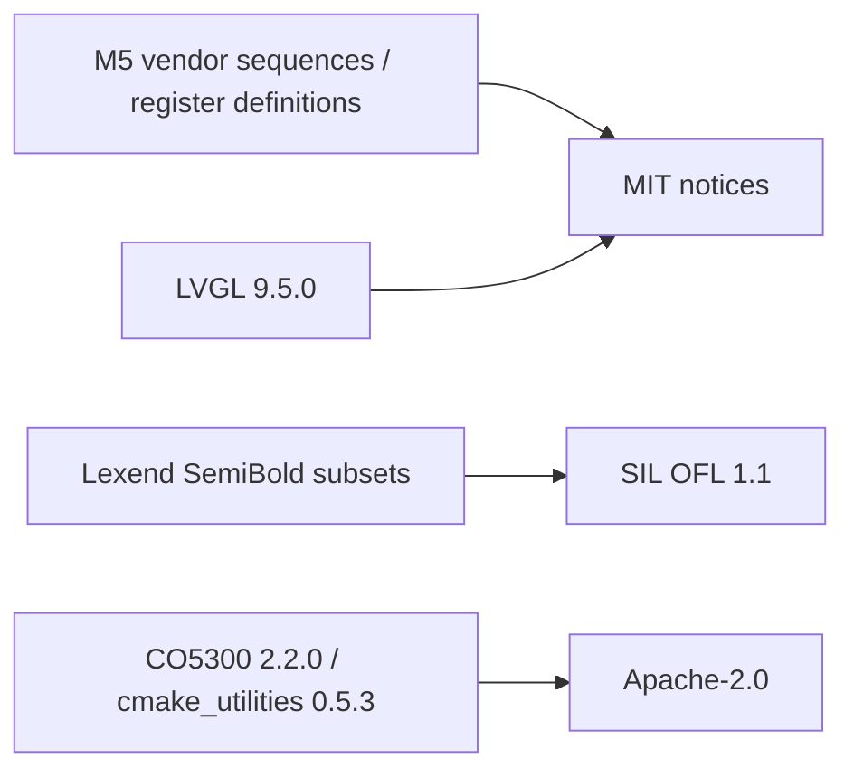

# Firmware dependency notices

| Notice | Applies to | Status |
|---|---|---|
| `M5Stack-MIT.txt` | Vendor UserDemo/PowerDemo board sequence adaptation | ✅ Header retained in `boards/m5stopwatch/board.c` |
| `M5IOE1-MIT.txt`, `M5PM1-MIT.txt` | Referenced register definitions | ✅ Notices retained |
| `LVGL-MIT.txt` | LVGL 9.5.0 code | ✅ Dependency licence checked |
| `Lexend-OFL.txt` | Supplied Lexend SemiBold target/pairing subsets; generation in `app/fonts/` | ✅ OFL included |
| `Montserrat-OFL.txt`, `FontAwesome5.txt` | Bundled font glyphs: SIL OFL 1.1 (FontAwesome notice includes CC BY 4.0 / MIT) | ✅ Upstream notices included |
| `Espressif-Apache-2.0.txt` | CO5300 2.2.0 and cmake_utilities 0.5.3 | ✅ Dependency licences checked |

Start with the [board provenance](../boards/m5stopwatch/README.md). Preserve MIT
copyright/permission notices in distributed copies and Apache licence/notices
when redistributing dependencies. ESP-IDF/NimBLE retain their installed upstream
licences (Apache-2.0; not vendored). Python tooling dependencies remain in uv's
environment and are not copied into firmware. No GPL code copied.

These notices are under FW/ by the explicit task exception; the coordinator can
move them to `DOCS/licences/` at merge and update links.
