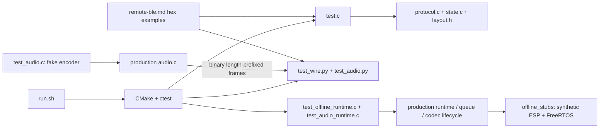

# Host verification



| File | Purpose | Status |
|---|---|---|
| `run.sh` | Single root-runnable host command | ✅ Reproducible |
| `CMakeLists.txt` | Plain native C, warnings as errors, assertions enabled; Python ≥3.12 | ✅ No IDF/board needed |
| `test.c` | I, E0–E5, P, A0–A2 round trips; malformed UTF-8/flags/enums/lengths, all split offsets, overflow, atomicity, transaction/input wrap, arm/OFF, debounce, scaled Orb sectors/disc/target/modals/dead zones, live/offline listening truth table, failed-touch-read hold/timeout/rearm/wrap, UTF-8 fallback, immediate preview/rollback and controls changing during a display wait | ✅ Host tested |
| `test_offline_store.c` | Factory-used partition initialization, damaged-magic preservation, corrupt List traversal/Fetch/Confirm errors, fake-flash power loss at every script write boundary across two data sectors, torn writes/erases/final frame, prefix recovery, full, resume, metadata/CRC, delete retry, ID/boot persistence, corruption and journal rotation | ✅ Host tested |
| `test_offline_capture.c` | Mode taps cannot restart paused/full/failed REC; fresh triggers, disconnect/reconnect, stored mode, OFF, owner/incompatibility/pause gates | ✅ Host tested |
| `check_partitions.py` | Generated StopWatch/C6 tables against original NVS offset/size and flash bounds | ✅ Build outputs required |
| `../tools/ble_client/test_offline.py` | Contract offline hex/fragments, resume/integrity, durable copy and clock behavior | ✅ Host tested |
| `test_config.py` | Rejects hook for explicit release and GitHub/GitLab firmware-tag signals before IDF setup | ✅ Host tested |
| `test_hook.c` | All serial commands, unknown input and held/released PTT decoder | ✅ Host tested |
| `../tools/hil/test_run_offline.py` | Entire unattended procedure using fake serial/BLE, durable fetch interruption/resume, failure and PTY serial collector | ✅ Host tested |
| `test_audio.c` | Production queue/framer with fake encoder: MTU 23/247, START/END/LAST, MTU changes, OFF discard, arm/hold gate, overflow and sequence/segment exhaustion; binary fixture mode | ✅ Host tested |
| `test_audio_runtime.c` | Production audio lifecycle: codec generation survives BLE reconnect/reset during local recording; live reset invalidates generation; OFF immediately stops mic/suspends worker and discards in-flight encoder output | ✅ Host tested |
| `test_offline_runtime.c`, `offline_stubs/` | Production writer and sync transport with synthetic NOR and bounded FIFO: queued/in-flight begin OFF, volatile discard, queue/flash full, write failure, clock/progress, contract result layouts, resume/deletion after reboot, enrollment guard, capability-disabled board fallback and live preemption; asserts storage IO never holds the app mutex | ✅ Host tested |
| `../tools/ble_client/test_audio.py` | C-to-Python framing at MTU 23/64/247/517, loss/conflicts/duplicates/watchdog, reconnect/ack/trigger policy, WAV format and real libopus decode | ✅ Host tested |
| `../tools/ble_client/test_wire.py` | Independent synthetic Python wire fixtures | ✅ Host tested |

Run from repository root, exactly:

```sh
heavy bash FW/tests/run.sh
```

[REQ-8], [REQ-18], [REQ-49–53] traceability only: these tests prove pure logic,
not GPIO timing, BLE stack behavior, physical display visibility or safety.
The test runner uses the client's locked `.venv` when available. Prepare it with
`uv sync --project FW/tools/ble_client` (offline environment in its README) to run
the real Opus/WAV case; otherwise that one codec test skips. Pure C and framing
round trips need no libopus headers. Fixtures are synthetic bytes/silence only.
They do not establish on-device encoding capacity or acoustic quality.

The pure gesture tests assert preview changes without protocol state changes,
release acceptance, cancellation without retargeting, and direct PTT→OFF. The
touch fault regression first failed by accepting REC on an I2C error; the fix
passes recovery, 100 ms cancellation, observed-up rearming and clock wrap. The
existing arm rule also rejects a stale control epoch after final-fragment parsing.

The writer regression first failed when OFF discarded an unopened queued record,
then an unnecessary finalize blocked live capture. Both queued and in-flight begin
cases now pass. Runtime tests execute the production source, capture policy and
store with fake queues/NOR; audio lifecycle tests replace the codec and microphone.
They establish scheduling decisions and generation checks, not flash-stall latency.

The actual LVGL interaction/display-barrier and pulse-bound checks run with
`heavy bash FW/tools/ui_preview/run.sh`; see [the preview](../tools/ui_preview/README.md).

The store resume test counts fake-flash reads: fetching the final frame of a
300-frame/two-sector record needs 96 reads, before and after remount, and never
rereads the first sector. The 16 KiB index changes RAM only, not flash format.

The root test command now also builds/runs the **real LVGL renderer** (managed
LVGL must exist). It models 175 ms redraw and a 450 ms completion racing wait
expiry; matching completed DMA succeeds. Missing/failed/modal draws fail.
Hook and PSRAM-free variants run too. Audio regressions cover one completely
unsent queued frame at OFF and C→Python clean END, retaining partial-frame loss.

| Fix-round regression | Evidence / boundary |
|---|---|
| `test_ble.c`, `ble_test_platform.h` | Production BLE callbacks with synthetic NimBLE/NVS: rejected bond removal, boot trust, delete retry, acknowledged layout marker/subscription retry despite a legacy marker, recently-live disconnect/reset, snapshot flag refreshing progress |
| `offline_factory`, `offline_corruption`, `offline_broken_mount` | Focused CTest cases for factory bytes, protected damaged stores, List past corrupt IDs and queue/live/pairing fallback; mount/recovered corruption asserts UI refresh; re-enrollment holds damaged storage across reboot even after repair |
| `test_audio_runtime.c` | Control edge before deferred local-stop snapshot; recent-live expiry and tick wrap after transport failure |
| `test_offline_runtime.c` | MTU-23 progress finishes during capture, then explicit refresh emits another complete snapshot |
| Native UI checks | OFF on DOWN while finger held; no extra release event; forget recognition commits OFF; PTT/REC release/debounce unchanged |

The fixes first failed their synthetic regressions before implementation (factory,
torn headers, corrupt List, failed-mount enrollment, mode restart, fragmented progress,
OFF timing, rejected bond and premature layout marker). The write-cut loop now
asserts no persistent error at all 529 mutation boundaries, whole and torn, including
both record headers. Haptic I2C errors are hardware-bound: the driver logs start/PWM
failures and retries a failed stop after 25 ms; bus fault injection remains unverified.

| Follow-up regression | Evidence / boundary |
|---|---|
| `offline_header_body` | Torn/uncommitted headers with erased bodies recover; bad commit, garbage and erased headers with dirty bodies retain byte-identical sectors and quarantine/error, including dirt at the final byte |
| `offline_sparse_format` | Three dirty sectors cause exactly three erases; magic at the partition end prevents all erases; cuts at each formatting erase, whole/torn, resume empty on next mount |
| `ble_enrollment_scope` | Stranger's failed ENC_CHANGE preserves owner/bond; rejected enrollment removes persisted keys even after the 60-second window expires |

All three follow-up tests failed on their target assertions before the fixes.
NimBLE malformed-key-size handling sets `enc_cb` (`ble_sm.c:2287–2294`);
`ble_sm_process_result` sends `ble_gap_enc_event` on failure (`ble_sm.c:1280–1287`),
which publishes ENC_CHANGE (`ble_gap.c:11140–11149`). A pending local termination
therefore does not protect the old cleanup predicate. Enrollment origin is now
latched at CONNECT and retained until DISCONNECT/reset, independent of its timeout.

| C6 port regression | Evidence / boundary |
|---|---|
| `test_c6_controls.c` | All 256 raw bytes/six valid selector combinations; 00, whole-byte 20 ms debounce, immediate OFF, I2C/stale stop, held boot buttons, no boot REC, wrap and bounded stuck-low INT; 4/16 MiB and overflow storage bounds |
| `audio_single_core` | Production audio lifecycle with single-core stack/priority assertions; reference dual-core configuration also runs |
| `c6_ui_touch`, `c6_ui_physical` | 240×280 production LVGL: ring controls/status-only Orb, physical mode changes, unchanged-selector sentinel, OFF on DOWN, pairing, offline partial/full pixel equality |
| `check_partitions.py` | Both generated tables fit/fill 16 MiB with offline data and historical NVS/PHY/factory unchanged |

The C6 small-strip AI glyph regression failed partial/full equality before the
bounded A8 glyph fix. Pin wiring, ISR deadlines, flash cache stalls, stack/heap
headroom and live/offline audio quality still need the coordinator's hardware run.
