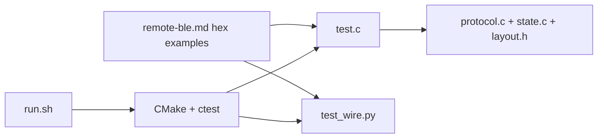

# Host verification



| File | Purpose | Status |
|---|---|---|
| `run.sh` | Single root-runnable host command | ✅ Reproducible |
| `CMakeLists.txt` | Plain native C, warnings as errors, assertions enabled; Python ≥3.12 | ✅ No IDF/board needed |
| `test.c` | I, E0–E5, P, A0–A2 round trips; malformed UTF-8/flags/enums/lengths, all split offsets, overflow, atomicity, transaction/input wrap, arm/OFF, debounce, layout | ✅ Host tested |
| `../tools/ble_client/test_wire.py` | Independent synthetic Python wire fixtures | ✅ Host tested |

Run from repository root, exactly:

```sh
heavy bash FW/tests/run.sh
```

[REQ-8], [REQ-18], [REQ-49–53] traceability only: these tests prove pure logic,
not GPIO timing, BLE stack behavior, physical display visibility or safety.
Audio examples test framing only; no audio implementation or codec is present.
