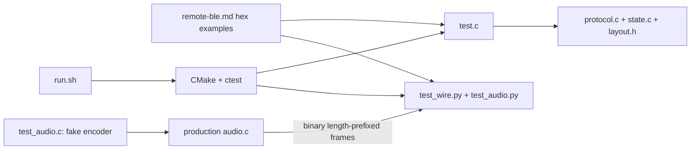

# Host verification



| File | Purpose | Status |
|---|---|---|
| `run.sh` | Single root-runnable host command | ✅ Reproducible |
| `CMakeLists.txt` | Plain native C, warnings as errors, assertions enabled; Python ≥3.12 | ✅ No IDF/board needed |
| `test.c` | I, E0–E5, P, A0–A2 round trips; malformed UTF-8/flags/enums/lengths, all split offsets, overflow, atomicity, transaction/input wrap, arm/OFF, debounce, scaled Orb sectors/disc/target/modals/dead zones, listening truth table, UTF-8 fallback, immediate preview/rollback and controls changing during a display wait | ✅ Host tested |
| `test_audio.c` | Production queue/framer with fake encoder: MTU 23/247, START/END/LAST, MTU changes, OFF discard, arm/hold gate, overflow and sequence/segment exhaustion; binary fixture mode | ✅ Host tested |
| `../tools/ble_client/test_audio.py` | C-to-Python framing at MTU 23/64/247/517, loss/conflicts/duplicates/watchdog, reconnect/ack/trigger policy, WAV format and real libopus decode | ✅ Host tested |
| `../tools/ble_client/test_wire.py` | Independent synthetic Python wire fixtures | ✅ Host tested |

Run from repository root, exactly:

```sh
heavy bash FW/tests/run.sh
```

[REQ-8], [REQ-18], [REQ-49–53] traceability only: these tests prove pure logic,
not GPIO timing, BLE stack behavior, physical display visibility or safety.
The test runner uses the client's locked `.venv` when available. Prepare it with
`uv sync --project FW/tools/ble_client` (offline environment in its README) to run
the real Opus/WAV case; otherwise that one codec test skips. Pure C and framing
round trips need no libopus headers. Fixtures are synthetic bytes/silence only.
They do not establish on-device encoding capacity or acoustic quality.

The pure gesture tests assert preview changes without protocol state changes,
release acceptance, cancellation without retargeting, and direct PTT→OFF. The
existing arm rule also rejects a stale control epoch after final-fragment parsing.

The actual LVGL interaction/display-barrier and pulse-bound checks run with
`heavy bash FW/tools/ui_preview/run.sh`; see [the preview](../tools/ui_preview/README.md).
