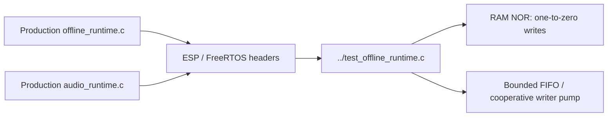

# Offline runtime host boundary

| Path | Purpose | Status |
|---|---|---|
| `freertos/` | Exact queue/task/semaphore subset used by runtime | ✅ Synthetic host harness |
| `esp_*.h` | Partition, timer, allocation and I/W/E logging boundary | ✅ No board or adapter |
| `nvs.h` | Persistent failed-store enrollment hold; synthetic reboot and write failure | ✅ No board access |
| `opus.h` | Synthetic codec API; no real microphone input or Opus output | ✅ Audio lifecycle harness |

Start with [the harness](../test_offline_runtime.c). Its writer runs until the
fake queue would block, then yields through `setjmp`/`longjmp`. Production
runtime, capture policy and storage code execute unchanged. IO asserts no app
mutex is held. This checks scheduling boundaries and bounded queues; it does not
establish FreeRTOS/radio/cache-stall timing or hardware compliance [REQ-49–53].

[The audio harness](../test_audio_runtime.c) uses the same task/semaphore boundary
to test local encoder continuity through BLE resets and generation cancellation
when OFF arrives during synthetic encoding.
