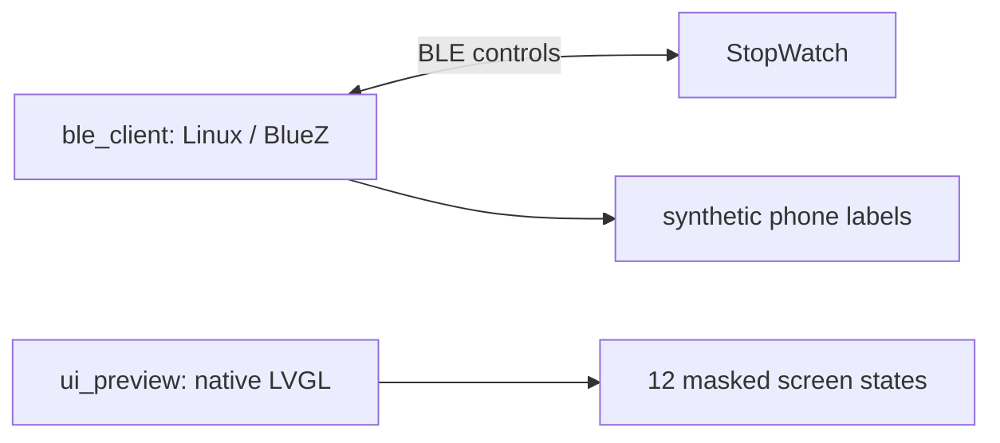

# Firmware host tools

| Folder | Purpose | Status |
|---|---|---|
| [ui_preview/](ui_preview/) | Real firmware Orb UI, synthetic pointer/barrier tests, PNG output | ✅ Native verified |
| [ble_client/](ble_client/) | uv/Bleak scanner, explicit Numeric Comparison, Input monitor, fragmented Phone state writer | 🟡 Hardware unverified |

Start with its README. [REQ-8]/[REQ-18] bench support; no real personal data.
