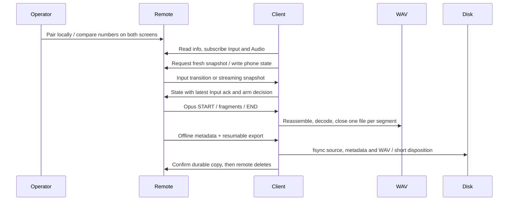

# BLE audio / deferred-sync bench client



| File | Purpose | Status |
|---|---|---|
| `client.py` | BlueZ CLI, Numeric Comparison, serialized/coalesced state writes; `--sync`, `--set-clock`, timed disconnect | 🟡 Adapter unverified |
| `offline.py`, `test_offline.py` | Draft 1.1 framing, durable resume/verification/delete, capture/OFF fetch preemption, idle OFF metadata replies, synthetic contract hex fixtures | ✅ Host tested; adapter unverified |
| [deferred.md](deferred.md) | Sync, clock, enrollment namespace, unattended disconnect procedure | 🟡 Hardware procedure unverified |
| `wire.py`, `test_wire.py` | Control codecs, sequence/trigger recovery policy, synthetic fixtures | ✅ Host tested |
| `audio.py`, `test_audio.py` | Bounded reassembly, duplicate/gap detection, 1 s watchdog, Opus decode/WAV and C framing round trip | ✅ Host tested |
| `pyproject.toml`, `uv.lock` | Python 3.12, Bleak 3.0.2, dbus-fast 5.2.0, opuslib-next 1.3.1 | ✅ Offline resolved |

Start here; [REQ-8]/[REQ-18]/[REQ-51] bench support. This records provisional
PTT audio, including short presses; it does not implement iPhone STT/gesture policy.
System `libopus.so.0` is required (`libopus0` on Debian); missing codec produces a
clear error. No development headers, av or FFmpeg. See [licences](../../../DOCS/licences/).

Set the supplied offline uv environment in this sandbox, then prepare dependencies:

```sh
export UV_CACHE_DIR=/tmp/voiceremote-uvc-s2 UV_OFFLINE=1 UV_LINK_MODE=copy
uv sync --project FW/tools/ble_client
uv run --project FW/tools/ble_client python -m unittest discover -s FW/tools/ble_client -p 'test_*.py' -v
```

Build `FW/build-host/audio_tests` first for the C/Python round trip
(`heavy bash FW/tests/run.sh` prepares it). Only the coordinator/operator runs
Bluetooth commands; substitute the scanned address:

```sh
uv run --project FW/tools/ble_client python FW/tools/ble_client/client.py --scan-only
uv run --project FW/tools/ble_client python FW/tools/ble_client/client.py --address AA:BB:CC:DD:EE:FF --capture 1 --recording 1 --arm --save /tmp/ptt.wav --seconds 60
uv run --project FW/tools/ble_client python FW/tools/ble_client/client.py --address AA:BB:CC:DD:EE:FF --capture 2 --recording 1 --arm --save /tmp/rec.wav --seconds 60
```

| Recording | Physical action after connection/snapshot |
|---|---|
| PTT | Select PTT, release yellow, then hold yellow while speaking; release to close |
| REC | Start OFF, deliberately select REC after client is ready; select OFF to close |
| Loss / overflow | Release then repress PTT, or select OFF then REC; snapshots/reconnect never create a REC trigger |

`--arm` keeps arm intent and follows the latest physical capture/mode state.
It writes a new current-ack state after each Input (coalescing a burst to its newest
ack); snapshot requests stop after resync, avoiding a write/snapshot loop. A racing
ack disarms correctly and the next event rearms. Pause/error/loss clears effective
arm. Data while OFF or an unqualified held/recovered trigger is rejected.
The timed exit writes stop, allows END, then disconnects; unexpected disconnect
closes any open segment as interrupted.

`/tmp/ptt.wav` becomes `/tmp/ptt-seg00000001.wav`, etc. Interrupted segments gain
`-interrupted.wav`; samples before loss are retained for diagnosis and never spliced
with later audio. Existing files are never overwritten: choose a fresh prefix per
connection. PCM is mono 16 kHz, 16-bit little-endian; each complete packet must
decode to exactly 320 samples, with no PLC/FEC or inserted silence. Stats show
frames, gap events, encoded/transport B/s, duration, public MTU and the lower bound
inferred from received notification lengths. They contain no audio contents.

| MTU API | Evidence / consequence |
|---|---|
| BlueZ public D-Bus `GattCharacteristic1.AcquireNotify` / `AcquireWrite` | Return FD + negotiated MTU; yes, BlueZ has a public way to obtain it. AcquireWrite applies to write-without-response, absent on Phone state here |
| Bleak 3.0.2 default `StartNotify`, public `mtu_size` | Backend `bleak/backends/bluezdbus/client.py:643–651` returns 23 without `_mtu_size`; `_acquire_mtu:552–600` demonstrates D-Bus MTU in `reply.body[1]` but is private. Normal public start-notify code at 938–990 never stores MTU |
| This client | Uses public Bleak APIs; no private MTU probe/FD subscription takeover. Prints public MTU and `audio_MTU_at_least`; exact negotiated Audio MTU comes from firmware serial log |
| Phone writes | Default 20-byte value budget, clamped to `min(512, public MTU−3, --budget)`; six bytes are the application header. Conservative writes do **not** clamp firmware Audio |
| Audio | Firmware fragments from actual `ble_att_mtu()` at each frame boundary; small-MTU inability stops visibly rather than accumulating latency |

The API evidence above is inspected installed source, not an adapter measurement.
The local BlueZ policy must permit registering a default `DisplayYesNo` agent.
Type `yes` within 25 s and confirm on the remote. PIN/passkey/Just Works are
rejected. Reconnect uses the stored bond; revoke on the remote and remove the
stale BlueZ bond manually before fresh enrollment. No adapter was accessed here.

Deferred audio simulates the phone transport only: no STT, history insertion or AI
execution. Start with [deferred.md](deferred.md). `--sync DIR` requires
`--remote-id ENROLLED_ID`; it resumes durable partials and confirms only after
length/frame-count/CRC validation and durable WAV/source or short-discard metadata.
Recordings under 15 frames receive no WAV. Same-major peers connect; capability
bit 7 gates all offline operations. C6 bit 7 clear is a clear unsupported error.

END must be next after the last transmitted Audio frame. The C/Python regression
covers discarding an entirely unsent queued tail without declaring a gap; partial
transmission still interrupts. For unattended local triggers and reboot, use
[the optional USB hook runner](../hil/README.md).
