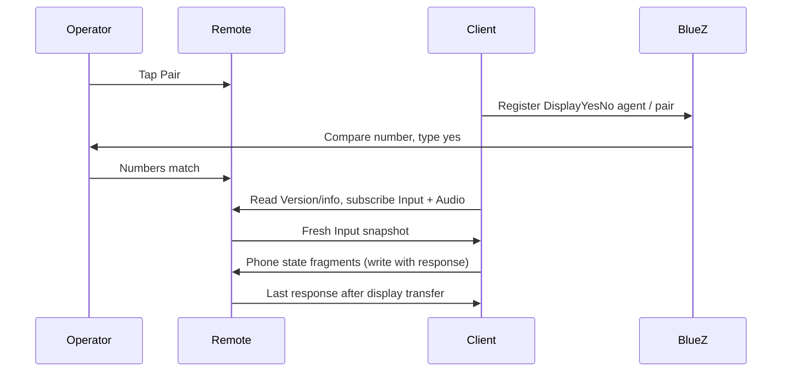

# BLE control bench client



| File | Purpose | Status |
|---|---|---|
| `client.py` | Linux/BlueZ CLI and Numeric Comparison D-Bus agent | 🟡 Adapter unverified |
| `wire.py`, `test_wire.py` | Independent synthetic wire codec/fixtures, no hardware imports | ✅ Host tested |
| `pyproject.toml`, `uv.lock` | Python 3.12, Bleak 3.0.2 and dbus-fast, locked dependencies | ✅ Offline resolved |

Start here; [REQ-8]/[REQ-18] bench aid, not an iPhone policy implementation.
Only the coordinator/operator runs against hardware:

```sh
uv run --project FW/tools/ble_client python FW/tools/ble_client/client.py --scan-only
uv run --project FW/tools/ble_client python FW/tools/ble_client/client.py --address AA:BB:CC:DD:EE:FF
```

Default state: disarmed, stopped/OFF, Auto resolved to synthetic `PC`. Default
20-byte write budget exercises the small-MTU fragments. The client clamps this
to `min(512, public MTU−3, --budget)`; BlueZ may report only 23 through Bleak's
public API, which is conservative. No ATT long writes, real labels or secrets.
The local BlueZ policy must allow registering a default agent (no sudo used).
The agent rejects PIN/passkey/Just Works paths, and requires typed `yes` within
25 s. Also confirm on the remote. Reconnect uses the stored bond; revoke on the
remote and remove the stale BlueZ bond manually before fresh enrollment.

Optional synthetic controls: `--target`, `--error`, `--mode 0|1`,
`--capture 0|1|2`, `--recording 0|1|2|3`, `--arm`, `--seconds`.
These write phone decisions, never remote control positions. Arm uses the latest
received Input sequence; a racing input correctly makes it stale. Stage 1 never
produces Audio even if the phone says recording. Unexpected Audio is reported
as an error. Full-v1 capability mismatch is printed explicitly.
