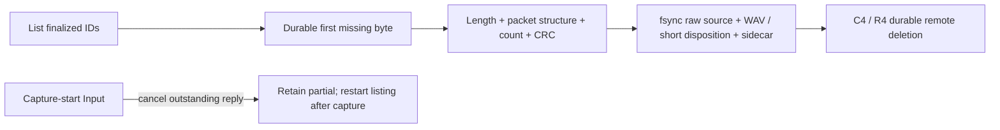

# Deferred sync simulator



| Path / option | Meaning | Status |
|---|---|---|
| `--sync DIR --remote-id ID` | Namespace SHA-256 of explicitly enrolled identity, then zero-padded recording ID | 🟡 Hardware unverified |
| `*.partial`, `*.stream` | fsynced resumable export / verified complete raw Opus stream | ✅ Synthetic paths covered |
| `*.json` | Original metadata, approximate capture time, mode, duration, disposition, durable and confirmation markers | ✅ Synthetic paths covered |
| `*-dictation.wav`, `*-ai.wav` | Mono 16 kHz PCM; capture UTC or unknown boot/tick in filename | ✅ Fake-decoder fixture; hardware decode unverified |
| `--set-clock` | Get current boot/tick from progress, pair receipt UTC with sample, send C1 | 🟡 BLE delay/clock accuracy unmeasured |
| `--disconnect-after N` | End BLE connection at N seconds without writing phone stop | 🟡 Hardware unverified |

Use the existing enrollment bond and explicitly assign `--remote-id` once. Keep
that ID across reconnect, reboot and reflash; after loss of identity/counter
continuity, re-enroll and use a new ID. The contract has no enrollment-identity
characteristic, so this CLI requires the operator's identity instead of silently
using a mutable Bluetooth address. Never use the same namespace for two devices.
Do not sync an earlier owner's retained records after re-enrollment: explicit
local erase is required by the contract.

From the repo root, after the [README dependency setup](README.md):

```sh
uv run --project FW/tools/ble_client python FW/tools/ble_client/client.py --address AA:BB:CC:DD:EE:FF --remote-id stopwatch-enrollment-1 --sync /tmp/stopwatch-sync --set-clock --seconds 120
```

Progress prints IDs, counts, offsets and capacity, never packet contents. Re-run
the identical command after disconnect/crash: the first fetch uses the partial
file's durable byte length; matching metadata is required. An inconsistent repeat,
malformed frame, wrong count/size/CRC or decode error stops sync and leaves the
remote record unconfirmed. A decode error retains the source and a visible error
in the sidecar for retry. A lost R4 retries C4 from the durable sidecar even if
listing is empty; it never refetches or creates another filename/job for that ID.
No STT engine or job is invoked here. Long AI-mode audio is ordinary deferred audio.
Under 300 ms means `discarded-short`, no WAV, with durable disposition before C4.
The bench retains the verified source even for a short record; the remote deletes
only after C4. Use synthetic speech or silence for tests; keep output outside git.

Capture Input cancels an outstanding reply and clears its assembly. Late fragments
from that transaction are ignored. The next request has a new transaction. Live
input/state processing continues in the main event loop; sync retries after idle.
A lost reply triggers result resubscription before retry. Fetch is paused while
OFF; clock/listing/confirmation continue through repeated idle OFF snapshots.
An idle progress snapshot clears the paused capture state. Status 1 is valid only
for List exhaustion; other opcodes reject it. The CLI exits before transaction reuse
and requires reconnect. A new pass always starts cursor 0 and deduplicates by ID.

Disconnect check (coordinator only; authenticated bond already enrolled). The
first command needs a fresh deliberate REC selection **after** its initial
snapshot, via an authorized physical-control fixture or a person. A preselected
REC snapshot cannot authorize live capture. Replace only the address/enrollment ID:

```sh
uv run --project FW/tools/ble_client python FW/tools/ble_client/client.py --address AA:BB:CC:DD:EE:FF --arm --capture 2 --recording 1 --disconnect-after 8
sleep 3
uv run --project FW/tools/ble_client python FW/tools/ble_client/client.py --address AA:BB:CC:DD:EE:FF --remote-id stopwatch-enrollment-1 --sync /tmp/stopwatch-sync --set-clock --seconds 15
```

Expected first log: streaming Input, then `Disconnecting BLE without phone stop`.
Expected reconnect log while REC remains selected: Input `offline=True`, no
Fetch audio and no confirmation for the open record, `sync paused`. The record
must finish on a local OFF/PTT release/mode action: **the production protocol has
no remote physical-control injection or remote OFF command**, so this remaining
step cannot be performed by these BLE commands alone. A phone stop cannot close
the locally owned offline capture. Once the coordinator's authorized hardware
fixture performs OFF and then deliberately selects PTT (idle/up), rerun the sync
command. Expect `resume=...`, `verified disposition=audio-saved` (or
`discarded-short`), `confirmed deletion`, and `offline list exhausted`. A second
sync run yields only `list exhausted`, without new WAV/source IDs. Pass requires
a single sidecar/WAV per ID, captured mode/time retained, no live packet splicing,
and remote waiting/full state updated. Fail on any unverified deletion,
transmission while OFF, missing retained prefix or repeated identity allocation.
This is a hardware procedure, **not hardware evidence**. An unattended end-to-end
run needs a physical-control fixture or an explicitly authorized test interface.
