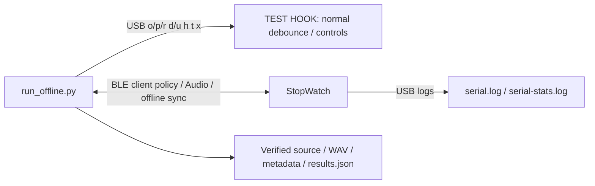

# Unattended StopWatch test



| File | Purpose | Status |
|---|---|---|
| `run_offline.py` | Existing-bond serial + BLE regression, nonzero exit on failure | 🟡 Hardware unverified |
| `test_run_offline.py` | Full fake-serial/BLE procedure, durable interruption/resume, failure reporting, POSIX PTY | ✅ Host tested |

Start with [build/flash setup](../../README.md); [REQ-8], [REQ-18], [REQ-49–53],
[REQ-56], [REQ-58], [REQ-62] traceability, no hardware compliance claim.
Use a pre-enrolled owner bond, an empty remote journal, exclusive serial/adapter
access and silence/curated test input. No pairing UI or actuator is needed after
those prerequisites. This tool never flashes, erases, enrolls or configures BlueZ.

```sh
uv run --project FW/tools/ble_client python FW/tools/hil/run_offline.py \
  --port /dev/ttyACM0 --address AA:BB:CC:DD:EE:FF \
  --remote-id stopwatch-enrollment-1 --output AI/scratch/offline-hil-run1
```

`--port`, `--address` and stable `--remote-id` are required. Output must be new;
keep it ignored. Uses Linux/POSIX `termios`, with no new Python dependency or lock
change. The locked BLE client supplies Bleak, Opus, policy and durable copy logic.
USB baud is 115200; DTR/RTS are untouched. USB re-enumeration is retried after `x`.

| Step | Required observation |
|---|---|
| Hook / live | Reboot logs TEST BUILD; fresh REC yields ≥50 live frames; OFF gives clean END |
| Drop / reconnect | Live disconnect starts offline acquisition; reconnect preserves locally owned recording, rejects sync and emits no live frames |
| Finalize / verify | Local OFF then idle PTT permits sync; exactly one verified, confirmed source/WAV; stored mode retained |
| Idempotence | Second sync creates no IDs or metadata changes |
| Resume | Abort after first fsynced fetch chunk, disconnect, resume at exactly that durable offset |
| Offline OFF | Acquisition stops; fetch remains blocked in OFF; idle PTT permits verified copy |
| Reboot during capture | New boot, no spontaneous capture, increasing recording ID, recovered interrupted prefix with original boot |
| Stats | Collect timing/audio/offline logs; fail on flush/barrier failures, storage errors or overflow |

Every step prints PASS/FAIL and writes `results.json`. Dependent steps fail as
blocked after a failure. A failed run retains durable partials and remote records;
recover them with the [ordinary sync client](../ble_client/deferred.md) before a
new run. Existing real recordings must be retained/synced separately first.
The runner tests a reboot during acquisition, not a precisely timed power cut.
Full-storage, injected flash faults, microphone gain/quality, maximum latency,
power and physical scanout still require the coordinator's hardware measurements.
