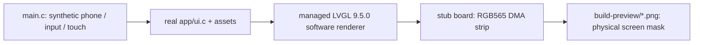

# Native Orb preview



| File / output | Purpose | Status |
|---|---|---|
| `run.sh`, `CMakeLists.txt` | Native C/C++ build; four compiler jobs maximum | ✅ Root runnable |
| `main.c` | Runtime/board stubs, synthetic fixtures, PNG writer and interaction checks | ✅ Native verified |
| `preview_runtime.h`, `stubs/` | ESP-free UI runtime boundary | ✅ No board access |
| `lv_conf.h` | LVGL software renderer and lodepng; no GPU/window system | ✅ Native verified |
| `../../build-preview/*.png` | Sixteen round states and one 240×280 physical-slider state | ✅ Generated; ignored |

Purpose: inspect the actual firmware UI without a panel. Inputs: bundled Lexend
subsets and `FW/managed_components/lvgl__lvgl`; no separate mock renderer.
Start from the repo root (CMake, C/C++ compiler):

```sh
heavy bash FW/tools/ui_preview/run.sh
```

LVGL must already exist from the [firmware dependency setup](../../README.md).
Missing source produces a clear CMake error; the tool never downloads dependencies.
Everything generated goes into ignored `FW/build-preview/`.

| PNG basename | Fixture |
|---|---|
| `off.png`, `ptt-armed.png` | Hollow grey / outlined transcribe orb |
| `ptt-listening-transcribe.png`, `rec-listening-ai.png` | Filled orb and pulse from explicit producer streaming bit |
| `auto-target.png`, `named-target.png` | Resolved destination, Auto badge, pips |
| `long-name.png`, `error-text.png` | Shrink/ellipsis and temporary red error |
| `no-link.png` | Hollow grey orb and Bluetooth-off pairing target |
| `pairing-number.png`, `forget-confirm.png` | Numeric comparison / bin confirmation |
| `offline-recording.png`, `offline-waiting.png` | Same filled/pulsed Orb offline, Bluetooth-off target, optional waiting icon |
| `storage-full.png`, `recordings-waiting.png` | Small red full / grey saved-record icons in existing pip row, including OFF |
| `syncing.png` | Small opposite-arrow transfer icon beside waiting icon |
| `rectangular.png` | 240×280 physical-slider layout; no capture ring |


`run.sh` first executes `ui_preview --check`: production touch sampling, immediate preview before release/debounce, preview rollback, OFF committing on touch-down before release/debounce, PTT/REC release
selection, mode/target events, cancelled/recognised 3-second holds (forget recognition commits OFF), haptics,
pair accept/reject, both modal display guards, failed/successful flush barriers, 175 ms realistic draw / 450 ms completed draw despite wait expiry, modal cancellation
during DMA, lock-free flushes with interleaved input sampling, partial redraws
matching forced full redraws, destination-only flush bounds,
error expiry and pulse invalidation bounds. A held PTT with streaming=0 never
pulses; streaming=1 pulses independently of the held level, and clearing the bit
stops it. Offline recording pulses with no link and retains its Bluetooth-off
target after reconnect until local capture ends. Full/waiting remain visible
in OFF; storage-state transitions equal forced full redraws. Failed touch reads
preserve the previous state briefly; sustained faults cancel without accepting
a control, and held recovery cannot retrigger it. All seventeen baseline PNGs remain byte-identical; cache-disabled output also
matches each cached fixture. Hook debounce and its modal-visible mark run in a
separate native executable. Fixtures inject the producer bit; this is not a microphone measurement. Pure geometry/listening checks live in
[tests](../../tests/). These support [REQ-8]/[REQ-18]; physical scanout, frame rate,
BLE/input latency, motor feel and panel colour remain **unverified**.

`--timing` uses production `timing.c` aggregates with a native monotonic clock,
`-O2`, and no panel delay. `run.sh` measures cache-enabled/disabled control and
pulse workloads, then compares all PNG pairs. Synthetic ticks cannot measure
physical touch/barrier latency. No-PSRAM fallback is selected by `VR_UI_NO_CACHE=1`.
The long-name fixture now fits the protocol's 32-byte field (the prior 33-byte
fixture overflow became visible at `-O2`); its rendered ellipsis is unchanged.
See [evidence](../../../AI/FW/2026-11-02-hardware-fixes/README.md).
