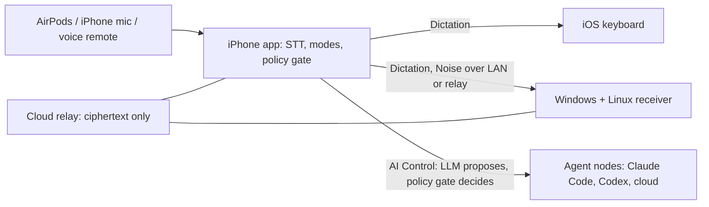

# voiceremote

A universal voice layer: speak on an iPhone (or a dedicated voice remote) and the text lands in the
right field on your iPhone, Windows or Linux machine, or goes to an AI control plane that directs your agents.
Dictation never presses Send. Model output never approves an action.

| Folder | What | Status |
|---|---|---|
| [SYS/](SYS/) | Product definition, design, requirements, protocol schemas | 🟡 |
| [SW/](SW/) | iPhone app, desktop receiver, relay, benchmark kit | ⬜ |
| [FW/](FW/) | Voice remote firmware | ⬜ |
| [HW/](HW/) | Voice remote hardware | ⬜ |
| [DOCS/](DOCS/) | External references and licences of reused code | ⬜ |
| [AI/](AI/) | AI working files, not authoritative | 🟡 |

Start with [SYS/system-design-v1.md](SYS/system-design-v1.md). Working rules are in [AGENTS.md](AGENTS.md).
